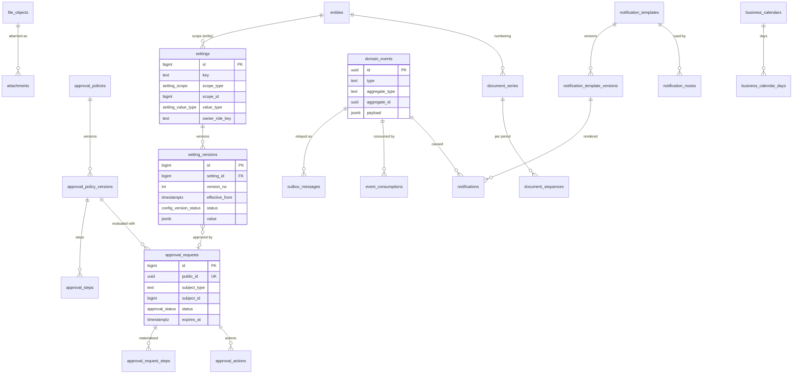
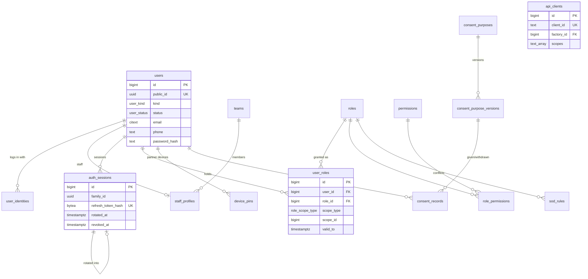
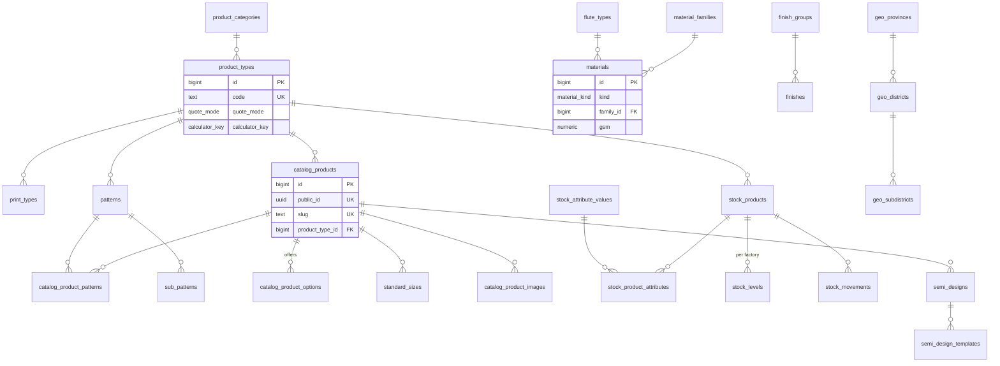
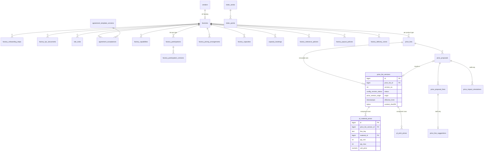
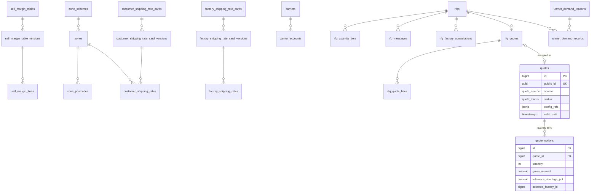
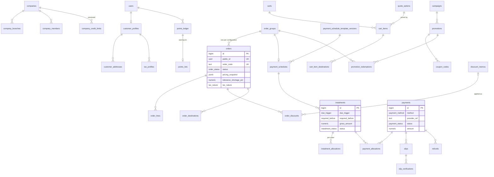
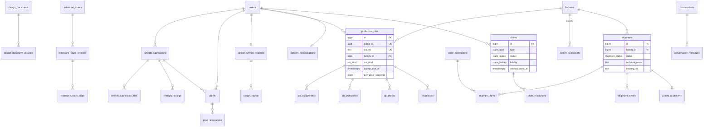
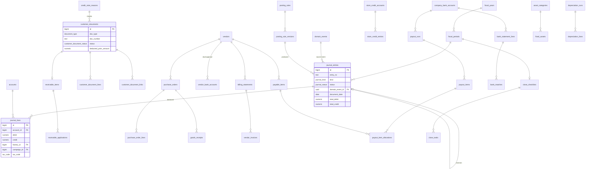
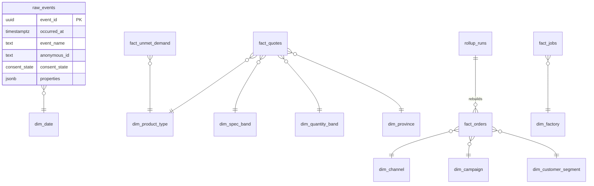

# Packio — Schema design (v1)

> **Status: APPROVED (2026-09-23) — review gate of B1.2 step 1 passed.** Assumptions, deviations and open questions in §7 stand as written until a later decision changes them. Next, B1.2 step 2 migrates only the Platform and IAM contexts (§3.1, §3.2); every other context is migrated by its own deliverable (§6) and must follow this design. A deliverable that needs to deviate records the deviation in `docs/PROGRESS.md` and updates this file in the same commit.
>
> Sources: `docs/decisions.md` (D-001…D-155, **wins over everything**), `docs/accounting-design.md`, `docs/prompts/00-master-plan.md` §5, ADR-0001, ADR-0004…0006, `docs/contract/api-conventions.md`, B1–B6 prompts. Legacy (`docs/legacy/00-domain-context.md` §3–§8, `03-legacy-schema.txt`) is inspiration only (D-005): nothing is migrated, no legacy id or code is kept.

## Contents
0. How to read this document
1. Global conventions
2. Cross-cutting patterns (effective dating, snapshots, multi-entity, multi-factory, scoping, state changes, documents & numbering, files, amounts & tax columns, actors, PII)
3. Bounded contexts — 3.1 Platform · 3.2 IAM & auth · 3.3 Catalogue & CMS · 3.4 Partners & price governance · 3.5 Pricing, shipping rate cards, quotes & RFQ · 3.6 Commerce · 3.7 Fulfilment · 3.8 Finance · 3.9 Analytics & reports
4. Enum catalogue
5. Decision → tables/columns traceability
6. Migration plan (which deliverable migrates what)
7. Assumptions, deviations and open questions

---

## 0. How to read this document
- Tables are listed per bounded context with **key columns only**. Every table also has the standard columns of §1.4 unless it says otherwise; they are not repeated.
- Column notation: `name type` · `→ table` = foreign key · `?` = nullable · `= x` = default · `PII` = personal data (§2.11) · `staff-only` = never serialised on the store or partner surface (D-044, D-050, D-141).
- **Indicative** marks column sets that are fixed in the deliverable that ports the legacy logic (B2.3 calculators): the table, its keys, relations and versioning are binding; the list of numeric parameter columns is finalised against the PHP source so golden tests can pass.
- Enum types are named in `snake_case` in SQL and appear as named OpenAPI components in PascalCase (`order_status` ↔ `OrderStatus`). Values are listed once in §4.
- "Versioned (§2.1)" means the table follows the effective-dating pattern exactly; the pattern's columns are not repeated.

---

## 1. Global conventions

### 1.1 Naming
- `snake_case`, plural table names, singular FK columns (`order_id → orders`). Prisma models are PascalCase singular with `@@map`/`@map`; one Prisma file per context in `prisma/schema/<context>.prisma` (`platform.prisma`, `iam.prisma`, `catalog.prisma`, `partners.prisma`, `pricing.prisma`, `commerce.prisma`, `fulfilment.prisma`, `finance.prisma`; analytics lives in the `analytics` Postgres schema, `analytics.prisma`).
- Constraint names: `pk_<table>`, `fk_<table>__<column>`, `ux_<table>__<cols>` (unique), `ix_<table>__<cols>`, `ck_<table>__<rule>`, `ex_<table>__<rule>` (exclusion), `tg_<table>__<purpose>` (trigger). Names are explicit in migrations so they are stable across environments.
- Human business keys (order code, document numbers, job no…) are `text` columns named `*_code` / `*_no` / `*_number`, unique within their scope; they are never used as path ids (contract §3).

### 1.2 Keys
- Primary key: `id bigint generated always as identity`. Never exposed by the API (contract §3).
- Public id: `public_id uuid not null default uuidv7()` with `ux_<table>__public_id` on every table that is addressed from the API (aggregate roots and child entities with their own URL). `uuidv7()` is native in PostgreSQL 18; time-ordered ids keep B-tree inserts local. Pure join tables, version rows that are only read through their parent, and log tables have no `public_id` unless stated.
- Exceptions: `domain_events.id` is the envelope `uuid` itself (B1 prompt envelope); `idempotency_keys` has a composite natural key.
- Every FK column has an index (leading column of some index), unless the table is tiny and append-only (stated).

### 1.3 Types
| Kind | SQL type | Rule |
|---|---|---|
| Money amount (line amount, total, balance, payment) | `numeric(14,2)` | CLAUDE.md hard rule. `decimal.js` in code, decimal string in JSON. Non-negative unless the column is explicitly signed (ledger balances, adjustments). |
| Unit rate (price per piece / sheet / m² / sq in / kg, index value) | `numeric(18,6)` | **Deviation for review (§7 A-1).** Legacy price tables and per-piece prices carry more than 2 decimals; rounding to 2 decimals happens where the ported legacy helpers round (`convertTo2Decimal`, `roundUp`). Amounts derived from rates are stored as `numeric(14,2)`. |
| Percentage | `numeric(7,4)` named `*_pct`, value in percent (`7.0000` = 7 %) | Legacy stores percents; check `>= 0` and, where meaningful, `<= 100`. |
| Quantity of pieces | `integer` (`bigint` for sheet/area totals where noted) | `> 0` checks. |
| Quantity of material / weight / area | `numeric(14,3)`; weight `*_g numeric(12,2)`; area `*_sqm numeric(14,6)` | Unit in the column name. |
| Dimension | `numeric(10,2)` named `*_mm` | Contract §3: millimetres. Legacy inch-based parameters keep `*_in numeric(10,4)` inside indicative price tables only. |
| Instant | `timestamptz` (UTC) | Named `*_at`. |
| Business date | `date` | Named `*_on` or `*_date` (document date, tax point date, period dates). Interpreted in `Asia/Bangkok`. |
| Email | `citext` | Lower-case comparisons; `PII`. |
| Phone | `text` E.164 (`+66…`) with `ck_…__phone_e164` | `PII`. |
| Thai tax id / branch | `char(13)` / `char(5)` | Check digits validated in code; `ck` on length/digits. Branch `00000` = head office. |
| Closed set | Postgres `enum` | Values only ever **added** (never renamed/removed — contract breaking). |
| Editable list (reasons, milestone steps, categories) | lookup table with `code text` unique | Used where business users add values or map them (e.g. credit-note reasons → statutory reasons). |
| Snapshot / calculator input & result / rich content | `jsonb` with a sibling `*_schema_version smallint` | Validated by a versioned JSON schema in code; never queried for money totals (totals are real columns). |
| Hash | `bytea` (32 bytes, sha256) | Tokens, OTPs, refresh tokens, bank account numbers (for duplicate detection) are stored hashed (HMAC-SHA256 with a server pepper where brute force is possible). |
| Encrypted secret value | `bytea` (`*_enc`) | Envelope-encrypted in the application (KMS data key); only where the plaintext must be recovered (bank account numbers for payout files). Never logged. |

### 1.4 Standard columns
| Column | Where | Notes |
|---|---|---|
| `created_at timestamptz not null default now()` | all tables | |
| `created_by bigint? → users` | tables written by people | `null` = system/job/webhook; the actor is also in `activity_logs`/`audit_logs`. |
| `updated_at timestamptz not null default now()` / `updated_by bigint? → users` | mutable tables only | Append-only tables (events, logs, ledger, versions, snapshots) have no `updated_*`. |
| `row_version integer not null default 1` | aggregates editable through the API | Incremented on every update; `ETag = W/"<public_id>:<row_version>"`; `If-Match` mismatch → `412 concurrency.stale` (contract §3). |
| `entity_id bigint not null → entities` | commercial and financial rows (§2.3) | |
| `deleted_at timestamptz?` | only the tables listed in §1.6 | |

### 1.5 Integrity
- Foreign keys everywhere, `on delete restrict` by default; `cascade` only for pure child rows of a draft aggregate (cart items, draft proposal lines) and stated per table.
- Check constraints for ranges, sign, mutually exclusive columns (`num_nonnulls(...) = 1`), and state/column consistency (e.g. `status = 'void' ⇒ void_reason is not null`).
- **Immutability triggers** on append-only tables: ledger (`journal_entries` once posted, `journal_lines`), issued documents' money columns, approved version rows, snapshots, `domain_events`, `audit_logs`, `points_ledger`, `store_credit_entries`, `stock_movements`. Attempts raise `restrict_violation`; tests prove it.
- Things Prisma cannot express (identity columns, expression unique indexes, check and exclusion constraints, triggers, partitioning, deferred constraint triggers) are written in the migration SQL by hand; `prisma migrate diff` ignores them, so the drift check stays clean. Partial indexes use Prisma's `partialIndexes` preview; `uuidv7()` defaults use `dbgenerated`. **Every foreign key must be declared in the Prisma schema** — the drift check drops FKs it does not know. Test `test/integration/schema-catalog.int-spec.ts` lists the expected constraints, triggers, indexes and partitions from `pg_catalog`, so a regenerated migration cannot drop them silently.

### 1.6 Deletion policy
- **Default: no deletes.** Business rows change status (`inactive`, `archived`, `cancelled`, `void`).
- `deleted_at` (soft delete) only on: CMS content (`articles`, `banners`, `faqs`, `home_sections`, `videos`), customer-owned convenience data (`customer_addresses`, `design_documents`), catalogue rows that were never referenced by a snapshot (otherwise `status = archived`).
- Hard delete only for transient rows: expired `idempotency_keys`, consumed/expired `otp_challenges`, abandoned `carts` after retention, pending `file_objects` never uploaded.
- **PDPA erasure** is anonymisation in place (`users.anonymised_at`, PII columns nulled/replaced), never a delete, because financial documents must be retained ≥ 10 years (`accounting-design.md` §2). Issued documents keep their buyer snapshot (legal requirement).

### 1.7 Partitioning & volume
Declarative monthly range partitioning on `occurred_at`/`created_at` for append-only, high-volume tables that are not FK targets: `audit_logs`, `activity_logs`, `calculate_logs`, `search_logs`, `analytics.raw_events`. Partitions are created ahead by a worker job; primary key includes the partition column. Everything else is unpartitioned in R1 (index review in B6.3).

### 1.8 Postgres schemas & extensions
- `public` — all OLTP tables. `analytics` — B6 star model and raw events (ADR-0001).
- Extensions (migration `20260923000001_extensions`): `vector`, `pgcrypto`, `pg_trgm`, `citext`; also schema `partitions`, which holds the monthly log partitions outside Prisma's introspection. `btree_gist` is added by `20260928000001_folding_pricing` for exclusion constraints on price bands (A-23).

---

## 2. Cross-cutting patterns

### 2.1 Effective-dated configuration (ADR-0005)
Every configurable value is an **identity row** plus **immutable version rows**:

```
<thing>             id, public_id, <natural key / scope>, description, decision_refs text[], …
<thing>_versions    id, <thing>_id → <thing>, version_no integer, effective_from timestamptz,
                    status config_version_status, <typed value columns or value jsonb>,
                    reason text not null, approval_request_id? → approval_requests,
                    created_at, created_by, decided_at?, decided_by?
  ux (<thing>_id, version_no)
  ix (<thing>_id, effective_from desc, version_no desc) where status = 'approved'
```
- `config_version_status`: `draft → proposed → approved | rejected | withdrawn` (+ `pending_acceptance` for platform rate cards that the factory must accept, D-042). Only `approved` versions resolve.
- **Resolution `at(t)`**: the `approved` version with the greatest `effective_from ≤ t`, ties broken by the greatest `version_no`. A scheduled (future) approved version is replaced by approving a newer version with the same or an earlier `effective_from`; rows are never edited (a trigger forbids any update of an `approved`, `rejected` or `withdrawn` row; `draft`/`proposed` rows may be edited by their author until decided).
- Approval: when the owning policy requires it (ADR-0006), a version is created `proposed` with an `approval_request_id`; the approval-outcome subscriber flips it to `approved`/`rejected` in one transaction with the audit row and a `<thing>.changed` event.
- Users of a value **snapshot the version id** (§2.2), never the value alone.
- Applies to: `settings`, `approval_policies`, `price_lists`, `factory_pricing_arrangements`, `factory_participations`, `factory_capacities`, `factory_tolerance_policies`, `factory_payout_policies`, `customer_shipping_rate_cards`, `factory_shipping_rate_cards`, `sell_margin_tables`, `payment_schedule_templates`, `milestone_routes`, `agreement_templates`, `consent_purposes`, `posting_rules`, `tax_rates`, `tax_nature_rules`, `company_credit_limits`, `company_discounts`, `document_series` (format changes), `bank_matching_rules`, `inspection_sampling` (via settings).

### 2.2 Snapshot pattern (quote → order → job → PO → GR)
Anything that prices or commits money copies what it used, so later configuration changes never alter it (ADR-0005, D-040, D-051, D-021).

| Stage | Table | Snapshot columns | Frozen when |
|---|---|---|---|
| Quote | `quotes` / `quote_options` | `input jsonb`, `result jsonb` (customer view), `internal_breakdown jsonb` (staff-only), `config_refs jsonb` = `{ priceListVersionIds{factoryId→id}, sellMarginVersionId, settingVersionIds{key→id}, shippingRateCardVersionIds, toleranceVersionId, vatRateVersionId, calculatorVersion }`, `snapshot_sha256`, `valid_until`, tolerance `%` | at save; immutable except `status` |
| RFQ quote | `rfq_quotes` / `rfq_quote_lines` → becomes a `quotes` row with `source = rfq` (manual snapshot) | same shape, `config_refs` references the RFQ quote version | at customer acceptance |
| Cart item | `cart_items` | `quote_id`, `quote_option_id`, priced amounts at add time, `price_locked_until` | re-priced only after expiry with a client-confirmed diff (B3.1) |
| Order | `orders.pricing_snapshot jsonb` + `order_lines` real money columns + `config_refs` + `tolerance_*_pct` + `tax_nature` + staff-only `buy_cost_net`, `margin_pct` | at checkout (server re-prices first) |
| Production job | `production_jobs.spec_snapshot`, `route_snapshot` (milestone route version), `buy_price_snapshot` + `price_list_version_id`, tolerance | at release (D-073) |
| Factory PO | `purchase_orders.price_snapshot` + `purchase_order_lines` money columns | at issue (B5.3) |
| GR / billing statement | amounts = PO unit prices × reported quantity (P15) | at POD confirmation |

Rules: snapshot columns are write-once (trigger `tg_*__snapshot_write_once`); `snapshot_sha256 = sha256(canonical JSON)` makes tampering detectable; the snapshot carries **version ids**, so any number can be re-explained from the configuration tables.

### 2.3 Multi-entity
- `entities` holds the legal entities; one active at launch: Collective Group (Thailand), seeded from env/settings (B1 prompt), its legal name/tax id/branch/logo live in **entity-scoped settings** (CLAUDE.md), not in code.
- `entity_id not null` on: `quotes`, `rfqs`, `carts`, `order_groups`, `orders`, `payments`, `refunds`, `campaigns`, `promotions`, `discount_memos`, `companies`, `production_jobs`, `shipments`, `claims`, and every Finance table (accounts, periods, journals, documents, series, AP/AR items, payouts, bank accounts, tax reports, fixed assets). Child tables inherit through their parent and do not repeat it, except `journal_lines` (denormalised for reporting).
- Masters shared across entities: users, factories, vendors, catalogue, rate cards (their use is snapshotted into entity-scoped rows).

### 2.4 Multi-factory ready, single-factory launch (D-101)
- `factory_id` on: price lists and all price components, capabilities, capacity, tolerance, payout policy, shipping payout rate cards, `production_jobs`, `purchase_orders`, `shipments`, `claims` (liable factory), `factory_scorecards`, `vendors` (1:1), `api_clients`, `user_roles` (scope).
- **Activation thresholds are derived, not stored**: "number of active factories serving product type X" = count of `factories.status = 'active'` with an approved `factory_participations` version for X at tier A/B/C (as required). Auto-selection/auto-reassignment need ≥ 2, peer benchmarks ≥ 3 (D-101, D-044); the thresholds are settings.
- Customer-facing tables never expose `factory_id` (D-050); staff/partner projections do.

### 2.5 Scoping (FactoryScoped, CompanyScoped)
- A partner principal carries `scp = factory:<uuid>` (from `user_roles.scope_type = factory`). Every partner-readable table has a direct `factory_id` column (no join needed to scope): `production_jobs`, `job_milestones` (denormalised `factory_id`), `shipments`, `purchase_orders`, `billing_statements`, `vendor_invoices` (via vendor → factory), `price_lists`, `price_proposals`, `factory_*`, `payout_items` (via vendor), `factory_scorecards`.
- Company members carry `company:<uuid>`; `company_id` is on `order_groups`, `orders`, `quotes`, `carts`, `rfqs`, `customer_addresses`, `tax_profiles`, `design_documents`, `customer_documents`, `receivable_items`.
- Repository-level scoping (B1.3) adds `where factory_id = any(:scopes)`; file access checks the owning row, not the S3 key.

### 2.6 State changes, activities, events, outbox
One transaction per state change writes (CLAUDE.md):
1. the aggregate row(s);
2. `activity_logs` — human-readable timeline row (aggregate, action key, actor, visibility `internal | customer | partner`, i18n message key + params);
3. `audit_logs` — only for security/finance/config/data-access actions (§3.1);
4. `domain_events` + `outbox_messages` via `DomainEvents.record(tx, event)`.
Subscribers are idempotent through `event_consumptions (consumer, event_id)`; notifications, ledger postings and analytics facts are subscribers only.

### 2.7 Documents & gapless numbering
- `document_series` (entity, `doc_type`, prefix/format, `reset_period`, `is_gapless`) + `document_sequences` (series, `period_key`, `next_value`). A number is taken with `select … for update` on the sequence row **inside the transaction that issues the document** (`accounting-design.md` §4); a void keeps its number (`status = void`, `void_reason`).
- Types: QT, IV, TR, RC, CN, DN, PO, GR, BS (per factory), PV, WT, JV (§4 of accounting design) + non-statutory running codes (order group code, job no, claim no, shipment no, RFQ code) generated from the same mechanism with `is_gapless = false`.

### 2.8 Files
- `file_objects` = one stored object (bucket/key, sha256, mime, size, dimensions/pages, scan status, retention class, legal hold).
- Domain tables reference files directly when the relation is 1:1 and typed (`slips.file_object_id`, `proofs.proof_file_id`); `attachments (subject_type, subject_id, role, file_object_id)` for 1:n evidence (KYC documents, milestone photos, claim photos, site-visit photos, memo evidence).
- Downloads always go through signed URLs after an authorisation check on the owning row (contract §3).

### 2.9 Amount & tax column set
Money-bearing lines and documents use the same set: `net_amount`, `discount_amount`, `vat_rate_pct`, `vat_amount`, `gross_amount` (= net − discount + VAT), and where withholding applies `wht_rate_pct`, `wht_amount`, `cash_amount` (= gross − WHT). Check constraints enforce the arithmetic at the stored precision; rounding mode (line vs document, `accounting-design.md` §1.5) is a setting and the rounding difference, if any, is an explicit `rounding_amount` on the document.

### 2.10 Actors
`actor_type` enum (`user`, `api_client`, `system`, `webhook`) + `actor_user_id?`, `actor_api_client_id?` on logs, events and decisions; `ck num_nonnulls` consistent with `actor_type`. CS acting on behalf of a customer is recorded as the CS user plus `on_behalf_of_user_id`.

### 2.11 Personal data (PDPA)
- Columns marked `PII`: names, emails, phones, addresses, tax ids of individuals, IPs, LINE ids, device ids. They are excluded from logs (pino redaction), analytics (hashed or banded) and the partner prospectus (D-102).
- Factories see only recipient name, delivery address and phone (D-142): the partner projection of orders/shipments reads the **shipment destination snapshot**, never `users` or `customer_addresses`.
- Bank account numbers: `*_enc` + `*_last4` + `*_hash` (duplicate detection, `accounting-design.md` §8); card data is never stored (gateways tokenise).
- IPs in `calculate_logs`, `search_logs` and analytics are truncated (/24, /48) or HMAC-hashed.

---

## 3. Bounded contexts

### 3.1 Platform (`platform.prisma`, migrated in B1.2 step 2 — except `document_series`/`document_sequences`, migrated with their first user in B2.5)

**Aggregates**: Entity · Setting (+versions) · FeatureFlag · ApprovalPolicy (+versions, steps) · ApprovalRequest (+request steps, actions) · ApprovalDelegation · FileObject (+attachments) · DomainEvent (+outbox, consumptions) · WebhookInbox · NotificationTemplate (+versions) · NotificationRoute · Notification · BusinessCalendar (+days) · DocumentSeries (+sequences) · logs (audit, activity) · IdempotencyKey · embeddings.

#### Tables
**`entities`** — legal entities (§2.3).
`public_id` · `code text` ux (e.g. `CGT`) · `display_name text` · `status entity_status` (`active|inactive`) · `is_default boolean` (partial ux: only one default) · `base_currency char(3) = 'THB'` ck `= 'THB'` (one currency, `accounting-design.md` §1.3) · `timezone text = 'Asia/Bangkok'` · `fiscal_year_start_month smallint = 1` ck 1..12.
Legal name (th/en), tax id, branch code/name, registered address, logo file, VAT registration, document footer: **entity-scoped settings** (`entity.legal_name_th`, `entity.tax_id`, …) so they are effective-dated and audited (D-092).

**`settings`** — identity of a configurable value (ADR-0005).
`public_id` · `key text` (dotted, e.g. `pricing.margin_floor_pct`) · `scope_type setting_scope` (`platform|entity|product_type`) · `scope_id bigint?` (entity id / product type id; ck `scope_type = platform ⇔ scope_id is null`) · `value_type setting_value_type` (`string|integer|decimal|money|percent|boolean|duration|time_of_day_window|date|enum|json`) · `value_schema jsonb?` (JSON schema for `json`/`enum`, min/max for numbers) · `description text` (must cite the decision, e.g. "D-012 margin floor") · `decision_refs text[]` · `owner_role_key text` (role allowed to change it, e.g. `superadmin`, D-063) · `approval_policy_key text?` (change needs approval) · `confirmation_status setting_confirmation` (`confirmed|proposed|pending_cpa|pending_business` — seeds from Proposed/⚖ decisions are flagged, ADR-0005) · `is_sensitive boolean` (value hidden from roles without `settings.read_sensitive`).
ux `(key, scope_type, coalesce(scope_id, 0))`.

**`setting_versions`** — versioned (§2.1): `value jsonb not null` (validated against `value_type`/`value_schema`).

**`feature_flags`** — `key text` ux · `description` · `enabled boolean` · `rules jsonb` (audience, entity, percentage, user allow-list) · `owner_role_key`. Operational toggles (e.g. R2 adapters disabled, D-111), not business values; changes audited, no versions.

**`approval_policies`** — `public_id` · `key text` ux (`discount_memo`, `company_discount`, `credit_limit`, `payout_run`, `price_proposal`, `rate_card_acceptance`, `vendor_bank_account_change`, `company_bank_account_change`, `manual_journal`, `credit_note`, `refund`, `write_off`, `posting_rule_change`, `coa_change`, `tax_setting_change`, `document_series_change`, `setting_change`, `partner_activation`, `partner_pricing_mode_change`, `payment_schedule_override`, `company_order_approval`, `company_kyc`, `referral_review`) · `subject_type text` · `description` · `decision_refs text[]`.
**`approval_policy_versions`** — versioned (§2.1); `expiry_rule jsonb?` (e.g. `{ "withSubject": "quote.valid_until" }`, D-052) · `on_no_match approval_no_match` = `fail_closed` (ADR-0006).
**`approval_steps`** — `policy_version_id → approval_policy_versions` · `step_no smallint` · `name` · `approver_role_id → roles` · `approver_scope approval_scope_rule` (`platform|subject_factory|subject_company|subject_entity`) · `condition jsonb?` (on `amount`, `pct`, `entity`, flags such as `belowMarginFloor`; evaluated by the engine; `null` = always) · `quorum smallint = 1` · `sla_minutes integer?` · `sla_calendar calendar_basis` (`business|calendar`) · `escalate_to_role_id? → roles`. ux `(policy_version_id, step_no)`.
**`approval_requests`** — `public_id` · `entity_id` · `policy_version_id` · `subject_type text` · `subject_id bigint` · `subject_public_id uuid` · `requester_user_id → users` · `payload_snapshot jsonb` · `amount numeric(14,2)?` · `pct numeric(7,4)?` · `flags text[]` · `status approval_status` · `current_step_no smallint?` · `expires_at?` · `decided_at?`.
`policy_id → approval_policies` (denormalised). ix `(subject_type, subject_id)`; partial ux `(policy_id, subject_type, subject_id) where status = 'pending'` (one open request per subject and policy).
**`approval_request_steps`** — materialised at creation: `request_id` · `step_no` · `approver_role_id` · `approver_scope_id bigint?` · `quorum` · `due_at?` · `status approval_step_status` · `completed_at?`. ux `(request_id, step_no)`.
**`approval_actions`** — append-only: `request_id` · `request_step_id?` · `action approval_action_kind` · `actor_user_id` · `on_behalf_of_user_id?` (delegation) · `comment text?` · `ip inet?` · `created_at`. ck: `approve` actor ≠ requester (maker-checker, ADR-0006); "one person cannot approve two steps of the same request" = partial ux `(request_id, actor_user_id) where action = 'approve'`.
**`approval_delegations`** — `delegator_user_id` · `delegate_user_id` · `policy_id?` (null = all) · `valid_from` · `valid_to` · `reason` · `revoked_at?`. ck `valid_to > valid_from`, delegator ≠ delegate.

**`file_objects`** — `public_id` · `bucket text` · `storage_key text` ux · `original_name text` · `mime_type text` · `size_bytes bigint` · `sha256 bytea?` (set after upload) · `width_px integer?` · `height_px integer?` · `page_count integer?` · `upload_status file_upload_status` · `multipart_upload_id text?` · `scan_status file_scan_status` · `scanned_at?` · `retention_class file_retention_class` (`transient|standard|customer_content|financial_record` — financial = ≥ 10 years, `accounting-design.md` §2) · `legal_hold boolean = false` · `owner_user_id? → users` · `owner_factory_id?` · `owner_company_id?` (scoping, FKs added when those tables exist) · `thumbnail_of_file_id? → file_objects` · `expires_at?` (pending uploads) · `purged_at?`.
ix `sha256`, `(upload_status, expires_at)`.
**`attachments`** — `file_object_id` · `subject_type attachment_subject` · `subject_id bigint` · `role text` (e.g. `kyc.company_certificate`, `claim.product_photo`, `claim.carton_photo`, `milestone.photo`, `memo.evidence`, `site_visit.photo`) · `sort smallint` · `customer_shareable boolean = false`. ix `(subject_type, subject_id)`; ux `(subject_type, subject_id, file_object_id, role)`.

**`audit_logs`** — partitioned monthly (§1.7), append-only. `id bigint` · `occurred_at` (pk `(id, occurred_at)`) · `entity_id?` · `actor_type` · `actor_user_id?` · `actor_api_client_id?` · `on_behalf_of_user_id?` · `category audit_category` (`security|finance|config|data_access|export|approval|iam`) · `action text` (e.g. `auth.login_failed`, `iam.role_granted`, `setting.changed`, `price.read_other_factory` (D-044), `export.generated`) · `outcome audit_outcome` (`success|denied|failure`) · `resource_type text?` · `resource_public_id uuid?` · `request_id text?` · `ip inet?` · `user_agent text?` · `data jsonb` (redacted before/after diff). ix `(resource_type, resource_public_id)`, `(actor_user_id, occurred_at)`, `(category, occurred_at)`.
**`activity_logs`** — partitioned monthly, append-only. `occurred_at` · `entity_id?` · `aggregate_type text` · `aggregate_public_id uuid` · `action text` (stable key, e.g. `order.cancelled`) · `actor_*` · `visibility activity_visibility[]` (`internal|customer|partner`) · `message_key text` + `message_params jsonb` (i18n) · `domain_event_id uuid?` · `data jsonb`. ix `(aggregate_type, aggregate_public_id, occurred_at)`.

**`domain_events`** — append-only, **not** partitioned (FK target of the ledger). `id uuid` pk (envelope id, uuidv7) · `type text` · `aggregate_type text` · `aggregate_id uuid` (public id) · `entity_id?` · `actor_type` · `actor_user_id?` · `actor_api_client_id?` · `occurred_at` · `correlation_id uuid` · `causation_id uuid?` · `payload jsonb` · `payload_schema_version smallint`. ix `(aggregate_type, aggregate_id, occurred_at)`, `(type, occurred_at)`.
**`outbox_messages`** — `event_id → domain_events` · `topic text` · `status outbox_status` (`pending|dispatched|failed|dead`) · `attempts smallint` · `next_attempt_at` · `last_error text?` · `dispatched_at?`. partial ix `(next_attempt_at) where status in ('pending','failed')`.
**`event_consumptions`** — inbox for idempotent subscribers: pk `(consumer text, event_id uuid → domain_events)` · `processed_at` · `outcome text`.
**`webhook_inbox`** — every inbound provider callback (payments, slip verification, carriers, LINE): `provider webhook_provider` · `provider_event_id text` · `received_at` · `signature_valid boolean` · `headers jsonb` (allow-listed) · `payload jsonb` (redacted per provider) · `status webhook_status` (`received|processed|ignored|failed`) · `processed_at?` · `error text?` · `domain_event_id uuid?`. ux `(provider, provider_event_id)` → replays are no-ops (B3.2 "never double-accept").

**`idempotency_keys`** — pk `(scope text, key uuid)` where `scope = <audience>:<principal public id>:<route>` · `request_sha256 bytea` · `status idempotency_status` (`in_progress|completed`) · `response_status smallint?` · `response_headers jsonb?` · `response_body jsonb?` · `locked_until?` · `created_at` · `expires_at` (in progress: lock expiry; completed: 24 h, contract §3). ix `expires_at`. Backs the B1.1 `IdempotencyStore` port durably (Redis stays the fast path).

**`notification_templates`** — `key text` + `channel notification_channel` ux (e.g. `order.paid:customer`, `email`) · `category notification_category` (`transactional|marketing|security`) · `description`.
**`notification_template_versions`** — `template_id` · `version_no` · `locale locale_code` (`th|en`) · `subject text?` · `body text` (MJML/Handlebars or plain) · `status template_version_status` (`draft|published|retired`) · `published_at?` · `published_by?`. ux `(template_id, locale, version_no)`; partial ux `(template_id, locale) where status = 'published'`.
**`notification_routes`** — the matrix event × audience × channel (D-143): `event_type text` · `audience notification_audience` (`customer|company_member|staff_team|factory|assignee`) · `staff_team_id? → teams` · `channel` · `template_id` · `is_critical boolean` (SMS only for critical events, D-143) · `is_marketing boolean` (quiet hours + consent, D-144) · `enabled boolean` · `conditions jsonb?`. ux `(event_type, audience, coalesce(staff_team_id,0), channel)`.
**`notification_preferences`** — `user_id` · `channel` · `category` · `enabled boolean` · ux `(user_id, channel, category)`. ck: a `transactional` email preference cannot be disabled (D-144: customers cannot opt out of order/finance messages; they choose additional channels).
**`notifications`** — send log & in-app inbox: `event_id uuid → domain_events` · `route_id?` · `recipient_user_id?` · `recipient_address_masked text` · `recipient_address_hash bytea` (external recipients) · `channel` · `template_version_id` · `status notification_status` (`queued|deferred_quiet_hours|suppressed_no_consent|sent|delivered|failed|bounced|read`) · `scheduled_for?` · `sent_at?` · `delivered_at?` · `read_at?` (in-app) · `provider_message_id text?` · `error text?`. ux `(event_id, coalesce(recipient_user_id, 0), recipient_address_hash, channel)` = idempotent per `(event_id, recipient, channel)` (B1.3). ix `(recipient_user_id, channel, created_at desc)`.
**`web_push_subscriptions`** — `user_id` · `endpoint text` ux · `p256dh text` · `auth_secret_enc bytea` · `user_agent text?` · `last_used_at?` · `revoked_at?`.

**`business_calendars`** — `code text` ux (`th_public`, `factory:<public_id>`) · `name` · `kind calendar_kind` (`national|factory|company`) · `factory_id?` · `weekend_days smallint[]` (day-of-week numbers, 0 = Sunday, in `Asia/Bangkok`; set explicitly — no DB default, ck not null) · `base_calendar_id? → business_calendars` (factory calendar = national + closures).
**`business_calendar_days`** — `calendar_id` · `day date` · `kind calendar_day_kind` (`holiday|closure|extra_working_day`) · `observance holiday_observance = 'all'` (`all|government_only|financial_institutions`; only `all` makes a day non-working for factory business-day maths, D-161) · `name_th`, `name_en`. ux `(calendar_id, day)`. The national calendar `th_public` is keyed in by admins once a year; factory calendars inherit it via `base_calendar_id` and add closures only. Used for SLAs (D-061 4 business hours, D-071, D-074) and lead times.

**`document_series`** (migrated in B2.5) — `entity_id` · `doc_type document_type` · `factory_id?` (BS is per factory) · `prefix text` · `format text` (e.g. `{prefix}{yyyy}{mm}-{seq:5}`; Buddhist-era option) · `reset_period sequence_reset` (`never|year|month`) · `is_gapless boolean` · `status` · format changes go through the `document_series_change` approval policy (§8 of accounting design). ux `(entity_id, doc_type, coalesce(factory_id,0))`.
**`document_sequences`** — `series_id` · `period_key text` (`2026`, `2026-10`, `all`) · `next_value bigint`. ux `(series_id, period_key)`; row-locked in the issuing transaction.

**`product_embeddings`**, **`design_embeddings`** (ADR-0001) — `subject_id bigint` (FK added with catalogue/design tables) · `model text` · `model_version text` · `embedding vector(1536)` · `created_at`. ux `(subject_id, model, model_version)`. The HNSW index (`vector_cosine_ops`) is created with the first AI feature: Prisma cannot model it (the drift check would drop it) and the dimension may still change (Q-8). Empty until an AI feature ships.

#### Enums (values in §4)
`entity_status`, `setting_scope`, `setting_value_type`, `setting_confirmation`, `config_version_status`, `approval_status`, `approval_step_status`, `approval_action_kind`, `approval_scope_rule`, `approval_no_match`, `calendar_basis`, `file_upload_status`, `file_scan_status`, `file_retention_class`, `attachment_subject`, `actor_type`, `audit_category`, `audit_outcome`, `activity_visibility`, `outbox_status`, `webhook_provider`, `webhook_status`, `idempotency_status`, `notification_channel`, `notification_category`, `notification_audience`, `notification_status`, `template_version_status`, `locale_code`, `calendar_kind`, `calendar_day_kind`, `holiday_observance`, `document_type`, `sequence_reset`.



### 3.2 IAM & auth (`iam.prisma`, migrated in B1.2 step 2)

**Aggregates**: User (+identities, staff profile) · AuthSession (family) · OtpChallenge · ApiClient · Role (+permissions) · UserRole · SodRule · Team · ConsentPurpose (+versions, records).

**`users`** — one table for every human principal; the audience is `kind` (ADR-0004). `public_id` (JWT `sub`) · `kind user_kind` (`customer|staff|partner`) · `status user_status` (`pending_verification|active|suspended|inactive`) · `email citext?` PII · `email_verified_at?` · `phone text?` PII (E.164) · `phone_verified_at?` · `display_name text` PII · `first_name?`, `last_name?` PII · `locale locale_code = 'th'` · `password_hash text?` (argon2id; ck `kind = customer ⇒ password_hash is null`) · `password_changed_at?` · `failed_login_count smallint` · `locked_until?` · `last_login_at?` · `anonymised_at?` · `deleted_at?` (PDPA erasure = anonymise, §1.6).
partial ux `(kind, email) where email is not null and anonymised_at is null`; partial ux `(kind, phone) where phone is not null and anonymised_at is null`. A person who is both a Packio employee and a customer has two rows (audiences never mix).
Company members (Company Admin/Buyer/Approver/Accountant, D-140) are `kind = customer` with company-scoped roles.

**`user_identities`** — external or passwordless login methods: `user_id` · `provider identity_provider` (`phone_otp|firebase_google|firebase_apple|line`) · `provider_subject text` (phone E.164, Firebase uid, LINE userId) PII · `linked_at` · `last_used_at?` · `unlinked_at?` · `profile jsonb?` (display name, picture URL). partial ux `(provider, provider_subject) where unlinked_at is null`.

**`teams`** — staff teams for routing (D-143 LINE group per team): `code` ux (`cs`, `prepress`, `finance`, `logistics`, `partner`, `marketing`, `management`) · `name_th`, `name_en` · `line_group_id text?` · `teams_webhook_secret_ref text?` (Secrets Manager reference, never the URL itself).
**`staff_profiles`** — `user_id` pk (`kind = staff`) · `employee_code text?` ux · `team_id?` · `title text?` · `line_user_id text?`.

**`auth_sessions`** — refresh-token rotation (ADR-0004): `public_id` · `user_id` · `audience token_audience` (`customer|staff|partner`) · `family_id uuid` (JWT `sid`; revoking a family revokes all its rows) · `refresh_token_hash bytea` ux · `parent_session_id? → auth_sessions` · `issued_at` · `expires_at` · `idle_expires_at` · `rotated_at?` · `revoked_at?` · `revoke_reason session_revoke_reason?` (`logout|reuse_detected|admin|password_changed|user_suspended|expired`) · `login_method login_method` (`password|phone_otp|firebase_google|firebase_apple|line|line_liff|device_pin`) · `ip inet?` · `user_agent text?` · `device_id text?` PII.
ix `(family_id)`, `(user_id, revoked_at)`. Reuse of a row with `rotated_at is not null` → revoke by `family_id`.

**`otp_challenges`** — `public_id` · `phone text` PII · `purpose otp_purpose` (`login|verify_phone|liff_login|link_phone`) · `code_hash bytea` (HMAC; the code is never stored or logged) · `expires_at` · `attempts smallint` · `max_attempts smallint` (from setting) · `consumed_at?` · `request_ip inet?` · `provider_message_id text?`. ix `(phone, created_at desc)` for rate limits; rows deleted after expiry + 24 h.

**`device_pins`** (partner optional device PIN, ADR-0004) — `user_id` · `device_id text` · `pin_hash text` (argon2id) · `failed_attempts smallint` · `locked_until?` · `revoked_at?`. ux `(user_id, device_id) where revoked_at is null`.
**`password_reset_tokens`** — `user_id` · `token_hash bytea` ux · `expires_at` · `used_at?`.

**`api_clients`** — OAuth2 client-credentials for partner machine clients: `public_id` · `client_id text` ux · `secret_hash text` (argon2id) · `name` · `factory_id → factories` (FK added in B2.2; ck not null for partner clients) · `scopes text[]` · `status api_client_status` (`active|suspended|revoked`) · `secret_rotated_at?` · `expires_at?` · `last_used_at?`.

**`roles`** — `key text` ux (D-140: `superadmin`, `c_level`, `vp`, `director`, `admin`, `cs`, `cs_lead`, `prepress`, `finance`, `finance_manager`, `logistics`, `marketing`, `partner_manager`, `auditor`, `factory_owner`, `factory_planner`, `factory_operator`, `factory_qc`, `factory_shipping`, `factory_accountant`, `company_admin`, `company_buyer`, `company_approver`, `company_accountant`) · `audience token_audience` · `scope_type role_scope_type` (`platform|factory|company`) · `name_th`, `name_en` · `is_system boolean` (seeded roles cannot be deleted).
**`permissions`** — catalogue from code (`resource.action`, B1.3): `key text` ux · `audience` · `description` · `is_sensitive boolean` (e.g. `factory_cost.read`, `margin.read` — D-141) · `decision_refs text[]`.
**`role_permissions`** — pk `(role_id, permission_id)`.
**`user_roles`** — `user_id` · `role_id` · `scope_type role_scope_type` · `scope_id bigint?` (factory id / company id; ck `scope_type = platform ⇔ scope_id is null`; trigger checks `scope_type = roles.scope_type` and `users.kind` matches `roles.audience`) · `valid_from = now()` · `valid_to?` (time-boxed Auditor access, `accounting-design.md` §8) · `granted_by` · `revoked_at?` · `revoked_by?` · `reason text`. partial ux `(user_id, role_id, scope_type, coalesce(scope_id,0)) where revoked_at is null`.
**`sod_rules`** — `key text` ux · `kind sod_rule_kind` (`role_pair` — two roles may not be held together by one user; `action_pair` — the actor of action A on a subject may not perform action B on the same subject/party) · `role_a_id?`, `role_b_id?` · `action_a text?`, `action_b text?` (permission keys, e.g. `payout_run.create` / `payout_run.approve`; `vendor_invoice.record` / `vendor_bank_account.change`) · `subject_match sod_subject_match?` (`same_subject|same_vendor|same_customer`) · `enforcement sod_enforcement` (`block|warn`) · `description text` · `decision_refs text[]` · `active boolean`. ck kind ⇒ matching columns not null. Changes audited (category `iam`).

**`consent_purposes`** — Packio's own consent management (D-005, D-144): `key text` ux (`marketing_email`, `marketing_line`, `marketing_sms`, `analytics_cookies`, `personalisation`, `terms_of_service`, `privacy_notice`) · `required boolean`.
**`consent_purpose_versions`** — versioned (§2.1): `text_th`, `text_en`, `summary_th`, `summary_en`.
**`consent_records`** — append-only: `user_id?` · `anonymous_id text?` (pre-login analytics consent) · `purpose_version_id` · `granted boolean` · `source consent_source` (`web|line_liff|cs|partner_zone`) · `ip inet?` · `user_agent text?` · `recorded_at`. `purpose_id` (denormalised). ix `(user_id, purpose_id, recorded_at desc)` — the latest record wins.

#### Enums
`user_kind`, `user_status`, `identity_provider`, `login_method`, `token_audience`, `session_revoke_reason`, `otp_purpose`, `api_client_status`, `role_scope_type`, `sod_rule_kind`, `sod_subject_match`, `sod_enforcement`, `consent_source`.



### 3.3 Catalogue & CMS (`catalog.prisma`, B2.1)

**Principle.** Legacy keeps most catalogue rows *per factory* (papers, colours, finishes, difficulty levels carry `factory_id` and prices). Packio splits this in two: a **platform catalogue** of what a customer can choose (this context, no prices, no `factory_id`) and **factory price components** that reference those catalogue rows (§3.4). A factory's legacy-style "paper id" becomes a price line for a platform `materials` row. This is what lets several factories quote the same configuration (D-101) and what keeps buy prices out of customer-facing tables (D-044, D-050).

**Aggregates**: ProductCategory · ProductType · PrintType · CatalogProduct (+patterns, options, images, standard sizes) · Pattern (+sub-patterns) · Material (+family, flute type) · Finish · InkColour · DiecutType · Assembly · DifficultyLevel · PackingType · StockProduct (+attributes, stock) · Showcase · SemiDesign · CMS content · Geography.

#### Product structure
**`product_categories`** — Packio reporting categories (replace legacy PH1–PH6, D-030): `public_id` · `code` ux · `name_th`, `name_en` · `parent_id?` · `sort` · `status catalog_status` (`draft|active|inactive|archived`).
**`product_types`** — `public_id` · `code text` ux (`folding_carton`, `corrugated`, `label_sticker`, `tag_sleeve`, `flexible_pouch`, `standard_product`, `service`, `rigid_box`, `paper_bag`, `food_packaging`, `tube`, `custom_tape`, `pop_display`, `other` — D-100) · `category_id` · `name_th`, `name_en` · `quote_mode quote_mode` (`instant|rfq`, switchable when a calculator ships, D-100; change audited + event `product_type.quote_mode_changed`) · `calculator_key calculator_key?` (`folding|corrugate|label|tag_sleeve|pouch|standard_product|service`; ck `quote_mode = instant ⇒ calculator_key not null`) · `is_food_contact_default boolean` (D-076 inspection uplift) · `rfq_spec_schema jsonb?` (fields per RFQ category, B2.5) · `sort` · `status`.
Whether a configuration is *actually* instant is resolved at runtime from factory participations (D-043), not stored.
**`print_types`** — `code` ux (e.g. `folding_offset`, `folding_digital`, `corrugate_flexo`, `corrugate_digital`, `label_digital`, …) · `product_type_id` · `name_th/en` · `can_charge_plate_and_die boolean` (legacy "print types that can charge plate + diecut") · `sort` · `status`.
**`catalog_products`** — the customer-facing product (legacy `mapping_inputs`, e.g. "กล่องฝาเสียบ"): `public_id` · `product_type_id` · `slug text` ux · `name_th`, `name_en` · `description_th/en` · `is_combination boolean` · `template_availability template_availability` (`none|online_template|drawing`) · `video_url?` · `seo_page_id?` · `sort` · `status`. GIN trgm on names.
**`catalog_product_patterns`** — `catalog_product_id` · `pattern_id` · `factor_nw`, `factor_nl`, `factor_nd` (numeric, legacy `mapping_input_rel_patterns`) · ux pair.
**`catalog_product_options`** — which catalogue items a product offers: `catalog_product_id` · `option_kind catalog_option_kind` (`material|finish|coating|ink_colour|diecut|assembly|print_type|print_side`) · `option_id bigint` (FK by kind — checked by trigger) · `is_default` · `sort`. ux `(catalog_product_id, option_kind, option_id)`.
**`catalog_product_images`** — `catalog_product_id` · `file_object_id` · `variant jsonb?` (material/colour/combination the image shows, legacy imagesets) · `sort`.
**`standard_sizes`** — `public_id` · `catalog_product_id` · `code` · `name` · `length_mm`, `width_mm`, `height_mm` · `calc_length_mm?`, `calc_width_mm?`, `calc_height_mm?` (legacy `*_for_calculate`) · `status`. ux `(catalog_product_id, code)`.
**`patterns`** — `public_id` · `product_type_id` · `code` ux · `name`, `technical_name` · `pattern_kind smallint?` (legacy `pattern_type`, *indicative*) · `constraints jsonb` (min/max w/l/h/b/s/cs/dl/dw, `required_x/c`; *indicative*, validated by the calculator port) · `dieline_key text?` (key understood by `@packio/dieline`) · `status`.
**`sub_patterns`** — `pattern_id` · `seq` · `name` · geometry factors `dl`, `dw`, `dh`, `nl`, `nw`, `nh numeric(10,4)` + conditions *(indicative)*.
**`pattern_flute_types`** — pk `(pattern_id, flute_type_id)`.

#### Materials & processes (platform definitions, no prices)
**`material_families`** — grouping used by the material price index (D-040 group 1): `code` ux (`art_card`, `kraft_liner`, `corrugated_medium`, `bopp_film`, `foil`, `ink`, …) · `name_th/en` · `index_unit text` (`THB/kg`, `THB/m2`).
**`flute_types`** — `code` ux (`B`, `C`, `E`, `BC`, …) · `name` · `layers smallint` · take-up factors `col_a`, `col_c`, `col_dd`, `col_g`, `col_fh`, `z numeric(10,4)` *(indicative, legacy `flute_type`)*.
**`materials`** — what the customer picks: `public_id` · `kind material_kind` (`paper|board|corrugated_board|film|foil|label_stock|other`) · `family_id` · `name_th/en` · `gsm numeric(8,2)?` · `micron numeric(8,2)?` · `flute_type_id?` · `paper_group text?` · `inside_colour`, `outside_colour text?` · `strength text?` · `is_food_grade boolean` · `status`. GIN trgm.
**`finish_groups`**, **`finishes`** — `group_id` · `code` · `name_th/en` · `finish_kind finish_kind` (`coating|lamination|foil|emboss|deboss|spot_uv|window|other`) · `is_special boolean` (foil/emboss/window → D-076 +20 pp inspection) · `requires_amount`, `requires_width`, `requires_length boolean` · `status`. **`foil_types`** — `code`, `name`.
**`ink_colour_groups`**, **`ink_colours`** — `group_id` · `code` · `name` · `colour_kind` (`process|spot|white|metallic`).
**`diecut_groups`**, **`diecut_types`**; **`assembly_groups`**, **`assemblies`** (`requires_amount/width/length`, `is_double_item`, `skip_waste` *indicative*); **`difficulty_level_groups`**, **`difficulty_levels`**; **`packing_types`** — platform definitions (code, name, status). Legacy per-factory numeric parameters (plate prices, waste %, setup sheets) move to price components (§3.4).
**`spec_titles`** — titles of factory spec lines shown to customers (values are factory price-list data).

#### Standard (stock) products
**`stock_attribute_values`** — `attribute stock_attribute` (`material|type|sub_type|shape|shoulder|neck|colour|size_text|cap_type`) · `code` · `name_th/en` · `status`. ux `(attribute, code)`.
**`stock_products`** — `public_id` · `product_type_id` (`standard_product`) · `sku text` ux (Packio code) · `name_th/en` · `description` · `unit product_unit` (`piece|box|pouch|tube|set`) · `capacity_ml numeric(10,2)?` · dims `*_mm` · `weight_g` · `min_order_qty integer` · `is_food_grade` · `seo_page_id?` · `status`. GIN trgm on `name_*`, `sku`.
**`stock_product_attributes`** — pk `(stock_product_id, attribute)` · `value_id → stock_attribute_values`.
**`stock_levels`** — `stock_product_id` · `factory_id` · `on_hand integer` · `reserved integer` · ck `on_hand >= 0`, `reserved >= 0`. ux pair. Stock is held by the supplying factory.
**`stock_movements`** — append-only: `stock_product_id` · `factory_id` · `kind stock_movement_kind` (`receipt|reservation|release|shipment|adjustment`) · `quantity integer` (signed) · `balance_after integer` · `order_id?` · `reason text?` · `created_by`.
Buy prices of stock products are price-list lines (`pl_stock_product_prices`, §3.4); the nightly "min price per piece with delivery" (legacy cron) becomes a derived read model `stock_product_price_summaries (stock_product_id, zipcode_zone, min_unit_price_with_delivery, computed_at)`.

#### Showcase, semi-designs
**`showcase_categories`** (legacy sample product categories) · **`showcase_products`** — `catalog_product_id` · `name_th/en` · `preset jsonb` (pre-filled configuration) · `sort` · `status`.
**`semi_designs`** — `catalog_product_id` · `name` · `status`; **`semi_design_templates`** — `semi_design_id` · `standard_size_id` · `design_document_version_id?` · `thumbnail_file_id` · `status`; **`design_fonts`** — `name` · `file_object_id` · `licence_note` · `status`; **`semi_design_template_fonts`** (pk pair); **`semi_design_colours`** — `semi_design_id` · `hex char(7)`.

#### CMS & SEO
**`banners`** — `position banner_position` (`home_hero|home_strip|category|popup`) · `desktop_file_id`, `mobile_file_id?` · `target_url` · `video_url?` · `valid_from?`, `valid_to?` · `sort` · `status` · `deleted_at?`.
**`home_sections`** — `slug` ux · `kind home_section_kind` (`product_types|catalog_products|showcase|articles|banner|custom`) · `config jsonb` · `sort` · `status` · `deleted_at?`.
**`article_categories`**, **`articles`** (`slug` ux, `title`, `cover_file_id?`, `body jsonb` (rich text), `status content_status` (`draft|published|archived`), `published_at?`, `seo_page_id?`, `deleted_at?`), **`article_category_links`** (pk pair).
**`faq_categories`**, **`faqs`** (`question_th/en`, `answer_th/en`, `sort`, `status`, `deleted_at?`).
**`seo_pages`** — `page_key text` ux (route or slug) · `title_th/en` · `description_th/en` · `keywords` · `h1`, `h2` · `canonical_url` · `og_image_file_id?` · `noindex boolean`.
**`videos`** — `provider video_provider` (`youtube|vimeo|file`) · `url` · `subject_type`, `subject_id` · `deleted_at?`.
Google Merchant feed: generated view over active `stock_products` and `showcase_products` (no table).

#### Geography (reference data)
**`geo_provinces`** (`code` ux, `name_th/en`, `region`), **`geo_districts`** (`province_id`, `code`, `name_th/en`), **`geo_subdistricts`** (`district_id`, `code`, `name_th/en`, `postcode char(5)`); ix `postcode`. Admin-maintained, not seeded from an outside dataset (D-161); entry method (form vs Excel import with preview → confirm) settled in B2.1.



### 3.4 Partners & price governance (`partners.prisma`, B2.2)

**Aggregates**: Factory (+addresses, contacts, onboarding steps, KYC, status history) · Vendor bank account (owned by Finance `vendors`, migrated here) · Capability · Participation (tier) · Capacity · TolerancePolicy · PayoutPolicy · PricingArrangement · Agreement (+acceptances) · SiteVisit · PriceList (+versions, components) · PriceProposal (+lines, suggestions, simulations) · IndexSeries (+points).

#### Factory & onboarding (D-011, D-041, D-100 note)
**`factories`** — `public_id` · `code text` ux (e.g. `F0001`, staff-facing only) · `vendor_id → vendors` ux (1:1, the AP identity, §3.8) · `legal_name` · `trade_name` · `juristic_type juristic_type` (`company|partnership|individual`) · `tax_id char(13)` · `branch_code char(5)` · `is_vat_registered boolean` (drives effective cost to Collective Group, `accounting-design.md` §11) · `vat_registered_on date?` · `status factory_status` (`applied|under_review|trial|active|suspended|offboarded`) · `status_changed_at` · `onboarding_mode onboarding_mode` (`self_service|assisted`) · `calendar_id → business_calendars` · `line_group_id text?` · `trial_jobs_completed integer` (cache for D-076 "first 3 jobs") · `activated_at?` · `offboarded_at?`. ux `tax_id, branch_code`.
Trigger: `trial → active` requires ≥ 1 `site_visits.result = 'pass'` and an `approved` `partner_activation` approval (D-041).
**`factory_status_history`** — `factory_id` · `from_status`, `to_status` · `reason` · `approval_request_id?` · `changed_by` · `changed_at`.
**`factory_addresses`** — `factory_id` · `kind factory_address_kind` (`registered|plant|pickup`) · address columns (`line1`, `line2`, `subdistrict_id`, `postcode`, …) · `lat`, `lng numeric(9,6)?`.
**`factory_contacts`** — `factory_id` · `name` PII · `role_title` · `phone` PII · `email` PII · `is_primary`.
**`factory_onboarding_steps`** — `factory_id` · `step onboarding_step` (`application|kyc|bank_account|capability|capacity|delivery_zones|pricing_arrangement|tolerance|payout_policy|agreement|site_visit|trial|activation`) · `status onboarding_step_status` (`pending|in_progress|submitted|approved|rejected|waived`) · `completed_at?`, `completed_by?` · `entered_by_staff boolean` (assisted onboarding) · `factory_signed_off_by? → users`, `factory_signed_off_at?` (factory sign-off of data Packio entered, D-100 note) · `notes`. ux `(factory_id, step)`.
**`factory_kyc_documents`** — `factory_id` · `doc_type kyc_doc_type` (`company_certificate|vat_registration_pp20|director_id|bank_book|factory_licence|other`) · `file_object_id` · `issued_on?` · `expires_on?` · `status kyc_status` (`pending|verified|rejected|expired`) · `verified_by?`, `verified_at?` · `note`.
**`site_visits`** (D-041) — `public_id` · `factory_id` · `visited_on date` · `checklist_version text` · `checklist jsonb` · `result site_visit_result` (`pass|conditional|fail`) · `notes` · photos via `attachments` · `recorded_by`. **`site_visit_inspectors`** — pk `(site_visit_id, user_id)`.

#### Agreements
**`agreement_templates`** (`key` ux, e.g. `partner_agreement`, `price_data_confidentiality`) + **`agreement_template_versions`** — versioned (§2.1): `text_th`, `text_en`, `pdf_file_id` (confidentiality clause both directions, D-044).
**`agreement_acceptances`** — `factory_id` · `template_version_id` · `accepted_by_user_id` · `accepted_at` · `method acceptance_method` (`e_acceptance|signed_upload`) · `ip inet?` · `user_agent?` · `evidence_sha256 bytea` · `signed_file_id?`. ux `(factory_id, template_version_id)`.

#### Capability, participation, capacity (D-043, D-101)
**`factory_capabilities`** — `factory_id` · `product_type_id` · `print_type_id?` · `max_sheet_width_mm?`, `max_sheet_length_mm?` · `min_order_qty?`, `max_order_qty?` · `status capability_status` (`active|inactive`). ux `(factory_id, product_type_id, coalesce(print_type_id,0))`.
**`factory_capability_items`** — replaces legacy `factory_match_*`: `factory_id` · `product_type_id` · `item_kind catalog_option_kind` · `item_id bigint` · ux `(factory_id, product_type_id, item_kind, item_id)`.
**`factory_machines`** — `factory_id` · `name` · `print_type_id?` · `max_width_mm`, `max_length_mm` · `details` · `status`.
**`factory_delivery_zones`** — `factory_id` · `zone_id → zones` · `serves boolean` · `extra_lead_days smallint = 0`. ux pair. Zones the factory cannot serve → carrier fallback (D-013, D-114).
**`factory_participations`** — identity per `(factory_id, product_type_id)` ux; **versions** (§2.1): `tier participation_tier` (`A|B|C`) · `envelope_note text?` (tier B: what the lines cover; the envelope itself is *which price lines exist*). Instant availability (D-043) = active factory ∧ capability ∧ approved participation A, or B with a matching line, at time *t*.
**`factory_pricing_arrangements`** — identity per `factory_id` ux; **versions**: `ownership_mode price_ownership_mode` (`platform_rate_card|factory_price_list`) — change requires the `partner_pricing_mode_change` approval (D-042).
**`factory_capacities`** — identity per `(factory_id, product_type_id)`; **versions**: `capacity_unit capacity_unit` (`pieces|sheets|sqm|jobs`) · `weekly_capacity numeric(14,3)`. **`factory_capacity_overrides`** — `factory_id` · `product_type_id` · `week_start date` (Monday, Bangkok) · `capacity numeric(14,3)` · `reason`. ux triple.
**`capacity_bookings`** — booked load per week: `factory_id` · `product_type_id` · `week_start` · `production_job_id` ux · `load numeric(14,3)` · `released_at?`. ix `(factory_id, product_type_id, week_start)`; lead-time engine refuses promises beyond capacity (D-101).

#### Tolerance & payout policies (D-021, D-022)
**`factory_tolerance_policies`** — identity per `(factory_id, product_type_id?)` (null = factory default; a row with a product type is the override, D-021); **versions**: `shortage_pct`, `overage_pct numeric(7,4)` ck 0..100. Platform default = setting `fulfilment.tolerance_default_pct` = 5 (D-163, Proposed).
**`factory_payout_policies`** — identity per `factory_id`; **versions** (D-022): `advance_pct` (default 30) · `advance_trigger payout_trigger` (`job_accepted|immediate|none`) · `balance_trigger payout_trigger` (`after_pod_and_claim_window|after_pod|immediate`) · `claim_window_days smallint` (7, D-082) · `retention_pct` (5) · `retention_release_days smallint` (platform default 30 days after the claim window, D-164, Proposed) · `payment_terms_days smallint = 0`. Platform defaults are settings; a factory override is a version with approval.

#### Price lists (D-040, D-042, D-043, D-044)
**Model: one price list per factory × product type; each approved version is a complete, immutable set of component rows** (copy-on-write). Resolution uses §2.1; quotes snapshot the version id. Per-line negotiation lives in proposals, not in the version tables.

**`price_lists`** — `public_id` · `factory_id` · `product_type_id` · ux pair.
**`price_list_versions`** — `public_id` · `price_list_id` · `version_no` · `status config_version_status` (`pending_acceptance` = platform rate card awaiting the factory, D-042) · `origin price_version_origin` (`factory_proposal|platform_rate_card|assisted_entry|import`) · `based_on_version_id?` · `effective_from` · `proposal_id? → price_proposals` · `approval_request_id?` · `factory_accepted_by?`, `factory_accepted_at?` (mode a) · `factory_signed_off_by?`, `factory_signed_off_at?` (assisted onboarding) · `line_count integer` · `content_sha256 bytea` · `reason`. ux `(price_list_id, version_no)`; resolution index as §2.1.

**Component tables** `pl_<component>` — every row: `id` · `price_list_version_id → price_list_versions` (cascade only while the version is `draft`) · `line_key text` (stable across versions: canonical hash of the row's dimension columns, used for diffs, proposals and suggestions) · dimension columns (catalogue FKs, quantity/sheet/area bands) · value columns (`numeric(18,6)` rates, `numeric(7,4)` %, integer sheets). ux `(price_list_version_id, line_key)`. Band columns carry `ck min <= max`. Exclusion constraints forbid overlapping bands for the same dimensions where the calculator assumes uniqueness (confirmed per calculator in B2.3).
Component list — names from the legacy master tables (§3.2 of domain context); **columns indicative**, fixed during B2.3:

| D-040 group | Component tables (legacy source) |
|---|---|
| 1 Materials (index-linked) | `pl_material_prices` (paper, paper_prices, paper_grade_match_flute: per kg / sheet / m² / sq ft by qty band), `pl_paper_sheets`, `pl_paper_sizes`, `pl_paper_roll_widths`, `pl_film_prices`, `pl_foil_prices` |
| 2 Process rates (peer + own history) | `pl_print_prices`, `pl_print_plates`, `pl_print_blocks`, `pl_ink_colours` (price per colour / per sqcm), `pl_finish_prices`, `pl_finish_plates`, `pl_diecut_prices`, `pl_diecut_block_prices`, `pl_assembly_prices`, `pl_assembly_sheets`, `pl_sortings`, `pl_packing_prices`, `pl_difficulty_levels` (plate price, min price) |
| 3 Waste / setup (actuals-based) | `pl_print_wastes`, `pl_finish_wastes`, `pl_diecut_wastes`, `pl_assembly_wastes`, `pl_semi_plate_wastes`, `pl_paper_trims` |
| 4 Commercial terms (impact only) | `pl_print_type_terms` (legacy `factory_match_print_type`: factory margin, lead time, min order, min sheets, fix costs, trims, flags), `pl_factory_margins`, `pl_step_prices`, `pl_code_margins`, `pl_difficulty_margins`, `pl_fix_cost_pcts`, `pl_percent_reduces`, `pl_standard_size_prices`, `pl_stock_product_prices` |
| Rules / conditions (no suggestion) | `pl_conditions`, `pl_calculate_conditions`, `pl_production_conditions`, `pl_pattern_conditions` (legacy `factory_rel_pattern_conditions`, `pattern_match_conditions`), `pl_process_exclusions` (`paper_cannot_do_process`, `match_can_do_process`), `pl_spec_details` |
| 5 Shipping buy rates | not here — `factory_shipping_rate_cards` (§3.5, D-013) |

Legacy **Locopack margins** (`locopack_margins`, `SALE_MARGIN_*` env values) are *Packio's sell-side* pricing, not a factory buy price: they live in `sell_margin_tables` (§3.5), owned by Packio.
Legacy `delivery_cost` (factory distance-based trip cost) is folded into the factory shipping payout rate card design; if a calculator needs it as an input it becomes `pl_delivery_costs` (decided in B2.3/B2.4).

#### Proposals, suggestions, simulations
**`price_proposals`** — `public_id` · `price_list_id` · `base_version_id` · `direction proposal_direction` (`factory_to_packio` (mode b) | `packio_to_factory` (mode a rate card)) · `status proposal_status` (`draft|submitted|under_review|countered|approved|partially_approved|rejected|withdrawn|accepted_by_factory`) · `proposed_effective_from` · `submitted_by`, `submitted_at?` · `approval_request_id?` · `resulting_version_id? → price_list_versions` · `comment`.
**`price_proposal_lines`** — `proposal_id` (cascade while draft) · `component price_component` (enum of the `pl_*` tables) · `line_key` · `action proposal_line_action` (`add|change|remove`) · `current_values jsonb?` · `proposed_values jsonb` · `decision proposal_line_decision` (`pending|accepted|rejected|countered`) · `counter_values jsonb?` · `decided_by?`, `decided_at?` · `comment`. ux `(proposal_id, component, line_key)`.
**`price_line_suggestions`** — **staff-only, physically separate so no partner query can join it** (D-040 note, D-044): `proposal_line_id` · `method suggestion_method` (`material_index|own_history_driver|peer_benchmark|waste_actuals|shipping_margin|none`) · `suggested_values jsonb` · `basis jsonb` (index series + points used, peer count, percentiles — never other factories' identities) · `deviation_pct numeric(9,4)?` · `flags text[]` (e.g. `above_band`, `above_peer_p75`, `above_waste_p75`) · `computed_at`. Peer method only when ≥ 3 active factories serve the type (D-044, D-101).
**`price_impact_simulations`** — `proposal_id` · `requested_by` · `window_from`, `window_to` (default 90 days) · `status job_status` (`queued|running|succeeded|failed`) · `result jsonb` (price Δ, margin Δ, selection-share Δ) · `completed_at?`. Staff-only.

#### Index series (D-040 groups 1–2)
**`index_series`** — `code` ux · `kind index_kind` (`material|cost_driver`) · `material_family_id?` (material) · `name_th/en` (e.g. minimum wage, electricity Ft, PPI) · `unit` · `source index_source` (`manual|feed`) · `adapter_key text?`.
**`index_points`** — `series_id` · `period date` (first day of month) · `value numeric(18,6)` · `source_ref text?` · `entered_by?`. ux `(series_id, period)`.



### 3.5 Pricing, shipping rate cards, quotes & RFQ (`pricing.prisma`, B2.3–B2.5)

**Aggregates**: SellMarginTable (+versions, lines) · Zone scheme (+zones, postcodes) · CustomerShippingRateCard (+versions, rates) · FactoryShippingRateCard (+versions, rates) · Carrier · Quote (+options) · Rfq (+tiers, messages, consultations, quotes) · UnmetDemandRecord · CalculateLog · SearchLog.

Calculators are pure code (B2.3); nothing in this context stores formulas. `calculator_version` (semver of the port) is recorded in every snapshot.

**`sell_margin_tables`** — Packio's own sell-side pricing (legacy `locopack_margins`, `difficult_match_margin`, `SALE_MARGIN_*` design-fee / fix-cost / target-margin values): identity `(product_type_id, print_type_id?, kind sell_margin_kind)` (`margin|design_fee|structure_design_fee|fix_cost|target_margin`); **versions** (§2.1) with **`sell_margin_lines`** — `version_id` · band columns (`qty_min/max`, `price_min/max`, `colour_count?`, `difficulty_level_id?`) · `value_pct?` · `value_amount numeric(18,6)?` · `min_amount?` *(indicative)*. Editable by Superadmin/C-Level (D-063).
Margin floor (D-012) is the setting `pricing.margin_floor_pct`, not a table.

**Shipping (B2.4, D-013, D-114)**
**`zone_schemes`** — `code` ux (`customer_default`, `carrier:flash_express`, …) · `name`.
**`zones`** — `scheme_id` · `code` · `name_th/en` · ux `(scheme_id, code)`.
**`zone_postcodes`** — `zone_id` · `postcode char(5)` · denormalised `scheme_id`; ux `(scheme_id, postcode)` (a postcode maps to one zone per scheme).
**`customer_shipping_rate_cards`** — identity `key` ux (normally one: `default`); **versions** + **`customer_shipping_rates`** — `version_id` · `zone_id` · `postcode char(5)?` (override) · `weight_min_g`, `weight_max_g` · `volume_min_cm3?`, `volume_max_cm3?` · `price_amount numeric(14,2)` (VAT-exclusive, VAT added on the order line) · `per_extra_kg numeric(18,6)?`. Exclusion constraint on overlapping bands per `(version, zone, postcode)`.
**`factory_shipping_rate_cards`** — identity per `factory_id`; **versions** (`pending_acceptance` when Packio drafts, D-042) + **`factory_shipping_rates`** — same band shape, `payout_amount`. Shipping margin = customer rate − factory payout (reports, D-013).
**`carriers`** — `code carrier_code` ux (`factory_fleet`, `flash_express`, `deliveree`; more added as adapters, D-114) · `name` · `adapter_key` · `enabled boolean` · `supports carrier_capability[]` (`quote|book|label|track|cancel|webhook`).
**`carrier_accounts`** — `entity_id` · `carrier_id` · `credentials_secret_ref text` (Secrets Manager key) · `sandbox boolean` · `status`.

**Quotes (B2.5, D-051)**
**`quotes`** — `public_id` · `quote_code text?` ux (QT number, issued when the customer saves/shares or CS exports the PDF, `document_series` QT) · `entity_id` · `channel sales_channel` (`web|cs|line|b2b`) · `source quote_source` (`instant|rfq`) · `rfq_quote_id?` · `customer_user_id?` · `company_id?` · `created_by?` (CS) · `anonymous_id text?` (configurator before login) · `product_type_id` · `catalog_product_id?` · `stock_product_id?` · `input jsonb` + `input_schema_version` · `calculator_version text` · `config_refs jsonb` (§2.2) · `status quote_status` (`calculated|saved|shared|converted|expired|superseded`) · `valid_until timestamptz` (15 days from the `quotes.validity_days` setting version, D-051) · `share_token_hash bytea?` ux · `pdf_file_id?` · `delivery_postcode char(5)?` · `promotion_code text?` · `discount_memo_id?` (CS quotes, B3.5) · `snapshot_sha256 bytea`. ck exactly one of `catalog_product_id`, `stock_product_id` or product type is `service`/RFQ. ix `(customer_user_id, created_at desc)`, `(status, valid_until)`.
**`quote_options`** — one per quantity tier (legacy `arrayBoxAmount`): `public_id` · `quote_id` · `quantity integer` · `unit product_unit` · `result jsonb` (customer view: per piece, plate, die block, delivery, design fee, VAT, total, lead time) · money columns (`net_amount`, `discount_amount`, `vat_amount`, `gross_amount`, `shipping_amount`, `unit_price numeric(18,6)`) · `lead_time_days smallint` · `earliest_ship_date date` (capacity, D-101) · `tolerance_shortage_pct`, `tolerance_overage_pct` (selected factory's values, shown to customer and frozen, D-021) · staff-only: `selected_factory_id?`, `price_list_version_id?`, `internal_breakdown jsonb`, `buy_cost_net numeric(14,2)`, `margin_pct numeric(9,4)`, `below_margin_floor boolean` (D-012). ux `(quote_id, quantity)`.

**RFQ (B2.5, D-100, D-043, D-102)**
**`rfqs`** — `public_id` · `rfq_code` ux · `entity_id` · `channel` · `customer_user_id` · `company_id?` · `product_type_id` (RFQ category) · `spec jsonb` + `spec_schema_version` · `length_mm?`, `width_mm?`, `height_mm?` · `target_date date?` · `delivery_postcode char(5)` · `province_id?` (derived, analytics) · `notes text` · files via `attachments` · `status rfq_status` (`submitted|in_review|need_info|quoted|accepted|declined|expired`) · `decline_reason_id? → unmet_demand_reasons` · `assigned_to_user_id?` · `sla_due_at` (setting per category) · `first_response_at?` · `routed_from_calculate_log_id bigint?` (automatic fallback when no instant path) · `accepted_quote_id? → quotes`.
**`rfq_quantity_tiers`** — `rfq_id` · `quantity` · ux.
**`rfq_messages`** — `rfq_id` · `author_user_id` · `visibility message_visibility` (`customer|internal`) · `body` · attachments.
**`rfq_factory_consultations`** — `rfq_id` · `factory_id` · `requested_by` · `due_at` · `status consultation_status` (`requested|responded|declined|expired`) · `response jsonb?` (buy price per tier, lead time, notes) · `responded_by?`, `responded_at?`. Partner surface sees only its own rows, and never the sell price.
**`rfq_quotes`** — `public_id` · `rfq_id` · `version_no` · `status rfq_quote_status` (`draft|sent|accepted|superseded|expired`) · `valid_until` · `created_by` · `sent_at?`. **`rfq_quote_lines`** — `rfq_quote_id` · `quantity` · `unit_price numeric(18,6)` · money columns · `lead_time_days` · staff-only `factory_id`, `buy_unit_price`, `margin_pct`, `below_margin_floor`.
**`unmet_demand_reasons`** — lookup: `code` ux (`capability_missing`, `capacity_full`, `price_not_competitive`, `spec_not_feasible`, `customer_no_response`, `expired`, …) · `name_th/en`.
**`unmet_demand_records`** (D-102) — `occurred_at` · `source unmet_demand_source` (`rfq_declined|rfq_expired|no_price_path|capability_missing|capacity_limited`) · `reason_id?` · `product_type_id` · `spec_band jsonb` (banded, no PII) · `quantity_band text` · `province_id?` · `rfq_id?` · `calculate_log_id?`.

**Logs (analytics sources, B2.3)**
**`calculate_logs`** — partitioned monthly: `occurred_at` · `channel` · `product_type_id` · `catalog_product_id?` · `stock_product_id?` · `actor_user_id?` · `anonymous_id?` · `quantities integer[]` · `length_mm`, `width_mm`, `height_mm` · `delivery_postcode` · `promotion_code?` · `input jsonb` · `result_summary jsonb` · `instant_path boolean` · `routed_to_rfq boolean` · `quote_id?` · `duration_ms integer` · `ip_prefix inet?` (truncated, §2.11).
**`search_logs`** — partitioned monthly: `occurred_at` · `keyword text` · `results_count` · `channel` · `actor_user_id?` · `anonymous_id?`.



### 3.6 Commerce (`commerce.prisma`, B3)

**Aggregates**: CustomerProfile (+addresses, tax profiles) · Company (+branches, members, KYC, credit limits, discounts) · Cart (+items, destinations) · OrderGroup (+orders, lines, destinations, discounts, notes) · PaymentScheduleTemplate (+versions, instalment templates) · PaymentSchedule (+instalments, allocations) · Payment (+allocations, slips, verifications) · Refund · Campaign · Promotion (+coupon codes, redemptions, counters) · Referral · Loyalty (+points ledger, lots) · Review · DiscountMemo.

#### Customers
**`customer_profiles`** — `user_id` pk (`kind = customer`) · `customer_code text` ux (running code; format is a setting, §7 Q-8) · `customer_type customer_type` (`individual|juristic|government`) · `referral_code text` ux · `referred_by_user_id?` · `first_touch jsonb?` (UTM/channel) · `created_via creation_channel` (`self|cs|line_liff`) · `created_by?` (CS).
**`customer_addresses`** — `public_id` · `user_id?` · `company_id?` (ck exactly one) · `kind address_kind` (`delivery|billing`) · `label` · `recipient_name` PII · `phone` PII · `line1`, `line2` PII · `subdistrict_id?` · `postcode char(5)` · `province_id` · `lat`, `lng?` · `is_default` · `deleted_at?`.
**`tax_profiles`** — `public_id` · `user_id?` · `company_id?` · `company_branch_id?` · `tax_type tax_type` (`individual|juristic|government`) · `name` PII · `tax_id char(13)` PII · `branch_type branch_type` (`head_office|branch`) · `branch_code char(5)` (ck head office ⇒ `00000`) · address columns · `withholds_tax boolean` (customer WHT flag, `accounting-design.md` §2) · `document_email citext?` · `is_default`.

#### Companies (D-120…D-125)
**`companies`** — `public_id` · `entity_id` · `company_code` ux · `legal_name` · `tax_id char(13)` · `is_vat_registered` · `status company_status` (`applied|kyc_review|active|suspended|closed`) · `credit_status credit_status` (`prepaid|eligible|credit|blocked_overdue`) · `po_number_policy po_number_policy` (`required|optional|none`, D-125) · `order_approval_threshold numeric(14,2)?` (company-set, D-123; changes audited) · `paid_orders_count integer` (cache, D-121 eligibility) · `kyc_approved_at?`.
**`company_branches`** — `company_id` · `branch_type` · `branch_code char(5)` · `name` · address · ux `(company_id, branch_code)` (tax invoice per branch, D-125).
**`company_members`** — `company_id` · `user_id` · `status member_status` (`invited|active|removed`) · `invited_by` · `joined_at?`. Company roles via `user_roles` scope `company`.
**`company_kyc_documents`** — as factory KYC; `doc_type` (`company_certificate` — ck at review: issued ≤ 6 months, D-120 · `vat_registration_pp20` · `signatory_id` · `financial_statement`).
**`company_credit_limits`** — identity per `company_id`; **versions**: `limit_amount numeric(14,2)` · `term_days smallint` ck `> 0` (allowed values 15/30/45/60, default 30, come from the setting `b2b.credit_term_days` (D-121) and are validated in the service — no business constant in the DB) · approval via `credit_limit` policy (≤ 100,000 Finance, above C-Level).
**`company_discounts`** — identity per `company_id`; **versions**: `discount_pct` · `discount_memo_id` (D-124) · `valid_to?`.

#### Carts (B3.1)
**`carts`** — `public_id` · `entity_id` · `customer_user_id?` · `company_id?` · `created_by_cs_user_id?` · `channel` · `status cart_status` (`active|checked_out|abandoned`) · `utm jsonb?` · `last_activity_at` · `row_version`.
**`cart_items`** — `public_id` · `cart_id` (cascade) · `quote_id` · `quote_option_id` · `reorder_of_order_id?` (D-153) · `quantity` · `design_option design_option` (`own_file|online_designer|hired_design|free_design`) · `design_document_id?` · `reuse_artwork_proof_id?` (reorder, proof skipped if unchanged, D-153) · `mockup_option mockup_option` (`none|with_print|without_print`, D-072) · priced columns at add time · `price_locked_until` (= quote `valid_until`) · `repriced_at?` · `pending_price_diff jsonb?` (client must confirm) · `sort`.
**`cart_item_destinations`** — `cart_item_id` (cascade) · `customer_address_id?` · `address_snapshot jsonb` · `quantity integer`. Sum = item quantity (checked at checkout).
**`cart_codes`** — `cart_id` · `code citext` · `promotion_id?` · `status` (validated/rejected + reason).

#### Order groups & orders (B3.1)
**`order_groups`** — one per checkout: `public_id` · `group_code` ux · `entity_id` · `customer_user_id` · `company_id?` · `company_branch_id?` · `placed_by_user_id` (customer or CS) · `on_behalf_of_user_id?` · `channel sales_channel` · `status order_group_status` (`pending_company_approval|waiting_payment|in_progress|completed|cancelled`) · `tax_profile_snapshot jsonb` · `billing_address_snapshot jsonb` · `po_number text?` · money totals (`net_amount`, `discount_amount`, `shipping_net_amount`, `vat_amount`, `gross_amount`, `points_redeemed integer`, `points_value numeric(14,2)`) · `payment_schedule_id?` · `expires_at?` (unpaid expiry, D-060) · `placed_at` · `cancelled_at?` · `cancel_reason_id?` · `company_approval_request_id?` (D-123) · `discount_memo_id?` · `cc_emails citext[]` · `cs_remarks text?` (internal) · `utm jsonb?` · `row_version`. partial ix `(expires_at) where status = 'waiting_payment'` (per-minute expiry job).
**`orders`** — one per configuration (legacy rule): `public_id` · `order_code` ux · `entity_id` · `order_group_id` · `customer_user_id` · `company_id?` · `product_type_id` · `catalog_product_id?` · `stock_product_id?` · `quote_id`, `quote_option_id` · `reorder_of_order_id?` · `status order_status` (`waiting_payment|paid_for_production|artwork_approved|in_production|shipping|completed|cancelled`, B3.1; transitions driven by facts) · `artwork_status artwork_status` (summary for queues) · `design_option` · `mockup_option` · `quantity_ordered integer` · `quantity_delivered integer?` · `unit product_unit` · `tolerance_shortage_pct`, `tolerance_overage_pct` (snapshot, D-021) · `tax_nature tax_nature` (snapshot of the product type's nature, `accounting-design.md` §2) · `pricing_snapshot jsonb` + `config_refs jsonb` + `snapshot_sha256` (§2.2) · money totals (as group) · `lead_time_days` · `promised_ship_date date?` · `confirmed_production_date date?` · `production_started_at?` · `start_mode production_start_mode?` (`auto|manual_exception`, D-073) · `delivered_at?` · `completed_at?` · `completion_mode completion_mode?` (`auto_after_days|customer_confirmed`, D-081) · `claim_window_ends_at?` (D-082) · `cancelled_at?` · `cancel_reason_id?` · `cancel_note?` · staff-only: `selected_factory_id?`, `buy_cost_net`, `margin_amount`, `margin_pct`, `below_margin_floor` · `row_version`.
ix `(order_group_id)`, `(status, promised_ship_date)` (admin queues "ใกล้ครบกำหนดส่ง", "ล่าช้า"), `(customer_user_id, created_at desc)`, `(company_id, created_at desc)`.
**`order_lines`** — `order_id` · `line_no` · `line_type order_line_type` (`product|design_fee|structure_design_fee|mockup|plate|die_block|shipping|service|extra_revision`) · `description_th/en` · `quantity numeric(14,3)` · `unit` · `unit_price numeric(18,6)` · §2.9 amount set · `revenue_category revenue_category` (`made_to_order|standard_product|design_service|mockup|shipping|other_service` → accounts 4110–4160 via posting rules) · `wht_category wht_category` (`hire_of_work|transport|service|none`) · `tax_nature` · `is_reusable_tooling boolean` · `waived_reason text?` (reorder, D-153) · staff-only `buy_cost_net`. ux `(order_id, line_no)`.
**`order_discounts`** — `order_id` · `order_line_id?` · `source discount_source` (`coupon|automatic_promotion|referral|cs_discount|discount_memo|company_discount|points_redemption`) · `promotion_id?` · `coupon_code_id?` · `campaign_id?` · `discount_memo_id?` · `granted_by_user_id?` (CS ≤ 5 %, D-052) · `pct?` · `amount numeric(14,2)` · `capped_amount numeric(14,2)` (margin guard, D-053) · `cap_reason?`. Feeds P09/P11 dimensions.
**`order_destinations`** — `public_id` · `order_id` · `recipient_name`, `phone`, address columns (snapshot; the only customer data a factory sees, D-142) · `postcode` · `province_id` · `quantity integer` · `sort`.
**`order_notes`** — `order_id` · `author_user_id` · `body` · `mentions bigint[]` (user ids, B4.4) · internal only.
**`order_cancel_reasons`** — lookup (`code`, `name_th/en`, `requires_credit_note boolean`, `credit_note_reason_id?`).

#### Payment schedules (D-020, B3.2)
**`payment_schedule_templates`** — identity `key` ux (`full_upfront`, `deposit_50_before_shipping_50`, `credit_term`, …); **versions** (§2.1): `selection_rule jsonb` (customer type, order value vs setting `payments.schedule_split_threshold` (THB 20,000), product types, `requires_credit_approval`) · `priority smallint` · `requires_permission_to_select boolean`.
**`payment_schedule_template_instalments`** — `template_version_id` · `seq` · `label_th/en` · `pct numeric(7,4)` · `due_trigger due_trigger` (`at_checkout|before_production|before_shipping|on_delivery|days_after_delivery`) · `due_offset_days smallint?` · `required_before required_before` (`none|production|shipping`). ck sum pct = 100 per version (deferred trigger).
**`payment_schedules`** — `order_group_id` ux · `template_version_id` · `is_override boolean` · `override_reason?` · `override_by?` · `approval_request_id?`.
**`instalments`** — `public_id` · `payment_schedule_id` · `seq` · `label` · `due_trigger` · `required_before` · `due_at?` (resolved when the trigger fires) · §2.9 amounts · `paid_amount numeric(14,2)` · `status instalment_status` (`pending|due|partially_paid|paid|overdue|cancelled|refunded`) · `paid_at?`. ux `(payment_schedule_id, seq)`.
**`instalment_allocations`** — group-level instalment split to child orders (rule in an ADR, B3.2): `instalment_id` · `order_id` · amounts. ux pair.

#### Payments (D-061, B3.2)
**`payments`** — `public_id` · `entity_id` · `order_group_id?` · `company_id?` (credit-term collections) · `method payment_method` (`scb_qr|scb_qr_cross_bank|card_2c2p|online_banking_2c2p|bank_transfer_slip|store_credit|credit_term_transfer`; R2 values `card_instalment_2c2p|scb_direct_debit` reserved behind feature flags, D-111) · `provider payment_provider` (`scb|twoc2p|slip|bank|internal`) · `status payment_status` (`initiated|pending|awaiting_verification|succeeded|failed|cancelled|expired|refunded|partially_refunded`) · `amount numeric(14,2)` (gross the customer settles incl. WHT portion) · `wht_amount numeric(14,2) = 0` · `cash_amount numeric(14,2)` · `fee_amount numeric(14,2)` (setting per method) · `provider_ref text?` · `provider_payload jsonb?` (redacted) · `qr_file_id?` · `expires_at?` · `paid_at?` · `verified_at?` · `verified_by?` · `initiated_by?`. partial ux `(provider, provider_ref) where provider_ref is not null` (never double-accept).
**`payment_allocations`** — `payment_id` · `instalment_id` · `amount`. ux pair.
**`slips`** — `public_id` · `payment_id` · `file_object_id` · `uploaded_via upload_channel` (`web|line_liff|cs`) · `declared_amount`, `declared_transferred_at` · `verification_status slip_status` (`pending|passed|failed|manual_review|manual_approved|manual_rejected`) · `bank_trans_ref text?` · `sla_due_at` (4 business hours, D-061) · `reviewed_by?`, `reviewed_at?`, `review_note?`. partial ux `(bank_trans_ref) where verification_status in ('passed','manual_approved')` — duplicate slip rejected.
**`slip_verifications`** — `slip_id` · `provider text` (adapter) · `requested_at` · `result slip_check_result` (`pass|mismatch|duplicate|unreadable|provider_error`) · `receiver_matched`, `amount_matched`, `date_matched boolean` · `response jsonb` (redacted).
**`refunds`** — `public_id` · `entity_id` · `payment_id` · `order_id?` · `amount` · `order_cancel_reason_id?` · `reason_note text` · `channel refund_channel` (`original_gateway|bank_transfer|store_credit`) · `status refund_status` (`requested|pending_approval|approved|processing|succeeded|failed|rejected`) · `approval_request_id?` · `credit_note_id?` · `provider_ref?` · `claim_id?` · `requested_by`.

#### Promotions, campaigns, referral (D-053, D-136, D-154, B3.3)
**`campaigns`** — `public_id` · `entity_id` · `code` ux · `name` · `starts_at`, `ends_at` · `budget_amount numeric(14,2)` · `spent_amount` (maintained with row lock) · `alert_threshold_pct` (setting default 80, D-154) · `alerted_at?` · `status campaign_status` (`draft|scheduled|active|paused|exhausted|ended`) · `goals jsonb` · `owner_user_id`.
**`promotions`** — `public_id` · `entity_id` · `campaign_id?` · `name` · `kind promotion_kind` (`coupon|automatic|referral`) · `priority smallint` · `stacking stacking_mode` (`exclusive|stackable|best_of`) · `stack_group text?` · `starts_at`, `ends_at` · `conditions jsonb` + schema version (D-053 conditions) · `benefit jsonb` + schema version (D-053 benefits) · `usage_limit_total?`, `usage_limit_per_customer?` · `budget_amount?` · `status promotion_status` (`draft|active|paused|ended`) · `row_version`. Redemptions snapshot the promotion as used.
**`coupon_batches`** — `promotion_id` · `kind coupon_kind` (`single|bulk_unique|per_customer`) · `count` · `generated_at`.
**`coupon_codes`** — `promotion_id` · `batch_id?` · `code citext` ux · `assigned_user_id?` · `usage_limit?` · `used_count integer` · `status coupon_status` (`active|used_up|disabled`).
**`promotion_usage_counters`** — pk `(promotion_id, coalesce(customer_user_id,0))` · `used_count` · row-locked on redemption (concurrency tests, B3).
**`promotion_redemptions`** — `promotion_id` · `coupon_code_id?` · `order_group_id` · `order_id?` · `customer_user_id` · `amount`, `capped_amount` · `status redemption_status` (`reserved|applied|reversed`) · `snapshot jsonb`.
**`customer_saved_coupons`** — pk `(user_id, coupon_code_id)`.
**`identity_fingerprints`** — anti-abuse matching (D-136): `user_id` · `kind fingerprint_kind` (`phone|address|card_token|device`) · `value_hash bytea` · ix `(kind, value_hash)`.
**`referral_attributions`** — `referrer_user_id` · `referee_user_id` ux · `referral_code` · `attributed_at` · `first_order_id?` · `status referral_status` (`pending|qualified|rewarded|rejected_fraud|under_review`) · `fraud_flags text[]` · `approval_request_id?` (Marketing review) · `reward_points_entry_id?`. Monthly cap (10) enforced from the setting with a count query.

#### Loyalty (D-130…D-135, B3.4)
**`loyalty_memberships`** — `user_id` pk · `tier loyalty_tier` (`member|silver|gold`) · `spend_12m numeric(14,2)` · `multiplier numeric(5,2)` · `evaluated_at`. Thresholds/multipliers are settings (D-134).
**`points_ledger`** — append-only: `public_id` · `user_id` · `entry_type points_entry_type` (`earn_order|earn_signup|earn_line_link|earn_review|earn_referral|earn_bonus|redeem|redeem_reversal|reversal_claim_refund|expire|adjust`) · `points integer` (signed) · `point_value numeric(18,6)` + `point_value_setting_version_id` (D-131) · `baht_value numeric(14,2)` · `status points_status` (`pending|available|expired|reversed`) · `available_at?` (after completion + claim window, D-132) · `expires_at?` (12 months per earning) · `order_id?` · `review_id?` · `referral_attribution_id?` · `domain_event_id uuid?` · `created_by?`. partial ux on one-off rewards: `(user_id, entry_type) where entry_type in ('earn_signup','earn_line_link')`; `(review_id) where entry_type = 'earn_review'`; `(order_id, entry_type) where entry_type = 'earn_order'`.
**`points_lots`** — one per earning entry: `earn_entry_id` ux · `remaining integer` · `expires_at`; **`points_lot_consumptions`** — `lot_id` · `consuming_entry_id` · `points`. FIFO expiry and exact reversal.
**`order_reviews`** — `order_id` ux · `user_id` · `rating smallint` ck 1..5 · `comment` · `status review_status` (`pending|published|hidden`).

#### Discount memos (D-052, D-124, B3.5)
**`discount_memos`** — `public_id` · `entity_id` · `requested_by` (CS) · `customer_user_id?` · `company_id?` · `quote_id?` · `cart_id?` · `order_group_id?` · `order_value numeric(14,2)` · `requested_pct` · `requested_amount` · `resulting_margin_pct` · `below_margin_floor boolean` · `reason` · evidence via `attachments` · `status memo_status` (`draft|pending_approval|approved|rejected|withdrawn|expired|applied`) · `approval_request_id?` · `approved_pct?` · `valid_until` (= quote validity, D-052) · `applied_order_group_id?`.



### 3.7 Fulfilment (`fulfilment.prisma`, B4)

**Aggregates**: ArtworkSubmission (+files, preflight findings) · Proof (+annotations) · DesignServiceRequest (+rounds) · DesignDocument (+versions, assets) · DrawingJob · MilestoneRoute (+versions, steps) · ProductionJob (+milestones, evidence, QC, inspections, issues, assignment history) · FactoryScorecard · Shipment (+items, cartons, events, POD) · DeliveryReconciliation · TrackingLink · Claim (+resolutions) · LineAccount · Conversation (+messages).

#### Artwork, preflight, proofs (D-070, B4.1)
**`artwork_submissions`** — `public_id` · `order_id` · `version_no` · `source artwork_source` (`upload|designer|design_service`) · `design_document_version_id?` · `submitted_by` · `submitted_at` · `preflight_status preflight_status` (`pending|running|passed|passed_with_warnings|blocked|error`) · `preflight_report jsonb?` · `preflight_completed_at?` · `status submission_status` (`submitted|superseded|accepted_for_proof|rejected`). ux `(order_id, version_no)`.
**`artwork_submission_files`** — `submission_id` · `file_object_id` · `role artwork_file_role` (`artwork|font|link|reference`).
**`preflight_findings`** — `submission_id` · `check_key preflight_check` (`size_mismatch|missing_bleed|low_resolution|rgb_colour|fonts_not_embedded|safe_zone|thin_lines|overprint|ink_coverage`) · `severity preflight_severity` (`block|warn|info` — per-check severity from settings, defaults per D-070) · `page smallint?` · `details jsonb`.
**`proofs`** — `public_id` · `order_id` · `version_no` · `submission_id` · `proof_file_id` · `dieline_file_id?` · `prepared_by` (Prepress) · `status proof_status` (`pending_customer|approved|changes_requested|superseded`) · `sent_at` · `decided_at?` · `decided_by_user_id?` · `decision_channel decision_channel?` (`web|line_liff|cs_on_behalf`) · `on_behalf_reason?` · `decision_ip inet?` · `decision_user_agent?` · `approved_file_id?` (locked copy) · `approved_file_sha256 bytea?`. partial ux `(order_id) where status = 'approved'`; ux `(order_id, version_no)`.
**`proof_annotations`** — `proof_id` · `parent_id?` (replies) · `page smallint` · `kind annotation_kind` (`pin|rect|draw`) · `geometry jsonb` · `comment` · `author_user_id` · `resolved_at?`, `resolved_by?`.
**`dieline_deliveries`** — template sent to the customer (legacy `sendDrawingAutov2`): `order_id` · `drawing_job_id` · `trigger dieline_trigger` (`auto_after_payment|manual`) · `sent_at` · `sent_by?`.

#### Design services (D-071) & mockups (D-072)
**`design_service_requests`** — `public_id` · `order_id` ux · `brief jsonb` (legacy `brd_*` fields) · `assigned_user_id?` · `assigned_vendor_id? → vendors` (freelancer, P26) · `status design_service_status` (`brief_pending|in_progress|delivered|revision_requested|approved|cancelled|requoted`) · `target_due_at` (5 BD) · `max_due_at` (10 BD) · `free_rounds smallint` (snapshot, 3) · `design_fee_net numeric(14,2)` (snapshot) · `policy_refs jsonb` (setting versions used).
**`design_rounds`** — `request_id` · `round_no` · `kind design_round_kind` (`initial|revision`) · `chargeable boolean` · `fee_amount numeric(14,2)?` (max(500, 20 % × fee) snapshot, D-071) · `order_line_id?` (extra-revision line) · `instalment_id?` (must be paid before start) · `status design_round_status` (`awaiting_payment|in_progress|delivered|approved|changes_requested`) · `requested_at`, `started_at?`, `delivered_at?`. ux `(request_id, round_no)`.
Mockups are an `order_lines` row (`mockup`) plus a `production_jobs` row with `job_kind = mockup`.

#### Designs & drawings
**`design_documents`** — `public_id` · `owner_user_id` · `company_id?` · `catalog_product_id` · `pattern_id?` · `length_mm`, `width_mm`, `height_mm` · `material_id?` · `semi_design_template_id?` · `title` · `thumbnail_file_id?` · `current_version_id?` · `row_version` (ETag) · `deleted_at?`.
**`design_document_versions`** — `document_id` · `version_no` · `schema_version smallint` · `document jsonb` · `content_sha256` · `created_by`. ux `(document_id, version_no)`. Immutable.
**`design_assets`** — `document_id` · `file_object_id` · `kind design_asset_kind` (`image|font|logo|svg`).
**`drawing_jobs`** — drawing log: `public_id` · `requested_by?` · `order_id?` · `pattern_id` · dims `*_mm` · `format drawing_format` (`svg|dxf|pdf`) · `engine_version text` (`@packio/dieline`) · `status drawing_status` (`queued|running|succeeded|failed|engine_unavailable`) · `output_file_id?` · `error?`.

#### Production (D-073…D-076, D-012, D-101, B4.2)
**`milestone_routes`** — identity `(product_type_id, print_type_id?, variant text)`; **versions** + **`milestone_route_steps`** — `version_id` · `seq` · `key` · `name_th/en` · `customer_visible boolean` · `customer_label_th/en?` · `evidence evidence_requirement` (`none|photo|qc_form|photo_and_qc_form`) · `tracks_quantity boolean` · `planned_share_pct?`. Editable data (D-075).
**`production_jobs`** — `public_id` · `job_no` ux · `entity_id` · `order_id` · `factory_id` · `job_kind job_kind` (`production|mockup|reproduction`) · `reproduction_of_job_id?` · `claim_id?` (P24) · `purchase_order_id?` (FK added B5.3) · `status production_job_status` (`released|accepted|rejected|in_progress|on_hold|completed|cancelled`) · `released_at` · `release_mode production_start_mode` (`auto|manual_exception`) · `release_reason?` (manual: permission + audit, D-073) · `accept_due_at` (1 business day, D-074) · `accepted_at?`, `accepted_by?` · `rejected_at?`, `rejected_by?`, `reject_reason_code?` · `planned_start_on`, `planned_finish_on` · `promised_ship_date` · `actual_start_at?`, `actual_finish_at?` · `priority smallint` · `lot_no?` · `quantity_ordered integer` · `quantity_good integer?` · `quantity_scrap integer?` · `spec_snapshot jsonb` · `route_version_id` + `route_snapshot jsonb` · `price_list_version_id` · `buy_price_snapshot jsonb` · `tolerance_shortage_pct`, `tolerance_overage_pct` · `inspection_required boolean` · `inspection_reasons text[]` · `row_version`.
partial ux `(order_id) where job_kind = 'production' and status not in ('rejected','cancelled')` (one live production job per order); ix `(factory_id, status)`, `(status, accept_due_at)`, `(factory_id, promised_ship_date)`.
**`job_assignments`** — assignment history (D-012): `job_id` · `from_factory_id?` · `to_factory_id` · `reason assignment_reason` (`initial|rejected|acceptance_overdue|manual`) · `margin_after_pct numeric(9,4)` · `mode assignment_mode` (`auto|manual|escalated`) · `decided_by?` · `decided_at`.
**`job_milestones`** — `job_id` · `factory_id` (denormalised for scoping) · `seq` · `step_key` · `status milestone_status` (`pending|in_progress|completed|skipped`) · `due_at?` · `started_at?`, `completed_at?` · `quantity_in`, `quantity_out`, `quantity_scrap integer?` · `reported_by?` · `client_ref uuid?` + `client_reported_at?` (partner device; server wins on conflict) · `on_time boolean?` · `note`. ux `(job_id, seq)`; ux `(job_id, client_ref)` where not null (idempotent updates). Evidence via `attachments` (`milestone.photo`, `customer_shareable`).
**`qc_checks`** — factory QC (D-076): `job_id` · `checklist_version` · `checklist jsonb` · `result qc_result` (`pass|fail|conditional`) · `is_first_pass boolean` · `defects jsonb` · `performed_by` · `performed_at`. Photos via `attachments`.
**`inspections`** — Packio risk-based inspection (D-076): `public_id` · `job_id` · `reasons inspection_reason[]` (`value_100_pct|value_band_sample|trial_factory|high_defect_factory|special_finish_or_food`) · `sampling_refs jsonb` (setting versions: bands, rates, AQL) · `selected boolean` (random draw result) · `lot_size integer` · `sample_size integer` (ISO 2859-1 level II) · `aql_critical`, `aql_major`, `aql_minor numeric(5,2)` · `found_critical`, `found_major`, `found_minor integer?` · `inspector_user_id?` · `scheduled_at?` · `status inspection_status` (`planned|in_progress|passed|failed|waived`) · `result_at?` · `notes`.
**`job_issues`** — `job_id` · `kind` · `description` · `raised_by` · `status issue_status` (`open|resolved`) · `resolved_at?`.
**`factory_scorecards`** (D-155) — `factory_id` · `month date` · `on_time_acceptance_pct`, `on_time_shipping_pct`, `qc_first_pass_pct`, `claim_rate_pct`, `on_time_updates_pct` · `jobs_count` · `inputs jsonb` · `computed_at`. ux `(factory_id, month)`. Visible to the factory.

#### Logistics (D-013, D-021, D-080, D-081, D-114, B4.3)
**`shipments`** — `public_id` · `shipment_no` ux · `entity_id` · `factory_id` · `carrier_id` (`factory_fleet` default) · `carrier_booking_ref?` · `tracking_no?` · `status shipment_status` (`draft|ready|picked_up|in_transit|out_for_delivery|delivered|failed|returned|cancelled`) · destination snapshot (`recipient_name`, `phone`, address, `postcode`, `province_id` — copied from `order_destinations`, D-142) · `cartons_count` · `weight_g`, `volume_cm3` · `ready_at?`, `picked_up_at?`, `delivered_at?` · `label_file_id?`, `packing_list_file_id?` · `customer_rate_version_id?` · `factory_payout_version_id?` + `payout_amount numeric(14,2)?` · `carrier_cost_amount numeric(14,2)?` (fallback, P25). ix `(factory_id, status)`, `(tracking_no)`.
**`shipment_items`** — `shipment_id` · `order_id` · `order_destination_id` · `quantity integer`. ux `(shipment_id, order_destination_id)`.
**`shipment_cartons`** — `shipment_id` · `seq` · `label_code` (QR → tracking token) · `weight_g?`.
**`shipment_events`** — `shipment_id` · `occurred_at` · `status` · `source shipment_event_source` (`factory|carrier_webhook|carrier_poll|staff`) · `location?` · `carrier_event_id?` · `raw jsonb?`. ux `(shipment_id, carrier_event_id)` where not null.
**`proofs_of_delivery`** — `shipment_id` ux · `kind pod_kind` (`factory_photo_signature|carrier_pod`) · `receiver_name` PII · `signature_file_id?` · photos via `attachments` · `delivered_quantity integer` (reported) · `captured_at` · `captured_by?` · `lat`, `lng?` · `carrier_pod_ref?`. Mandatory for factory deliveries (D-013); unlocks payout eligibility.
**`delivery_reconciliations`** (D-021, D-080) — `order_id` ux · `ordered_quantity` · `delivered_quantity` · `tolerance_shortage_pct`, `tolerance_overage_pct` (from the order snapshot) · `outcome tolerance_outcome` (`exact|shortage_within|overage_within|shortage_outside|overage_outside`) · `credit_amount numeric(14,2)?` (pro-rata) · `claim_id?` (automatic) · `evaluated_at` · `domain_event_id`.
**`tracking_links`** — public tracking (B4.4): `token_hash bytea` ux · `order_id` · `shipment_id?` · `expires_at?` · `revoked_at?` · `views integer`. No PII returned (contract).

#### Claims & reorder (D-082, D-083, D-153, B4.5)
**`claims`** — `public_id` · `claim_no` ux · `entity_id` · `order_id` · `shipment_id?` · `customer_user_id` · `type claim_type` (`damaged|wrong_spec|print_defect|quantity_short|late|other`) · `origin claim_origin` (`customer|tolerance_auto|staff`) · `status claim_status` (`submitted|under_review|need_info|factory_review|approved|rejected|resolved|closed`) · `received_at` (anchor) · `window_ends_at` (7 days, D-082; ck `submitted_at <= window_ends_at` unless `origin <> customer`) · `submitted_at` · `requested_resolution claim_resolution_kind` (`reprint|partial_refund|full_refund|credit`) · `claimed_quantity?` · `claimed_amount?` · `liability claim_liability` (`factory|customer|carrier|packio|undetermined`) · `liability_by_rule claim_liability` + `liability_overridden_by?` + `override_reason?` (D-083) · `factory_id?` · `factory_response factory_claim_response?` (`accepted|disputed`) · `factory_responded_at?` · `decided_by?`, `decided_at?`. Evidence via `attachments` with roles `claim.product_photo` **and** `claim.carton_photo` (both required at submit, D-082).
**`claim_resolutions`** — `claim_id` · `action claim_action` (`reproduction_job|refund|credit_note|store_credit|factory_deduction|carrier_recovery`) · `amount?` · `production_job_id?` · `refund_id?` · `customer_document_id?` · `vendor_deduction_id?` · `executed_at` · `executed_by`.
Reorder: `orders.reorder_of_order_id`, `cart_items.reuse_artwork_proof_id`, `order_lines.waived_reason` (D-153) — no extra table.

#### LINE & conversations (D-151, B4.6)
**`line_accounts`** — `user_id?` · `line_user_id text` PII · `channel_id text` · `display_name`, `picture_url` PII · `friend_status line_friend_status` (`followed|blocked|unknown`) · `linked_at?` · `unlinked_at?`. ux `(channel_id, line_user_id)`.
**`line_rich_menus`** — `key` · `audience rich_menu_audience` (`guest|member`) · `provider_menu_id` · `active boolean`.
**`conversations`** — `public_id` · `channel conversation_channel` (`line|web`) · `customer_user_id?` · `line_account_id?` · `status conversation_status` (`open|pending|closed`) · `assigned_user_id?` · `last_message_at`.
**`conversation_messages`** — `conversation_id` · `direction message_direction` (`inbound|outbound`) · `sender_user_id?` · `kind message_kind` (`text|image|file|sticker|system`) · `body text?` · `file_object_id?` · `provider_message_id text?` ux · `sent_at` · `read_at?`.



### 3.8 Finance (`finance.prisma`, B5 — `vendors` and `vendor_bank_accounts` migrate early, in B2.2)
Implements `accounting-design.md` exactly; tax positions marked ⚖ there are data (tax rates, nature rules, posting-rule versions), never code.

**Aggregates**: FiscalYear/Period · Account (CoA) · CostCentre · JournalEntry (+lines) · PostingRule (+versions) · TaxRate · TaxNatureRule · RecurringJournal · CustomerDocument (+lines, links) · CreditNoteReason · CustomerWhtCertificate · ReceivableItem (+applications, dunning) · StoreCreditAccount (+entries) · Vendor (+bank accounts) · PurchaseOrder (+lines) · GoodsReceipt (+lines) · BillingStatement (+lines) · VendorInvoice (+lines) · PayableItem · VendorDeduction · PayoutRun (+items, allocations) · WhtCertificate · CompanyBankAccount · BankStatementImport (+lines, matches) · GatewaySettlement (+lines) · UnidentifiedReceipt · TaxReport · TaxCalendarItem · AssetCategory · FixedAsset · DepreciationRun · CloseChecklist (+tasks) · AuditSample · PbcExport.

#### Ledger core (B5.1, principles §1)
**`fiscal_years`** — `entity_id` · `label` · `start_date`, `end_date` · `status period_status`. **`fiscal_periods`** — `entity_id` · `fiscal_year_id` · `period_no smallint` · `start_date`, `end_date` · `status period_status` (`open|soft_closed|closed|locked`) · `status_changed_by`, `status_changed_at`. ux `(entity_id, start_date)`; exclusion on overlapping `daterange` per entity.
**`accounts`** — `public_id` · `entity_id` · `code text` · `name_th`, `name_en` · `account_type account_type` (`asset|liability|equity|revenue|cost_of_sales|expense`) · `normal_side ledger_side` (`debit|credit`) · `parent_id?` · `is_control boolean` (1210, 2110, 2120, 1250 — only sub-ledger postings) · `is_postable boolean` · `allowed_dimensions ledger_dimension[]` · `required_dimensions ledger_dimension[]` · `status`. ux `(entity_id, code)`. Changes via `coa_change` approval (§8). Seed = `accounting-design.md` §3 (codes are defaults, ⚖).
**`cost_centres`** — `entity_id` · `code` · `name` · `status`.
**`journal_entries`** — `public_id` · `entity_id` · `entry_no text` (per entity/month running number; manual journals also get a JV document number) · `jv_number text?` · `fiscal_period_id` · `entry_date date` (posting date) · `document_date date` (original date, kept for tax when posted late, §1.4) · `kind journal_kind` (`auto|manual|reversal|recurring|closing`) · `status journal_status` (`draft|pending_approval|posted`) · `source_document_type text?` · `source_document_id bigint?` · `source_document_public_id uuid?` · `domain_event_id uuid? → domain_events` · `posting_rule_version_id?` · `reverses_entry_id? → journal_entries` ux · `description` · `total_debit`, `total_credit numeric(14,2)` · `approval_request_id?` · `approved_by?` · `posted_at?` · `posted_by?`.
`posting_rule_id?` (denormalised); partial ux `(domain_event_id, posting_rule_id) where domain_event_id is not null` — **the posting engine is idempotent per event and rule** (B5.1). ck `status = posted ⇒ total_debit = total_credit`. Trigger: posted entries are immutable; posting into a period whose status ≠ `open` is rejected (soft-closed: only roles with `ledger.post_soft_closed`).
**`journal_lines`** — `journal_entry_id` · `line_no` · `account_id` · `debit`, `credit numeric(14,2)` ck `debit >= 0 and credit >= 0 and (debit = 0) <> (credit = 0)` · `description` · dimensions (§3 of accounting design, typed nullable FKs): `order_id`, `order_group_id`, `customer_user_id`, `company_id`, `factory_id`, `vendor_id`, `product_type_id`, `channel sales_channel`, `campaign_id`, `promotion_id`, `cost_centre_id` · tax tagging: `tax_code tax_code?` (`output_vat|output_vat_not_due|input_vat|input_vat_pending|wht_receivable|wht_pnd3|wht_pnd53`) · `tax_base_amount numeric(14,2)?` · denormalised `entity_id`, `fiscal_period_id`, `entry_date`.
**Deferred constraint trigger** at commit: Σdebit = Σcredit per entry; required dimensions of the account are present; `is_control` accounts only from `kind = auto` entries with an allowed sub-ledger source. ix `(account_id, entry_date)`, `(entity_id, fiscal_period_id, account_id)`, one ix per dimension column (partial `where <dim> is not null`).
**`posting_rules`** — `key text` ux (`P01`…`P30`) · `event_type text` · `description`; **versions** (§2.1) with `conditions jsonb` (event fields, tax nature, payment method…) · `template jsonb` (lines: account code, side, amount expression, dimension mapping, tax code) — changes via `posting_rule_change` maker-checker (§8).
**`tax_rates`** — identity `code` ux (`vat_standard`, `wht_hire_of_work`, `wht_transport`, `wht_service_individual`, `wht_customer_default`, `wht_government`); **versions**: `rate_pct` (VAT 7 %, dated, `accounting-design.md` §2).
**`tax_nature_rules`** — identity per `product_type_id`; **versions**: `nature tax_nature` (`hire_of_work|sale_of_goods`; defaults: made-to-order → hire of work, standard products → sale of goods, ⚖).
Rounding mode (line vs document) and expected points redemption rate (P10) are settings.
**`recurring_journals`** — `entity_id` · `name` · `schedule text` (monthly day) · `template jsonb` · `auto_reverse boolean` · `next_run_on date` · `status` · approval as manual journal.

#### Receivables & customer documents (B5.2)
**`customer_documents`** — IV, TR, RC, CN, DN (QT stays on `quotes`): `public_id` · `entity_id` · `doc_type document_type` · `doc_number text` · `series_id` · ux `(entity_id, doc_type, doc_number)` · `status customer_document_status` (`issued|void`) · `issued_at` · `document_date date` · `tax_point_date date?` · `is_full_form boolean` (juristic) · `customer_user_id?` · `company_id?` · `company_branch_id?` · `buyer_snapshot jsonb` (name, tax id, branch, address — full-form tax invoice) · `seller_snapshot jsonb` (entity settings versions at issue, D-092) · `order_group_id?` · `order_id?` · `instalment_id?` · `payment_id?` · `original_document_id?` (CN/DN reference the original TR, §2) · `credit_note_reason_id?` (ck: CN/DN ⇒ not null) · §2.9 amounts + `deducted_prior_amount numeric(14,2) = 0` (final TR netting instalment TRs) + `wht_amount`, `cash_amount` (receipts) · `void_reason?`, `voided_at?`, `voided_by?` (ck void ⇒ reason) · `pdf_file_id?` · `pdf_sha256?` · `e_tax_status e_tax_status` (`not_applicable|pending|submitted|accepted|rejected`, enabled R2, D-091) · `e_tax_xml_file_id?` · `journal_entry_id?` · `approval_request_id?` (CN maker-checker) · `legal_hold boolean`. Money columns immutable after issue (trigger).
**`customer_document_lines`** — `document_id` · `line_no` · `order_line_id?` · `description` · `quantity` · `unit_price numeric(18,6)` · §2.9 amounts · `revenue_category` · `tax_nature`.
**`customer_document_links`** — `document_id` · `linked_document_id` · `kind document_link_kind` (`deducts_instalment|credits|debits|replaces`) · `amount?`.
**`credit_note_reasons`** — controlled list (§2): `code` ux · `statutory_category cn_statutory_category` (`price_reduction|defective_or_short|returns|cancellation|post_sale_discount|other`) · `name_th/en` · `applies_to cn_applies_to` (`item|service|both`) · `active`.
**`customer_wht_certificates`** — 50 ทวิ received: `entity_id` · `customer_document_id` (receipt) · `payment_id?` · `customer_user_id?` / `company_id?` · `wht_rate_pct` · `wht_amount` · `status wht_cert_status` (`pending|received|waived`) · `certificate_no?` · `certificate_date?` · `file_object_id?` · `received_at?`. Missing-certificate report.
**`receivable_items`** — AR open items: `entity_id` · `customer_user_id?` / `company_id?` · `customer_document_id` ux · `due_date date` · `amount`, `open_amount numeric(14,2)` · `status ar_item_status` (`open|partially_paid|paid|written_off`). ix `(company_id, status, due_date)` (credit exposure & overdue block, D-122).
**`receivable_applications`** — `receivable_item_id` · `payment_id?` · `store_credit_entry_id?` · `credit_document_id?` · `amount` · `applied_at`.
**`dunning_notices`** — `receivable_item_id` · `stage dunning_stage` (`before_due|on_due|overdue`) · `notification_id?` · `sent_at`. ux `(receivable_item_id, stage)` (D-122 reminders once).
**`store_credit_accounts`** — `entity_id` · `customer_user_id?` / `company_id?` (ck one) · ux. **`store_credit_entries`** — append-only: `account_id` · `amount numeric(14,2)` (signed) · `source store_credit_source` (`shortage_credit|cancellation|claim|refund_alternative|applied_to_order|manual`) · `customer_document_id?` · `order_id?` · `journal_entry_id?`.
**`bad_debt_provisions`** — `entity_id` · `fiscal_period_id` · `receivable_item_id?` · `method text` · `amount` · `journal_entry_id` (P30).
**`company_statements`** — monthly (D-125): `entity_id` · `company_id` · `period_month date` · `opening`, `invoiced`, `paid`, `closing numeric(14,2)` · `file_object_id` · `generated_at` · `sent_at?`. ux `(company_id, period_month)`.

#### Payables, payouts (B5.3, D-022, D-090, D-093)
**`vendors`** — `public_id` · `kind vendor_kind` (`factory|carrier|freelancer|service|other`) · `legal_name` · `juristic_type` (→ ภ.ง.ด.3 vs 53) · `tax_id char(13)` · `branch_code char(5)` · `is_vat_registered` · address · `default_wht_category wht_category` · `payment_terms_days` · `status`. (Factory 1:1 via `factories.vendor_id`.)
**`vendor_bank_accounts`** — `public_id` · `vendor_id` · `bank_code text` · `branch_name?` · `account_name` · `account_no_enc bytea` · `account_no_last4 char(4)` · `account_no_hash bytea` (ix — duplicate vendor bank accounts exception report, §8) · `status bank_account_status` (`pending_approval|active|superseded|rejected`) · `approval_request_id` (dual approval, `vendor_bank_account_change`) · `verification_call jsonb` (who called, number called (masked), when, outcome — logged, §8) · `effective_from`. Never updated in place; partial ux `(vendor_id) where status = 'active'`.
**`purchase_orders`** — `public_id` · `entity_id` · `po_number` (PO series) · `vendor_id` · `factory_id` · `production_job_id` ux · `order_id` · `status po_status` (`issued|accepted|cancelled|received|closed`) · `issued_at` · `price_list_version_id` · `price_snapshot jsonb` · §2.9 totals. Event → P13 memo commitment.
**`purchase_order_lines`** — `po_id` · `line_no` · `line_type po_line_type` (`production|shipping|mockup|design|reproduction`) (production and shipping separated for WHT, §2) · `quantity` · `unit_price numeric(18,6)` · §2.9 amounts · `wht_category`.
**`goods_receipts`** — GR from POD + reported quantity: `public_id` · `entity_id` · `gr_number` · `po_id` · `proof_of_delivery_id?` · `received_quantity` · `payable_quantity` (= min(received, ordered), D-165; ck `payable_quantity <= received_quantity`) · `received_at` · §2.9 amounts (payable qty × unit cost) · `journal_entry_id?` (P15). **`goods_receipt_lines`** — per PO line.
**`billing_statements`** — BS generated by the system (D-090): `public_id` · `entity_id` · `bs_number` (series per factory) · `vendor_id` · `factory_id` · `period_from`, `period_to` · `status billing_statement_status` (`generated|sent|confirmed|disputed|superseded`) · `generated_at` · `confirmed_by_user_id?`, `confirmed_at?` · `dispute_note?` · totals. **`billing_statement_lines`** — `statement_id` · `goods_receipt_id?` · `vendor_deduction_id?` · `advance_payable_item_id?` · `description` · amounts.
**`vendor_invoices`** — the vendor's own tax invoice/bill (factories and other vendors, P25/P26): `public_id` · `entity_id` · `vendor_id` · `billing_statement_id?` · `vendor_invoice_no` · `invoice_date` · `seller_tax_id`, `seller_branch_code` · `is_tax_invoice boolean` · `source vendor_invoice_source` (`e_tax|pdf_upload|manual`) · `file_object_id?` · §2.9 amounts · `input_vat_status input_vat_status` (`claimable|pending_document|not_claimable`) · `validated_by?`, `validated_at?` · `recorded_by` (SoD with bank-account changes, §8) · `journal_entry_id?`. ux `(vendor_id, vendor_invoice_no)`.
**`vendor_invoice_lines`** — per line with `wht_category`, expense `account_id?`.
**`payable_items`** — AP open items: `entity_id` · `vendor_id` · `source payable_source` (`advance|goods_receipt|vendor_invoice|retention|deduction`) · `source_id bigint` · `amount`, `open_amount numeric(14,2)` · `eligible_at` (advance on acceptance; balance after POD + claim window; retention after release period — from the payout policy version snapshot) · `payout_policy_version_id` · `status payable_status` (`open|eligible|in_run|paid|cancelled`). ix `(vendor_id, status, eligible_at)`.
**`vendor_deductions`** — claim deductions (P20): `vendor_id` · `claim_id` · `amount` · `status deduction_status` (`pending|applied|cancelled`) · `vendor_credit_note_no?` (factory issues its CN) · `applied_payout_item_id?`.
**`payout_runs`** — `public_id` · `entity_id` · `run_no` · `company_bank_account_id` (bank chosen per run, D-093) · `bank_format_adapter text` · `status payout_run_status` (`draft|proposed|pending_approval|approved|file_generated|sent|confirmed|partially_failed|posted|cancelled`) · `proposed_by`, `proposed_at?` · `approval_request_id?` (2 levels: Finance → executive; SoD proposer ≠ approver, D-022) · `approved_at?` · `bank_file_id?` · `bank_file_sha256?` · `confirmation_import_id?` · totals `gross_amount`, `wht_amount`, `deduction_amount`, `net_amount`.
**`payout_items`** — `run_id` · `vendor_id` · `vendor_bank_account_id` (snapshot of the active account at proposal) · `kind payout_kind` (`advance|balance|retention_release`) · §amounts `gross`, `wht_amount`, `deductions`, `net_amount` · `pv_number?` (PV) · `status payout_item_status` (`included|paid|failed|excluded`) · `bank_ref?` · `failure_reason?` · `wht_certificate_id?` · `journal_entry_id?`.
**`payout_item_allocations`** — `payout_item_id` · `payable_item_id` · `amount`.
**`wht_certificates`** — 50 ทวิ issued (WT): `public_id` · `entity_id` · `wt_number` · `vendor_id` · `form wht_form` (`pnd3|pnd53`) · `income_type_code text` · `paid_on date` · `paid_amount`, `wht_rate_pct`, `wht_amount` · `status` (`issued|void`) · `file_object_id` · `void_reason?`.

#### Banking (B5.3, D-093)
**`company_bank_accounts`** — `public_id` · `entity_id` · `bank_code` · `branch_name` · `account_name` · `account_no_enc`, `account_no_last4`, `account_no_hash` · `gl_account_id → accounts` (112x) · `purpose bank_account_purpose` (`collection|payout|both`) · `default_bulk_format text?` · `status bank_account_status` · `approval_request_id?` (maker-checker).
**`bank_statement_imports`** — `entity_id` · `company_bank_account_id` · `source statement_source` (`csv|api`) · `file_object_id?` · `period_from`, `period_to` · `file_sha256 bytea` ux (duplicate import guard) · `line_count` · `imported_by`.
**`bank_statement_lines`** — `import_id` · `company_bank_account_id` · `txn_date`, `value_date` · `amount numeric(14,2)` (signed) · `description`, `reference`, `counterparty` · `running_balance?` · `dedupe_hash bytea` · `match_status bank_match_status` (`unmatched|matched|partially_matched|unidentified|ignored`). ux `(company_bank_account_id, dedupe_hash)`.
**`bank_matches`** — `statement_line_id` · `target_type bank_match_target` (`payment|gateway_settlement|payout_item|refund|receivable_item|unidentified_receipt|journal`) · `target_id` · `amount` · `rule_version_id?` · `matched_by?` · `journal_entry_id?`.
**`bank_matching_rules`** — identity `key`; **versions**: `rule jsonb` (amount, reference pattern, date window).
**`gateway_settlements`** — `entity_id` · `provider payment_provider` · `settlement_date` · `report_file_id` · `gross`, `fee`, `vat_on_fee`, `net numeric(14,2)` · `fee_tax_invoice_no?` (input VAT on fee only when recorded, P04) · `status settlement_status` (`imported|matched|posted`) · `journal_entry_id?`. **`gateway_settlement_lines`** — `settlement_id` · `payment_id?` · `provider_ref` · amounts.
**`unidentified_receipts`** — `statement_line_id` ux · `amount` · `status unidentified_status` (`open|matched|refunded`) · `matched_payment_id?` · `journal_entry_id?` (P29).

#### Tax (B5.4)
**`tax_reports`** — `public_id` · `entity_id` · `kind tax_report_kind` (`sales_tax|purchase_tax|pp30|pnd3|pnd53|wht_issued_register|wht_received_register`) · `fiscal_period_id` · `status tax_report_status` (`draft|final|filed`) · `generated_at` · `totals jsonb` · `gl_difference numeric(14,2)` (must be 0 to finalise, §7 step 7) · `file_object_ids bigint[]` · `filed_at?` · `filing_ref?`. ux `(entity_id, kind, fiscal_period_id)` where status ≠ draft.
**`tax_calendar_items`** — `entity_id` · `kind` · `period` · `due_on` (from settings) · `status` · `reminded_at?`.

#### Fixed assets (B5.5, D-150 — R1)
**`asset_categories`** — `entity_id` · `code` · `name` · `useful_life_months` · `method depreciation_method` (`straight_line`) · `asset_account_id`, `accumulated_account_id`, `expense_account_id`, `disposal_gain_loss_account_id`.
**`fixed_assets`** — `public_id` · `entity_id` · `asset_no` ux per entity · `category_id` · `name` · `acquired_on` · `cost numeric(14,2)` · `residual_value` · `useful_life_months` (snapshot) · `vendor_invoice_id?` · `location?` · `custodian_user_id?` · `status asset_status` (`active|fully_depreciated|disposed|written_off`) · `disposed_on?` · `disposal_proceeds?` · `journal_entry_id?`.
**`depreciation_runs`** — `entity_id` · `fiscal_period_id` ux per entity · `status` · `journal_entry_id`. **`depreciation_lines`** — `run_id` · `asset_id` · `fiscal_period_id` (denormalised) · `amount` · `accumulated_after`. ux `(asset_id, fiscal_period_id)`.

#### Period close & audit support (B5.6)
**`close_checklists`** — `entity_id` · `fiscal_period_id` ux · `status close_status` (`open|in_review|closed|locked`). **`close_tasks`** — `checklist_id` · `step_no` (1–9, §7) · `key` · `owner_user_id` · `status close_task_status` (`pending|blocked|done|waived`) · `check_result jsonb` (blocking checks) · evidence via `attachments` · `completed_by?`, `completed_at?` · `reviewed_by?`.
**`audit_samples`** — `auditor_user_id` · `entity_id` · `fiscal_period_id` · `population text` · `method sample_method` (`random|stratified`) · `seed bigint` · `selected jsonb` · `created_at`.
**`pbc_exports`** — `entity_id` · `fiscal_period_id` · `file_object_id` · `sha256` · `generated_by` · `generated_at`.
Exception reports (§8) are SQL views over the tables above (series gaps, back-dated documents, manual journals by user, reversals, duplicate vendor bank accounts via `account_no_hash`, duplicate slip references, CN after period end, payouts to vendors without a valid tax invoice).



### 3.9 Analytics & reports (`analytics.prisma` — Postgres schema `analytics`, B6)

Fed by outbox subscribers and by frontend events posted through the BFF with consent (PDPA). No customer identity or individual price reaches the prospectus (D-044, D-102).

**`analytics.raw_events`** — partitioned monthly: `event_id uuid` (client-generated; dedup) · `occurred_at` · `received_at` · `source analytics_source` (`bff|outbox`) · `event_name text` (`page_view`, `configurator_step`, `quote_shown`, `add_to_cart`, `checkout_step`, …) · `anonymous_id text` · `session_id text` · `user_public_id uuid?` (only with analytics consent) · `consent_state consent_state` (`granted|denied`) · `page_path text?` · `product_type_code text?` · `properties jsonb` (no PII, schema-validated) · `utm jsonb?` · `device_class text?` · `province_code text?` (from postcode). No IP stored. pk `(event_id, occurred_at)`.
**Dimensions**: `dim_date`, `dim_product_type`, `dim_spec_band`, `dim_quantity_band`, `dim_province`, `dim_channel`, `dim_campaign`, `dim_customer_segment` (new/returning/B2B/tier — no identity), `dim_factory` (staff-only reports).
**Facts** (daily or event grain, rebuilt idempotently by `rollup_runs`): `fact_sessions`, `fact_funnel` (visit → configure → quote → cart → paid), `fact_quotes`, `fact_rfqs`, `fact_orders` (GMV, AOV inputs), `fact_payments`, `fact_jobs` (utilisation, on-time), `fact_shipments`, `fact_claims`, `fact_unmet_demand`, `fact_campaigns`.
**`analytics.rollup_runs`** — `job` · `for_date` · `status` · `started_at` · `finished_at` · ux `(job, for_date)`.
**`analytics.prospectus_exports`** — `generated_by` · `params jsonb` · `k_threshold smallint` (from setting `analytics.prospectus_min_group_size`, §7 Q-5) · `suppressed_cells integer` · `pdf_file_id`, `xlsx_file_id` · `generated_at`.
**`report_schedules`** (public, B6.2) — `report_key` · `filters jsonb` · `format report_format` (`xlsx|csv|pdf`) · `recipient_user_ids bigint[]` · `cron text` · `timezone = 'Asia/Bangkok'` · `active`. **`report_runs`** — `schedule_id?` · `report_key` · `requested_by?` · `status job_status` · `file_object_id?` · `row_count` · `started_at`, `finished_at?` (exports also write `audit_logs` category `export`).



---

## 4. Enum catalogue
SQL name → values. Each becomes a named OpenAPI component (PascalCase) when it appears in the contract. Values are only ever added.

**Platform & IAM**
| Enum | Values |
|---|---|
| `entity_status` | active, inactive |
| `setting_scope` | platform, entity, product_type |
| `setting_value_type` | string, integer, decimal, money, percent, boolean, duration, time_of_day_window, date, enum, json |
| `setting_confirmation` | confirmed, proposed, pending_cpa, pending_business |
| `config_version_status` | draft, proposed, pending_acceptance, approved, rejected, withdrawn |
| `approval_status` | pending, approved, rejected, withdrawn, expired |
| `approval_step_status` | pending, approved, rejected, skipped, expired |
| `approval_action_kind` | approve, reject, withdraw, delegate, comment, escalate |
| `approval_scope_rule` | platform, subject_factory, subject_company, subject_entity |
| `approval_no_match` | fail_closed |
| `calendar_basis` | business, calendar |
| `file_upload_status` | pending, uploaded, failed |
| `file_scan_status` | pending, clean, infected, failed, skipped |
| `file_retention_class` | transient, standard, customer_content, financial_record |
| `attachment_subject` | factory, company, site_visit, discount_memo, rfq, rfq_message, claim, job_milestone, qc_check, inspection, proof_of_delivery, close_task, price_proposal, vendor_invoice, other |
| `actor_type` | user, api_client, system, webhook |
| `audit_category` | security, finance, config, data_access, export, approval, iam |
| `audit_outcome` | success, denied, failure |
| `activity_visibility` | internal, customer, partner |
| `outbox_status` | pending, dispatched, failed, dead |
| `webhook_provider` | scb, twoc2p, slip_verify, flash_express, deliveree, line_messaging, line_login |
| `webhook_status` | received, processed, ignored, failed |
| `idempotency_status` | in_progress, completed |
| `notification_channel` | email, sms, line, web_push, in_app, teams |
| `notification_category` | transactional, marketing, security |
| `notification_audience` | customer, company_member, staff_team, factory, assignee |
| `notification_status` | queued, deferred_quiet_hours, suppressed_no_consent, sent, delivered, failed, bounced, read |
| `template_version_status` | draft, published, retired |
| `locale_code` | th, en |
| `calendar_kind` | national, factory, company |
| `calendar_day_kind` | holiday, closure, extra_working_day |
| `holiday_observance` | all, government_only, financial_institutions |
| `document_type` | qt, iv, tr, rc, cn, dn, po, gr, bs, pv, wt, jv, order_group, order, job, shipment, claim, rfq |
| `sequence_reset` | never, year, month |
| `user_kind` | customer, staff, partner |
| `user_status` | pending_verification, active, suspended, inactive |
| `identity_provider` | phone_otp, firebase_google, firebase_apple, line |
| `login_method` | password, phone_otp, firebase_google, firebase_apple, line, line_liff, device_pin |
| `token_audience` | customer, staff, partner |
| `session_revoke_reason` | logout, reuse_detected, admin, password_changed, user_suspended, expired |
| `otp_purpose` | login, verify_phone, liff_login, link_phone |
| `api_client_status` | active, suspended, revoked |
| `role_scope_type` | platform, factory, company |
| `sod_rule_kind` | role_pair, action_pair |
| `sod_subject_match` | same_subject, same_vendor, same_customer |
| `sod_enforcement` | block, warn |
| `consent_source` | web, line_liff, cs, partner_zone |

**Catalogue, partners, pricing**
| Enum | Values |
|---|---|
| `catalog_status` | draft, active, inactive, archived |
| `quote_mode` | instant, rfq |
| `calculator_key` | folding, corrugate, label, tag_sleeve, pouch, standard_product, service |
| `template_availability` | none, online_template, drawing |
| `catalog_option_kind` | material, finish, coating, ink_colour, diecut, assembly, print_type, print_side, pattern, process |
| `material_kind` | paper, board, corrugated_board, film, foil, label_stock, other |
| `finish_kind` | coating, lamination, foil, emboss, deboss, spot_uv, window, other |
| `stock_attribute` | material, type, sub_type, shape, shoulder, neck, colour, size_text, cap_type |
| `product_unit` | piece, box, pouch, tube, set, job, round, trip |
| `stock_movement_kind` | receipt, reservation, release, shipment, adjustment |
| `banner_position` | home_hero, home_strip, category, popup |
| `home_section_kind` | product_types, catalog_products, showcase, articles, banner, custom |
| `content_status` | draft, published, archived |
| `video_provider` | youtube, vimeo, file |
| `juristic_type` | company, partnership, individual |
| `factory_status` | applied, under_review, trial, active, suspended, offboarded |
| `onboarding_mode` | self_service, assisted |
| `factory_address_kind` | registered, plant, pickup |
| `onboarding_step` | application, kyc, bank_account, capability, capacity, delivery_zones, pricing_arrangement, tolerance, payout_policy, agreement, site_visit, trial, activation |
| `onboarding_step_status` | pending, in_progress, submitted, approved, rejected, waived |
| `kyc_doc_type` | company_certificate, vat_registration_pp20, director_id, signatory_id, bank_book, factory_licence, financial_statement, other |
| `kyc_status` | pending, verified, rejected, expired |
| `site_visit_result` | pass, conditional, fail |
| `acceptance_method` | e_acceptance, signed_upload |
| `capability_status` | active, inactive |
| `participation_tier` | A, B, C |
| `price_ownership_mode` | platform_rate_card, factory_price_list |
| `capacity_unit` | pieces, sheets, sqm, jobs |
| `payout_trigger` | job_accepted, immediate, none, after_pod, after_pod_and_claim_window |
| `price_version_origin` | factory_proposal, platform_rate_card, assisted_entry, import |
| `price_component` | one value per `pl_*` table (§3.4) |
| `proposal_direction` | factory_to_packio, packio_to_factory |
| `proposal_status` | draft, submitted, under_review, countered, approved, partially_approved, rejected, withdrawn, accepted_by_factory |
| `proposal_line_action` | add, change, remove |
| `proposal_line_decision` | pending, accepted, rejected, countered |
| `suggestion_method` | material_index, own_history_driver, peer_benchmark, waste_actuals, shipping_margin, none |
| `job_status` | queued, running, succeeded, failed |
| `index_kind` | material, cost_driver |
| `index_source` | manual, feed |
| `sell_margin_kind` | margin, design_fee, structure_design_fee, fix_cost, target_margin |
| `carrier_code` | factory_fleet, flash_express, deliveree |
| `carrier_capability` | quote, book, label, track, cancel, webhook |
| `sales_channel` | web, cs, line, b2b |
| `quote_source` | instant, rfq |
| `quote_status` | calculated, saved, shared, converted, expired, superseded |
| `rfq_status` | submitted, in_review, need_info, quoted, accepted, declined, expired |
| `message_visibility` | customer, internal |
| `consultation_status` | requested, responded, declined, expired |
| `rfq_quote_status` | draft, sent, accepted, superseded, expired |
| `unmet_demand_source` | rfq_declined, rfq_expired, no_price_path, capability_missing, capacity_limited |

**Commerce**
| Enum | Values |
|---|---|
| `customer_type` / `tax_type` | individual, juristic, government |
| `creation_channel` | self, cs, line_liff |
| `address_kind` | delivery, billing |
| `branch_type` | head_office, branch |
| `company_status` | applied, kyc_review, active, suspended, closed |
| `credit_status` | prepaid, eligible, credit, blocked_overdue |
| `po_number_policy` | required, optional, none |
| `member_status` | invited, active, removed |
| `cart_status` | active, checked_out, abandoned |
| `design_option` | own_file, online_designer, hired_design, free_design |
| `mockup_option` | none, with_print, without_print |
| `order_group_status` | pending_company_approval, waiting_payment, in_progress, completed, cancelled |
| `order_status` | waiting_payment, paid_for_production, artwork_approved, in_production, shipping, completed, cancelled |
| `artwork_status` | awaiting_template, awaiting_upload, uploaded, in_review, proof_sent, changes_requested, approved |
| `production_start_mode` | auto, manual_exception |
| `completion_mode` | auto_after_days, customer_confirmed |
| `tax_nature` | hire_of_work, sale_of_goods |
| `order_line_type` | product, design_fee, structure_design_fee, mockup, plate, die_block, shipping, service, extra_revision |
| `revenue_category` | made_to_order, standard_product, design_service, mockup, shipping, other_service |
| `wht_category` | hire_of_work, transport, service, none |
| `discount_source` | coupon, automatic_promotion, referral, cs_discount, discount_memo, company_discount, points_redemption |
| `due_trigger` | at_checkout, before_production, before_shipping, on_delivery, days_after_delivery |
| `required_before` | none, production, shipping |
| `instalment_status` | pending, due, partially_paid, paid, overdue, cancelled, refunded |
| `payment_method` | scb_qr, scb_qr_cross_bank, card_2c2p, online_banking_2c2p, bank_transfer_slip, store_credit, credit_term_transfer, card_instalment_2c2p (R2), scb_direct_debit (R2) |
| `payment_provider` | scb, twoc2p, slip, bank, internal |
| `payment_status` | initiated, pending, awaiting_verification, succeeded, failed, cancelled, expired, refunded, partially_refunded |
| `upload_channel` | web, line_liff, cs |
| `slip_status` | pending, passed, failed, manual_review, manual_approved, manual_rejected |
| `slip_check_result` | pass, mismatch, duplicate, unreadable, provider_error |
| `refund_channel` | original_gateway, bank_transfer, store_credit |
| `refund_status` | requested, pending_approval, approved, processing, succeeded, failed, rejected |
| `campaign_status` | draft, scheduled, active, paused, exhausted, ended |
| `promotion_kind` | coupon, automatic, referral |
| `stacking_mode` | exclusive, stackable, best_of |
| `promotion_status` | draft, active, paused, ended |
| `coupon_kind` | single, bulk_unique, per_customer |
| `coupon_status` | active, used_up, disabled |
| `redemption_status` | reserved, applied, reversed |
| `fingerprint_kind` | phone, address, card_token, device |
| `referral_status` | pending, qualified, rewarded, rejected_fraud, under_review |
| `loyalty_tier` | member, silver, gold |
| `points_entry_type` | earn_order, earn_signup, earn_line_link, earn_review, earn_referral, earn_bonus, redeem, redeem_reversal, reversal_claim_refund, expire, adjust |
| `points_status` | pending, available, expired, reversed |
| `review_status` | pending, published, hidden |
| `memo_status` | draft, pending_approval, approved, rejected, withdrawn, expired, applied |

**Fulfilment**
| Enum | Values |
|---|---|
| `artwork_source` | upload, designer, design_service |
| `artwork_file_role` | artwork, font, link, reference |
| `preflight_status` | pending, running, passed, passed_with_warnings, blocked, error |
| `submission_status` | submitted, superseded, accepted_for_proof, rejected |
| `preflight_check` | size_mismatch, missing_bleed, low_resolution, rgb_colour, fonts_not_embedded, safe_zone, thin_lines, overprint, ink_coverage |
| `preflight_severity` | block, warn, info |
| `proof_status` | pending_customer, approved, changes_requested, superseded |
| `decision_channel` | web, line_liff, cs_on_behalf |
| `annotation_kind` | pin, rect, draw |
| `dieline_trigger` | auto_after_payment, manual |
| `design_service_status` | brief_pending, in_progress, delivered, revision_requested, approved, cancelled, requoted |
| `design_round_kind` | initial, revision |
| `design_round_status` | awaiting_payment, in_progress, delivered, approved, changes_requested |
| `design_asset_kind` | image, font, logo, svg |
| `drawing_format` | svg, dxf, pdf |
| `drawing_status` | queued, running, succeeded, failed, engine_unavailable |
| `evidence_requirement` | none, photo, qc_form, photo_and_qc_form |
| `job_kind` | production, mockup, reproduction |
| `production_job_status` | released, accepted, rejected, in_progress, on_hold, completed, cancelled |
| `assignment_reason` | initial, rejected, acceptance_overdue, manual |
| `assignment_mode` | auto, manual, escalated |
| `milestone_status` | pending, in_progress, completed, skipped |
| `qc_result` | pass, fail, conditional |
| `inspection_reason` | value_100_pct, value_band_sample, trial_factory, high_defect_factory, special_finish_or_food |
| `inspection_status` | planned, in_progress, passed, failed, waived |
| `issue_status` | open, resolved |
| `shipment_status` | draft, ready, picked_up, in_transit, out_for_delivery, delivered, failed, returned, cancelled |
| `shipment_event_source` | factory, carrier_webhook, carrier_poll, staff |
| `pod_kind` | factory_photo_signature, carrier_pod |
| `tolerance_outcome` | exact, shortage_within, overage_within, shortage_outside, overage_outside |
| `claim_type` | damaged, wrong_spec, print_defect, quantity_short, late, other |
| `claim_origin` | customer, tolerance_auto, staff |
| `claim_status` | submitted, under_review, need_info, factory_review, approved, rejected, resolved, closed |
| `claim_resolution_kind` | reprint, partial_refund, full_refund, credit |
| `claim_liability` | factory, customer, carrier, packio, undetermined |
| `factory_claim_response` | accepted, disputed |
| `claim_action` | reproduction_job, refund, credit_note, store_credit, factory_deduction, carrier_recovery |
| `line_friend_status` | followed, blocked, unknown |
| `rich_menu_audience` | guest, member |
| `conversation_channel` | line, web |
| `conversation_status` | open, pending, closed |
| `message_direction` | inbound, outbound |
| `message_kind` | text, image, file, sticker, system |

**Finance & analytics**
| Enum | Values |
|---|---|
| `period_status` | open, soft_closed, closed, locked |
| `account_type` | asset, liability, equity, revenue, cost_of_sales, expense |
| `ledger_side` | debit, credit |
| `ledger_dimension` | entity, order, order_group, customer, company, factory, vendor, product_type, channel, campaign, promotion, cost_centre |
| `journal_kind` | auto, manual, reversal, recurring, closing |
| `journal_status` | draft, pending_approval, posted |
| `tax_code` | output_vat, output_vat_not_due, input_vat, input_vat_pending, wht_receivable, wht_pnd3, wht_pnd53 |
| `customer_document_status` | issued, void |
| `document_link_kind` | deducts_instalment, credits, debits, replaces |
| `cn_statutory_category` | price_reduction, defective_or_short, returns, cancellation, post_sale_discount, other |
| `cn_applies_to` | item, service, both |
| `e_tax_status` | not_applicable, pending, submitted, accepted, rejected |
| `wht_cert_status` | pending, received, waived |
| `ar_item_status` | open, partially_paid, paid, written_off |
| `dunning_stage` | before_due, on_due, overdue |
| `store_credit_source` | shortage_credit, cancellation, claim, refund_alternative, applied_to_order, manual |
| `vendor_kind` | factory, carrier, freelancer, service, other |
| `bank_account_status` | pending_approval, active, superseded, rejected |
| `po_status` | issued, accepted, cancelled, received, closed |
| `po_line_type` | production, shipping, mockup, design, reproduction |
| `billing_statement_status` | generated, sent, confirmed, disputed, superseded |
| `vendor_invoice_source` | e_tax, pdf_upload, manual |
| `input_vat_status` | claimable, pending_document, not_claimable |
| `payable_source` | advance, goods_receipt, vendor_invoice, retention, deduction |
| `payable_status` | open, eligible, in_run, paid, cancelled |
| `deduction_status` | pending, applied, cancelled |
| `payout_run_status` | draft, proposed, pending_approval, approved, file_generated, sent, confirmed, partially_failed, posted, cancelled |
| `payout_kind` | advance, balance, retention_release |
| `payout_item_status` | included, paid, failed, excluded |
| `wht_form` | pnd3, pnd53 |
| `bank_account_purpose` | collection, payout, both |
| `statement_source` | csv, api |
| `bank_match_status` | unmatched, matched, partially_matched, unidentified, ignored |
| `bank_match_target` | payment, gateway_settlement, payout_item, refund, receivable_item, unidentified_receipt, journal |
| `settlement_status` | imported, matched, posted |
| `unidentified_status` | open, matched, refunded |
| `tax_report_kind` | sales_tax, purchase_tax, pp30, pnd3, pnd53, wht_issued_register, wht_received_register |
| `tax_report_status` | draft, final, filed |
| `depreciation_method` | straight_line |
| `asset_status` | active, fully_depreciated, disposed, written_off |
| `close_status` | open, in_review, closed, locked |
| `close_task_status` | pending, blocked, done, waived |
| `sample_method` | random, stratified |
| `analytics_source` | bff, outbox |
| `consent_state` | granted, denied |
| `report_format` | xlsx, csv, pdf |

---

## 5. Decision → tables/columns traceability
Every decision with a data implication, and where it lives. "—" = no data implication (process, branding or programme decision).

| Decision | Tables / columns |
|---|---|
| D-001 Brand | — (brand strings in settings/templates) |
| D-002 Two repos, contract only | — (enum ↔ OpenAPI component naming, §4) |
| D-003 Superseded | — |
| D-004 Web restart | — |
| D-005 No migration; legacy reference only; own accounts & consent | No legacy id/code columns anywhere; no SAP/PH columns; `consent_purposes`, `consent_purpose_versions`, `consent_records`; `carrier_accounts`, integration secrets per entity; §1.6 |
| D-010 Packio is principal; CG issues all customer docs | `customer_documents.seller_snapshot` from entity settings; `entities`; no document table issues in a factory's name; `vendor_invoices` = factory → CG |
| D-011 Onboarding precedes work | `factories.status`, `factory_onboarding_steps`, `factory_kyc_documents`, `agreement_acceptances`, `factory_pricing_arrangements`; jobs only for `active`/`trial` factories (service + FK to status check) |
| D-012 Rejection → reassignment, margin floor 10 % | setting `pricing.margin_floor_pct`; `job_assignments` (`margin_after_pct`, `mode`); `quote_options.below_margin_floor`; `orders.margin_pct` |
| D-013 Factory fleet; two rate cards; carrier fallback | `customer_shipping_rate_cards`/`_rates`, `factory_shipping_rate_cards`/`_rates`, `zones`, `factory_delivery_zones`, `carriers`, `shipments.carrier_id`, `shipments.payout_amount`, `order_lines(line_type = shipping)`, `proofs_of_delivery` |
| D-020 Payment schedules; THB 20,000 | `payment_schedule_templates` (+versions, instalment templates), `payment_schedules`, `instalments` (`due_trigger`, `required_before`), `instalment_allocations`; setting `payments.schedule_split_threshold` |
| D-021 Tolerance per factory / product type, frozen in quote | `factory_tolerance_policies` (+versions); `quote_options.tolerance_*_pct`; `orders.tolerance_*_pct`; `production_jobs.tolerance_*_pct`; `delivery_reconciliations` |
| D-022 Payout 30 % / after claim window / 5 % retention; 2-level approval | `factory_payout_policies` (+versions); `payable_items.eligible_at`; `payout_runs`, `payout_items`, approval policy `payout_run`; `sod_rules` (proposer ≠ approver) |
| D-030 No SAP; PH1–PH6 dropped | no SAP tables/columns; `product_categories` for reporting (the "migrated as read-only history" clause is overridden by D-005, §7 C-1) |
| D-031 Full GL | §3.8 ledger tables |
| D-032 R1 finance scope | §3.8 AR, AP, posting, GL, VAT/WHT, TB, close |
| D-033 Accounting & control design, ⚖ as config | `posting_rules` (+versions), `tax_rates`, `tax_nature_rules`, `accounts` seed, settings with `confirmation_status = pending_cpa` |
| D-040 Effective-dated price tables; suggestions; simulation | `price_lists`, `price_list_versions`, `pl_*`, `price_proposals`, `price_proposal_lines`, `price_line_suggestions`, `price_impact_simulations`, `index_series`, `index_points`; snapshot in `quote_options.price_list_version_id` |
| D-041 Partner team approval; site visit before active | approval policy `partner_activation`; `site_visits`, `site_visit_inspectors`; trigger on `factories` `trial → active` |
| D-042 Two ownership modes | `factory_pricing_arrangements` (+versions, `ownership_mode`); `price_list_versions.origin`, `pending_acceptance`, `factory_accepted_*`; `price_proposals.direction` |
| D-043 Tiers A/B/C per type | `factory_participations` (+versions, `tier`); instant-path resolution over participations + price lines |
| D-044 Price-data protection | `price_line_suggestions` physically separate, staff-only; `audit_logs` `price.read_other_factory`; permissions `is_sensitive`; setting `analytics.prospectus_min_group_size`; `agreement_templates` confidentiality |
| D-050 Customers don't see factories | staff-only columns (`selected_factory_id`, `buy_*`, `margin_*`) never in store DTOs; `shipments` destination only |
| D-051 Quote validity 15 days | setting `quotes.validity_days`; `quotes.valid_until`; `cart_items.price_locked_until` |
| D-052 CS 5 %; discount memo tiers | setting `discounts.cs_limit_pct`; `discount_memos`; approval policy `discount_memo` (+steps with conditions); `order_discounts.source` |
| D-053 Promotion engine | `campaigns`, `promotions` (`conditions`, `benefit`, `stacking`), `coupon_batches`, `coupon_codes`, `promotion_usage_counters`, `promotion_redemptions`, `order_discounts.capped_amount`, `identity_fingerprints`; journal dimensions `campaign_id`, `promotion_id` |
| D-060 Unpaid expiry | `order_groups.expires_at` (+ partial index); setting `orders.unpaid_expiry_days` (rule extracted in B3.1, D-060) |
| D-061 Slip auto-verification; 4 business hours | `slips`, `slip_verifications`, partial ux on `bank_trans_ref`; `slips.sla_due_at`; `business_calendars`; `webhook_inbox` |
| D-063 Superadmin configures thresholds | `settings.owner_role_key`, `setting_versions`, `audit_logs`, approval policy `setting_change` |
| D-070 Preflight block/warn | `preflight_findings.severity`; settings per check |
| D-071 Hired design SLA & revision fees | `design_service_requests` (`target_due_at`, `max_due_at`, `free_rounds`), `design_rounds` (`chargeable`, `fee_amount`, `instalment_id`); settings |
| D-072 Mockup add-on | `cart_items.mockup_option`, `orders.mockup_option`, `order_lines(mockup)`, `production_jobs.job_kind = mockup` |
| D-073 Auto start production | `production_jobs.release_mode`, `release_reason`; `orders.start_mode`; `instalments.required_before = production` |
| D-074 Accept ≤ 1 business day | `production_jobs.accept_due_at`, `accepted_at`; `business_calendars`; setting |
| D-075 Stage updates tied to scorecard; editable stages | `milestone_routes` (+versions, steps), `job_milestones.on_time`, `factory_scorecards.on_time_updates_pct` |
| D-076 QC & risk-based inspection | `qc_checks`, `inspections` (`reasons`, `sampling_refs`, AQL columns), `finishes.is_special`, `materials.is_food_grade`, `factories.trial_jobs_completed`; settings for bands/rates |
| D-080 Tolerance billing | `delivery_reconciliations.outcome`, `credit_amount`, `claim_id`; `store_credit_entries(shortage_credit)`; P19 |
| D-081 Auto-complete 7 days | `orders.delivered_at`, `completed_at`, `completion_mode`; setting |
| D-082 Claim window 7 days; photos | `claims.window_ends_at`, `attachments` roles `claim.product_photo`/`claim.carton_photo`; setting |
| D-083 Liability rules | `claims.liability`, `liability_by_rule`, `liability_overridden_by`, `override_reason` |
| D-090 System-generated billing statement | `billing_statements` (+lines), `vendor_invoices` (factory's own number), `goods_receipts` |
| D-091 e-Tax model R1, enabled R2 | `customer_documents.e_tax_status`, `e_tax_xml_file_id`; feature flag |
| D-092 Issuing entity CG; fresh series | `entities`, entity-scoped settings, `document_series` starting at go-live |
| D-093 Configurable payout bank & adapters | `company_bank_accounts`, `payout_runs.company_bank_account_id`, `bank_format_adapter` |
| D-100 Launch tiers; assisted onboarding | `product_types.quote_mode`, `calculator_key`; `factory_onboarding_steps.entered_by_staff`, `factory_signed_off_*`; `price_list_versions.origin = assisted_entry` |
| D-101 Single factory; thresholds; capacity | derived counts (§2.4); settings for thresholds; `factory_capacities`, `factory_capacity_overrides`, `capacity_bookings`; `quote_options.earliest_ship_date` |
| D-102 Demand & growth analytics | `calculate_logs`, `search_logs`, `unmet_demand_records`, `analytics.*`, `prospectus_exports` |
| D-110 / D-111 / D-112 / D-113 Release scope | feature flags for R2 methods/adapters; `payment_method` R2 values reserved; — |
| D-114 Carrier adapter, 1–2 carriers | `carriers`, `carrier_accounts`, `shipment_events.carrier_event_id`, `zone_schemes` per carrier |
| D-120 B2B KYC | `company_kyc_documents` (issued-on ≤ 6 months check at review) |
| D-121 Credit limits & terms | `companies.credit_status`, `paid_orders_count`; `company_credit_limits` (+versions); approval policy `credit_limit` |
| D-122 Overdue handling | `receivable_items.due_date`, `dunning_notices`; `companies.credit_status = blocked_overdue` |
| D-123 Company-side approval | `companies.order_approval_threshold`; `order_groups.status = pending_company_approval`, `company_approval_request_id`; approval policy `company_order_approval` (company-scoped step) |
| D-124 Company discount via memo | `company_discounts` (+versions, `discount_memo_id`) |
| D-125 Invoice per order + monthly statement; PO no.; branches | `companies.po_number_policy`, `order_groups.po_number`, `company_branches`, `tax_profiles.company_branch_id`, `company_statements` |
| D-130…D-135 Loyalty | `points_ledger`, `points_lots`, `points_lot_consumptions`, `loyalty_memberships`, `order_reviews`; settings (earn rate, point value 2.50, expiry, tiers, activity rewards, min/max redemption) |
| D-136 Referral | `customer_profiles.referral_code`, `referral_attributions`, `identity_fingerprints`; approval policy `referral_review`; settings |
| D-140 Roles; SoD | `roles` seed, `user_roles` (scopes, `valid_to`), `sod_rules` |
| D-141 Cost & margin visibility | `permissions.is_sensitive`; staff-only columns listed per table |
| D-142 Factory sees recipient name, address, phone only | `order_destinations` / `shipments` destination snapshot; no FK path from partner projections to `users` |
| D-143 Channels | `notification_routes`, `notification_templates` (+versions), `notification_preferences`, `teams.line_group_id`, `web_push_subscriptions`, `line_accounts` |
| D-144 Marketing quiet hours & consent | `notification_routes.is_marketing`, `notifications.status = deferred_quiet_hours | suppressed_no_consent`, `consent_records`; setting quiet hours |
| D-150 Fixed-asset register (R1) | `asset_categories`, `fixed_assets`, `depreciation_runs`, `depreciation_lines` |
| D-151 LINE LIFF | `line_accounts`, `conversations`, `conversation_messages`, `upload_channel = line_liff`, `decision_channel = line_liff` |
| D-152 3D preview / 2D mockups | — (frontend; `catalog_products.template_availability`, `patterns.dieline_key`) |
| D-153 Reorder | `orders.reorder_of_order_id`, `cart_items.reorder_of_order_id`, `reuse_artwork_proof_id`, `order_lines.is_reusable_tooling`, `waived_reason` |
| D-154 Campaign budget & 80 % alert | `campaigns.budget_amount`, `spent_amount`, `alert_threshold_pct`, `alerted_at`, `status = exhausted` |
| D-155 Scorecard monthly, visible to factory | `factory_scorecards` |
| D-166 Payout run approved by C-Level · D-167 pricing-mode change by Partner Manager · D-169 Finance Manager default approver | `approval_steps` of policies `payout_run`, `partner_pricing_mode_change` and the §8 maker-checker list |
| D-168 Auditor independent of Finance | `sod_rules` role pairs `auditor` × `finance` / `finance_manager` |
| D-160 Prospectus k ≥ 3 | setting `analytics.prospectus_min_group_size`; `prospectus_exports.k_threshold` |
| D-161 Admin-maintained holidays & geography | `business_calendars`, `business_calendar_days`, `geo_*` (no seed data) |
| D-162 Discount memo: matching tier only | `approval_steps.condition` per band on policy `discount_memo` |
| D-163 Default tolerance ± 5 % | setting `fulfilment.tolerance_default_pct`; `factory_tolerance_policies` |
| D-165 Overage within tolerance not paid to factory | `goods_receipts.payable_quantity`; `delivery_reconciliations.outcome` |
| D-164 Retention release 30 days after claim window | setting `payouts.retention_release_days`; `factory_payout_policies.retention_release_days`; `payable_items.eligible_at` (source `retention`) |
| `accounting-design.md` §1 principles | immutability triggers, `journal_entries.domain_event_id`/`posting_rule_version_id`/`approved_by`, `fiscal_periods.status`, `entity_id` |
| §2 tax model ⚖ | `tax_rates`, `tax_nature_rules`, `tax_code` on lines, `input_vat_status`, `customer_wht_certificates`, `credit_note_reasons`, retention class `financial_record` |
| §3 CoA & dimensions | `accounts` (`is_control`, allowed/required dimensions), journal line dimension columns, `cost_centres` |
| §4 Documents & numbering | `document_series`, `document_sequences`, `customer_documents`, `purchase_orders`, `goods_receipts`, `billing_statements`, `vendor_invoices`, `payout_items.pv_number`, `wht_certificates`, `journal_entries.jv_number` |
| §5 Posting rules P01–P30 | `posting_rules` (+versions); `event_consumptions`; ux `(domain_event_id, posting_rule_id)` |
| §6 Sub-ledgers | `receivable_items`, `payable_items`, `store_credit_*`, `bank_*`, `gateway_settlements`, `unidentified_receipts`, `tax_reports` |
| §7 Close checklist | `close_checklists`, `close_tasks`, `tax_reports.gl_difference` |
| §8 Controls | approval policies (maker-checker list), `sod_rules`, `vendor_bank_accounts` (dual approval + `verification_call`, `account_no_hash`), `user_roles.valid_to` (auditor), `audit_samples`, `pbc_exports`, exception views |

---

## 6. Migration plan
One Prisma file per context; each deliverable migrates only its tables, following this design. FKs to tables of a later context are added by the later migration (noted).

| Deliverable | Migrations | Tables |
|---|---|---|
| **B1.2 step 2** | `20260923000001_extensions` | `vector`, `pgcrypto`, `pg_trgm`, `citext` |
| | `20260923000002_platform` | `entities`, `settings`, `setting_versions`, `feature_flags`, `approval_policies`, `approval_policy_versions`, `approval_steps`, `approval_requests`, `approval_request_steps`, `approval_actions`, `approval_delegations`, `file_objects`, `attachments`, `audit_logs` (partitioned), `activity_logs` (partitioned), `domain_events`, `outbox_messages`, `event_consumptions`, `webhook_inbox`, `idempotency_keys`, `notification_templates`, `notification_template_versions`, `notification_routes`, `notification_preferences`, `notifications`, `web_push_subscriptions`, `business_calendars`, `business_calendar_days`, `product_embeddings`, `design_embeddings` |
| | `20260923000003_iam` (+ every FK of platform and IAM, which reference each other) | `users`, `user_identities`, `teams`, `staff_profiles`, `auth_sessions`, `otp_challenges`, `device_pins`, `password_reset_tokens`, `api_clients` (without the `factory_id` FK), `roles`, `permissions`, `role_permissions`, `user_roles`, `sod_rules`, `consent_purposes`, `consent_purpose_versions`, `consent_records` |
| | seeds | roles & permissions (D-140), SoD rules (§8), settings defaults from decisions (with decision id and `confirmation_status`), approval policies (discount memo D-052, credit limit D-121, payout run D-022, price proposals D-040, vendor bank-account change §8, plus the §8 maker-checker list), no holidays (admins key them in, D-161), entity from env; dev seed with obviously fake users |
| B2.1 | `catalog` | §3.3 (+ `geo_*`; FKs from embeddings) |
| B2.2 | `partners` + `vendors`, `vendor_bank_accounts` | §3.4; `api_clients.factory_id` FK; `file_objects.owner_factory_id` FK; `business_calendars.factory_id` FK; `pl_*` created empty as each calculator is ported (B2.3) |
| B2.3 | `folding_pricing` (shared, first session) + per calculator engine slice | shared: `sell_margin_*`, `tax_rates` + versions (A-22), `calculate_logs`, `search_logs`; then each engine slice adds the `pl_*` component tables it reads, columns finalised against the PHP (A-24) |
| B2.4 | `shipping` | zones, rate cards, carriers |
| B2.5 | `quotes_rfq` | quotes, RFQ tables, unmet demand, `document_series`, `document_sequences` |
| B3.1–3.5 | `commerce_*` | §3.6 in deliverable order (customers/carts/orders → schedules/payments → promotions → loyalty → companies/memos) |
| B4.1–4.6 | `fulfilment_*` | §3.7 in deliverable order |
| B5.1 | `ledger` | periods, accounts, journals, posting rules, tax rates/nature, recurring journals (+ CoA seed §3, posting-rule seed P01–P30) |
| B5.2–5.6 | `finance_*` | AR → AP/payouts/banking → tax → fixed assets → close/audit |
| B6.1–6.2 | `analytics` | `analytics.*`, `report_schedules`, `report_runs` |

---

## 7. Assumptions, deviations and open questions
Recorded here and in `docs/PROGRESS.md`. Conservative choices were made where the sources are silent; nothing below invents a business value.

**Conflicts between sources (resolved by precedence, flagged for confirmation)**
- **C-1** D-030 says "legacy SAP data is migrated as read-only history on the order"; D-005 (later, explicit) says nothing is migrated. **Design follows D-005**: no SAP or PH columns.
- **C-2** `accounting-design.md` §3/§9 place fixed assets in R2; D-110 and D-150 put the fixed-asset register in R1. **Design follows the decisions** (§3.8 fixed assets, migrated in B5.5). The seeded CoA has no accumulated-depreciation / depreciation-expense / disposal accounts — codes needed from the CPA (⚖ §10 "chart-of-accounts codes").
- **C-3** D-044 says k ≥ 3, B6.1 said k ≥ 5. **Resolved by D-160: k ≥ 3**; setting `analytics.prospectus_min_group_size` = 3, `confirmation_status = confirmed`.
- **C-4** Wrong ids in sources (noted only, shared docs not edited): B1 prompt "D-057" for payout-run approval = D-022; `accounting-design.md` §2 "(D-041)" for e-Tax = D-091; §6 "(D-044)" for slip verification = D-061.
- **C-5** `accounting-design.md` §2 says legacy credit-note reasons "migrate to this list": treated as *reference for building* `credit_note_reasons`, not a data migration (D-005).
- **C-6** `api-conventions.md` §2 lists "SEO" among admin users; D-140 has no SEO role. **No SEO role is seeded**; CMS/SEO permissions go to Marketing (and Admin). Please confirm or add a role by decision.

**Design deviations for review**
- **A-1** `numeric(18,6)` for unit rates and index values (§1.3). CLAUDE.md says money is `numeric(14,2)`; legacy price tables and per-piece prices carry more decimals and golden tests must match to 0.005. All *amounts* stay `numeric(14,2)`.
- **A-2** Approval engine has two tables more than the B1 list: `approval_policy_versions` (ADR-0005/0006 require versioned policies) and `approval_request_steps` (steps materialised per request, ADR-0006); plus `approval_delegations` (ADR-0006 delegation).
- **A-3** Platform tables added beyond the B1 list, needed by ADR/contract rules: `event_consumptions` (idempotent subscribers), `webhook_inbox` (idempotent provider callbacks), `activity_logs` (CLAUDE.md "audit/activity row"), `notification_routes` (D-143 matrix), `teams`, `staff_profiles`, `user_identities`, `otp_challenges`, `device_pins`, `password_reset_tokens`, consent tables (D-005/D-144).
- **A-4** Business constants never live in DB checks: e.g. credit terms 15/30/45/60 and the 80 % budget alert are settings validated in services; checks only enforce structural rules (sign, ranges 0–100 %, arithmetic).
- **A-5** One `users` table for all audiences (`kind`), with company members as `customer` users with company-scoped roles; one person with two audiences has two rows.
- **A-6** Order granularity: one `order_group` per checkout, one `order` per configuration, `order_lines` per charge type (needed for revenue by line type, shipping WHT and P06).
- **A-7** Price lists are **copy-on-write complete versions** per factory × product type; the `pl_*` column sets are indicative until each calculator is ported (B2.3). Legacy Locopack margins become Packio's `sell_margin_tables`, not factory price lines.
- **A-8** Journal-line dimensions are typed nullable FK columns (not `jsonb`) for constraints and report performance.
- **A-9** `order_status` keeps exactly the B3.1 list; "delivered, waiting for auto-complete" is represented by `orders.delivered_at` rather than an extra status.
- **A-10** `domain_events` is not partitioned in R1 because the ledger references it by FK (audit trail from journal to event); `audit_logs`, `activity_logs`, `calculate_logs`, `search_logs` and `analytics.raw_events` are partitioned.
- **A-11** Found while implementing B1.2 (2026-09-23): migration directories use Prisma's timestamp names (`20260923000001_extensions`, …) instead of `0001_…`; the HNSW indexes on the embedding tables are deferred to the first AI feature (Prisma would drop them); `business_calendars.weekend_days` has no DB default (Prisma's array-default comparison reports false drift), so it is set explicitly and checked not null; `idempotency_keys.locked_until` and `sod_rules.description` were added; the platform/IAM FKs all live in the IAM migration because the two contexts reference each other.
- **A-12** (B2.2, 2026-09-26) `zone_schemes`, `zones` and `zone_postcodes` migrate with the partners context (`20260926000001_partners`, Prisma file `pricing.prisma`) instead of B2.4, because `factory_delivery_zones` (the `delivery_zones` onboarding step) references them; the rate cards stay in B2.4. `zone_postcodes (zone_id, scheme_id)` references `zones (id, scheme_id)` (composite FK) so the denormalised scheme always matches.
- **A-13** (B2.2, 2026-09-26) The `price_component` enum ships with every §3.4 component name before the `pl_*` tables exist (they are created by each calculator port, B2.3). Proposal lines, suggestions and simulations work over a component registry in code; with nothing registered, versions carry no component rows and tier-B coverage resolves to RFQ.
- **A-14** (B2.1, 2026-09-25) Excel import preview → confirm is **stateless**: no import-batch table. Preview returns `previewSha256` = sha256 over (kind, parser version, file sha256, parsed rows, planned action per row, the stored values each update overwrites, invalid rows); confirm re-plans the same uploaded file inside one transaction and writes only when the hash matches and nothing is invalid (`catalog.import_stale` / `catalog.import_invalid`). The upload itself (`file_objects`, purpose `import`, retention `transient`) is the only stored artefact; `audit_logs` (`catalog.import_applied`) and the event carry the counts.
- **A-15** (B2.1, 2026-09-25) `stock_product_price_summaries` (the derived "min price per piece with delivery" read model of §3.3) is created with the catalogue migration so the Merchant feed can read it; it has `zone_code text?` (null = nationwide) because zones arrive later, and it is filled by the standard-product calculator job (B2.3). Until then the feed omits items without a price.
- **A-16** (B2.1, 2026-09-25) The reference seed creates the 14 product types of D-100 (one reporting category each) with `calculator_key` for the 7 instant types but **`quote_mode = rfq` for all**: a type switches to `instant` only through `actions/change-quote-mode`, which requires its calculator to be listed as shipped (`SHIPPED_CALCULATORS`, added by each B2.3 session with its golden tests). This keeps the storefront from offering instant prices before a calculator exists.
- **A-17** (B2.2, 2026-09-26) Approval policies not listed in B1.2: `factory_tolerance_change` (subject `factory_tolerance_policy_version`) and `factory_payout_policy_change` (subject `factory_payout_policy_version`), one Superadmin step each (D-173, proposed default). The setting `partners.suggestion_deviation_band_pct` is seeded as a definition without a version (D-172); `partners.impact_simulation_window_days` = 90 (D-040 note).
- **A-18** (B2.2, 2026-09-26) `vendor_bank_accounts.account_no_hash` is an HMAC-SHA256 keyed with the new env `LOOKUP_HMAC_SECRET` (required in production; a fixed development key elsewhere, so duplicate detection is stable across restarts) over the digits of the number; the number itself is AES-256-GCM encrypted with `FIELD_ENCRYPTION_KEY`. A change activates only when its `vendor_bank_account_change` approval is approved **and** Finance has logged a confirmed verification call (whichever comes last), superseding the previous active account.
- **A-19** (B2.1, 2026-09-25) Small catalogue additions found while implementing §3.3: `materials.code` (natural key for Excel import upserts); `stock_product_images` and `showcase_products.cover_file_id` / `slug` / descriptions (the storefront and the Google Merchant feed need an image and a URL); `semi_designs.thumbnail_file_id` (legacy image); `banners.title` (staff label / alt text); `home_sections.title_th/en`; `articles.title_th/title_en/excerpt_*` and `body_schema_version` (§1.3 jsonb rule); enums `ink_colour_kind` and `video_subject` (named in §3.3 but missing from §4); `stock_product_attributes` references `stock_attribute_values (id, attribute)` through a composite FK so an attribute cannot point at another attribute's value; `catalog_product_options` kinds without a definition table yet (`print_side`, `process`) are refused by the option trigger until a deliverable defines them; `coating` options must be finishes of kind `coating` or `lamination`. Every catalogue FK is `on delete restrict` (rows are archived, never deleted, §1.6); `product_embeddings.subject_id → catalog_products`.
- **A-20** (B2.2, 2026-09-26) Partner-context additions found while implementing §3.4/§3.8: enum `vendor_status` (`active|inactive`, not in §4); `vendors` address columns (`address_line1/2`, `subdistrict_id`, `postcode`); `vendor_bank_accounts.decided_at` and a trigger that allows only `pending_approval → active|rejected` and `active → superseded` (never an edit of the account data); public ids on addresses, contacts, KYC documents, site visits, agreement versions/acceptances, capabilities, machines, capacity overrides, tolerance/payout policies, participations, proposal lines and simulations (they are addressed from the API); `agreement_template_versions.text_sha256` (the e-acceptance evidence); `price_impact_simulations.error`, `attempts`, `locked_until`, `started_at` (worker lease, like file processing); `factories.status_changed_at` maintained by the status trigger, which also enforces the lifecycle graph (`applied → under_review → trial → active`, `suspended`, `offboarded`) and D-041 on `trial → active`; checks that a platform rate card applies only once accepted (D-042) and an assisted entry only once signed off (D-100 note); one primary contact per factory. `price_proposal_lines`/`price_line_suggestions` rows cascade with their draft parent (§1.5).

- **A-21** (B2.2, 2026-09-26) Price governance details found while implementing §3.4: partial unique index `ux_price_proposals__one_open` (one proposal in `draft|submitted|under_review|countered` per price list, plus a service check for a rate card still `pending_acceptance`) so every proposal applies to the version it was based on; function `forbid_decided_price_row_change()` that every `pl_*` table attaches (rows writable only while their version is `draft` or `pending_acceptance` — a rate card under negotiation or an assisted entry awaiting sign-off — and frozen once decided); proposal line values travel in API form (decimals as fixed-scale strings, catalogue references as public ids) and `line_key` = SHA-256 of the canonical dimension values in descriptor order; `content_sha256` = SHA-256 over every row in (component, line key) order; the component registry descriptor carries the D-040 group, `costDriverSeries` (group 2) and optional `materialFamilyOf` / `coversConfiguration` hooks.
- **A-22** (B2.3, 2026-09-26) `tax_rates` + `tax_rate_versions` (§3.8) migrate early with `20260928000001_folding_pricing` (Prisma file `finance.prisma`) so quotes snapshot `vatRateVersionId` (§2.2); the reference seed creates only `vat_standard` = 7 % (accounting-design §2), withholding rates stay with B5. Versions follow §2.1 (`forbid_decided_version_change`, `pending_acceptance` refused); admin maintenance arrives with B5 under `tax_setting_change` (D-169).
- **A-23** (B2.3, 2026-09-26) Sell margins as implemented: `sell_margin_tables` is scoped `(product_type_id, print_type_id?, kind)` without a factory — legacy `locopack_margins` was per factory × print type, but it is Packio's sell-side policy and customers never see a factory (D-050), so one table applies to every factory (identical at launch with one factory, D-101). Versions carry `fallback_pct` / `fallback_amount`, used when no line matches (legacy `factory_match_print_type.locopack_margin` / `locopack_fix_cost`). Lines: quantity bands inclusive, price bands half-open (legacy `FoldingCalculator.php:1419-1427`), null bounds open; `ex_sell_margin_lines__no_overlap` (GiST, needs `btree_gist`) makes the matching line unique, replacing legacy's order-dependent `first()`; lines are frozen with their version (`forbid_decided_sell_margin_line_change`). The legacy base margin is the same `margin` table evaluated at quantity 1, price 1 — no separate kind. `calculate_logs.calculator_version` added; `calculate_logs` is not append-only because B2.5 may link `quote_id` after a save.
- **A-24** (B2.3, 2026-09-26) The folding `pl_*` tables are created by the engine slice that ports the PHP reading them (geometry, A offset, A digital, B), not all at once, so each column set is finalised against the code that uses it. Legacy global rule tables without a factory (`conditions`, `calculate_conditions`) are decided in the geometry slice.
- **A-25** (B2.3, 2026-09-26) Folding geometry as implemented (migration `20260929000001_folding_geometry`). Legacy's global pattern maths tables become **platform catalogue** data, not price-list rows (they have no factory): `geometry_band_tables` + `geometry_bands` (legacy `conditions` grouped by `condition_conditionid`; bounds inclusive like legacy, overlaps refused by `ex_geometry_bands__no_overlap`), `geometry_conditions` (legacy `calculate_conditions`: band table + variable + determinant `w|l|d|x|c`) and `pattern_geometry_conditions` (legacy `pattern.condition_dw…nw`, per pattern or part). The legacy `switch` on pattern ids becomes `patterns.geometry_formula` / `sub_patterns.geometry_formula` (enum `geometry_formula`, legacy case numbers mapped in `docs/legacy/05-folding-port-map.md` §6); the condition groups legacy hard-codes by id (1 and 10) become the slots `aux_f` / `aux_f10`; legacy sub-pattern 6's turned box is `sub_patterns.swap_dimensions`; the food-box blanks (legacy cases 45–48) are `pattern_standard_blanks`. Geometry data is catalogue data, not versioned: quotes keep their results and changes apply to new quotes. First folding `pl_*` components: `pl_print_type_terms` (legacy `factory_match_print_type` plus the folding flags of `factory` — engine variant A/B, waste method, finish-2 step-down, flip paper, and `disable_overlap_layout` for legacy's hard-coded factories 9/23 — kept per print type because the engine runs per factory × print type), `pl_paper_trims`, `pl_pattern_conditions`, `pl_material_prices` (per kg / piece / m², optional paper-amount band for digital), `pl_paper_sizes` (a list component without value columns: proposals may add or remove a line, never `change` it) and `pl_paper_sheets`. Legacy cut-to-size sheets (`is_cut_to_size`, used only by the factory tools) are not ported.
- **A-26** (B2.3, 2026-09-26) Engine A offset components (migration `20260930000001_folding_offset_components`): `pl_ink_colours` (colours the factory prints, `is_standard`), `pl_process_exclusions` (list), `pl_print_wastes`, `pl_finish_wastes` (no finish = every finish), `pl_diecut_wastes` (optional box band), `pl_assembly_wastes` (no assembly = every assembly), `pl_print_plates`, `pl_print_prices`, `pl_finish_prices` (+ `adds_diecut_window`), `pl_finish_plates`, `pl_diecut_prices`, `pl_diecut_block_prices`, `pl_assembly_prices` (+ `assembly_type` 1–4, `adds_diecut_window`), `pl_assembly_sheets` (list). Machines are the factory's `factory_machines`. Like legacy, die-cut and die-block prices have no die-cut-type dimension and assembly prices no print type. `pl_print_type_terms.engine_variant` is `a_offset | a_digital | b` (the engine is chosen per print type) and gains `four_colour_price_by_max_percent`, `assembly_waste_by_assembly` (legacy factory `PFO`) and `diecut_waste_by_box_amount` (legacy factory 23). Band bounds left `NULL` are open (port-map Q20).
- **A-27** (B2.3, 2026-09-26) Engine A digital (migration `20261001000001_folding_digital_components`): the digital terms of `pl_print_type_terms` (`digital_paper_method`, `trim_dl_mm`, `trim_dw_mm`, `use_paper_amount_for_cal`, `digital_print_method`, `digital_print_band`, `digital_print_by_material`, `digital_finish_method`, `digital_diecut_block`, `cost_multiplier`, `min_lot_price`; checked enumerations, defaults = legacy's generic branch), and the columns legacy's digital branches read: `pl_print_prices` run band / material / ink per m² / two-sided add-on, `pl_diecut_prices` price per piece / minimum, `pl_diecut_block_prices` pieces band / price per piece / minimum, `pl_assembly_prices` print type / window-area band / `digital_method`. Mapping in `docs/legacy/05-folding-port-map.md` §8.
- **A-28** (B2.3, 2026-09-26) `pl_print_type_terms.bulk_lead_time_min_qty` / `bulk_lead_time_days` (migration `20261002000001_folding_lead_time_terms`): from that quantity the lead time is the bulk one (legacy `getCustomLeadTime`, factories 9 and 16). The folding components are registered with price governance at start-up (`FoldingPriceComponentsRegistrar`); none carries a cost-driver series yet, so group-2 own-history suggestions report `driver_not_configured` until Packio names the series (D-040, no invented value).
- **A-29** (B2.4, 2026-09-26) Shipping as implemented (migration `20261003000001_shipping`): rate-card versions carry `scheme_id` and every rate references `zones (id, scheme_id)` and its version `(id, scheme_id)` through composite FKs, so a version never mixes schemes; bands are half-open `[min, max)` on weight and volume (null max = open, null volume bounds = any volume; a band with volume bounds needs a known volume), overlaps refused per `(version, zone, postcode)` by GiST exclusion; a postcode row overrides its zone and must belong to that zone (checked by the service, zone membership being editable); `per_extra_kg` is charged per started kilogram above `weight_min_g`. Customer versions go `draft → proposed → approved|rejected|withdrawn` through the approval policy `customer_shipping_rate_change` (one C-Level step, chosen at B2.4 planning — no decision names the approver), one `proposed` at a time. Factory payout cards never use `proposed`: `draft → pending_acceptance → approved|withdrawn`, one open version per card, rates writable while `pending_acceptance` so the factory's per-line answer (`acceptance rate_line_acceptance`, `counter_amount`, `counter_per_extra_kg`, `counter_note`) and Packio's counter settlements are stored on the line; approved only once every line is accepted (`factory_accepted_at` check, D-042). `carriers.enabled` defaults to false (fallback carriers are enabled by a Superadmin once Packio's own account exists, D-005); `carrier_accounts` gained `label`, enum `carrier_account_status`, and a partial unique index (one active account per entity, carrier and environment). No legacy carrier rate table is seeded (D-005). Settings `shipping.carton_spec`, `shipping.pallet_spec`, `shipping.target_margin_pct` are defined without values (no decision gives them).
- **A-30** (B2.5, 2026-09-27) Quotes & RFQ as implemented (migrations `20261004000001_quotes_rfq`, `20261004000002_rfq_quote_open_versions`): `document_series` / `document_sequences` carry `description`, `decision_refs`, a gapless check for statutory types and a `period_key` of `all|YYYY|YYYY-MM`; the next value is an `INSERT … ON CONFLICT DO UPDATE … RETURNING` inside the issuing transaction. **No series is seeded** (formats are Q-2): the Finance Manager creates them (`admin.documentSeries`, D-169) and anything needing a number refuses with `numbering.series_missing` until then; the dev seed adds `DEVQT` / `DEVRFQ`. `quotes` gained `shared_at`, `pdf_requested_at`, `converted_at`, `superseded_by_id`; `company_id` and `discount_memo_id` arrive with B3.5; the `catalog_product_id | stock_product_id | service` check is not applied (instant folding may be quoted without a catalogue product). The snapshot is write-once by trigger (`tg_quotes__snapshot_write_once`: code and owner set once, never deleted); `quote_options` are insert-only with `gross = net − discount + vat`. `calculate_logs.quote_id` got its FK. RFQs: `closed_at`, `decline_note`, `created_by` (CS on behalf), check that declined ⇒ reason and accepted ⇒ quote; `rfq_messages` and `unmet_demand_records` are append-only (`tg_forbid_row_change`); `unmet_demand_records.domain_event_id` unique makes the subscriber idempotent; `rfq_quote_lines` are frozen once their quotation is sent; one draft and one sent quotation per RFQ (sending supersedes the previous). `rfq_factory_consultations` gained `note`, one open per factory and RFQ.
- **A-31** (B3.1, 2026-09-27) Customers, carts and orders as implemented (migration `20261005000001_commerce_orders`): `customer_profiles.customer_code` is nullable and assigned from the new `customer` series when the customer first checks out or CS creates the account (registration never depends on a numbering series); `referral_code` / `referred_by_user_id` arrive with B3.3. `tax_profiles` get `deleted_at` (customer-owned convenience data like addresses; orders keep their snapshot). `carts.customer_user_id` is **not null** (a cart needs a signed-in customer; anonymous quotes are claimed first) with one active cart per customer and channel; `checked_out_at`. `cart_items` carry the price-lock columns plus `pending_quote_id` / `pending_quote_option_id` / `pending_price_diff` (all or none) for the confirmed re-price, and `design_note` until design documents exist (B4.1 adds `design_document_id`, `reuse_artwork_proof_id`). `order_groups`: `cart_id`, `wht_amount`, `cash_amount` (= gross − expected customer WHT), `cancel_note`; `payment_schedule_id` is **not** a column — `payment_schedules.order_group_id` (unique) is the link (B3.2); `company_*`, `discount_memo_id` and `company_approval_request_id` arrive with B3.5; `cc_emails` is `text[]` lower-cased by the service (Prisma 7 cannot map `citext[]`), at most 10 (technical bound). `orders`: `status_changed_at`, `paid_for_production_at`, `artwork_approved_at`, `shipped_at`, `design_note`, `wht_amount`, `cash_amount`, `pricing_revision`; the snapshot trigger (`tg_orders__snapshot_write_once`) keeps identity columns write-once and lets pricing columns change only while the order is `waiting_payment | paid_for_production | artwork_approved` **and** `pricing_revision` goes up by one — the previous pricing is kept in the new append-only table **`order_price_revisions`** (`order_id`, `revision`, `previous_snapshot`, `previous_lines`, `previous_gross`, `new_gross`, `reason`, `created_by`). `order_lines` (+ `public_id`, `wht_rate_pct`, `wht_amount`), `order_discounts` and `order_destinations` (+ `customer_address_id`, `shipping_net_amount` per destination) can be written only while the order is before production (`forbid_order_child_change_after_production`). `order_cancel_reasons` gained `applies_to` (`customer|staff|system`), `active`, `sort`; seeded with seven reasons. New enums `tax_nature`, `cart_code_status`, `cancel_reason_applies_to`; `document_type` gained `order` and `customer` (running codes, not gapless). The nature of the sale is the setting `tax.nature_by_product_type` (⚖, Finance Manager) until B5.1's `tax_nature_rules`. Generic `tg_forbid_delete()` for rows that are never deleted.
- **A-32** (B3.2, 2026-09-27) Payment schedules and payments as implemented (migration `20261006000001_commerce_payments`, ADR-0008): templates carry `name_th/en` and `decision_refs`; versions follow §2.1 with `priority` (lower tried first) and never `pending_acceptance`; `payment_schedule_template_instalments` are frozen once their version leaves `draft` and a **deferred constraint trigger** checks that a proposed / approved version's percentages add up to 100. `instalments` copy `pct`, labels and `due_offset_days` from the template and carry `discount_amount`, `wht_amount`, `cash_amount` (§2.9) and `overdue_notified_at`; `paid_amount` is cash received (≤ cash; `paid` ⇔ fully paid). `instalment_allocations` carry net / VAT / gross / WHT / cash per order. `payments` gain `reference_code` (unique, `[A-Z0-9]{8,20}` — the value providers echo as SCB `ref1` / QR CS `invoice` / 2C2P `invoiceNo`), `refunded_amount`, `qr_payload`, `redirect_url`, `failure_reason`; `company_id` arrives with B3.5; a receipt that matches no group keeps `order_group_id` null (unidentified receipts queue). `payment_allocations` carry cash and gross and are append-only. `slips.created_by`; `slip_verifications.trans_ref` (append-only). `refunds` gain `decided_at`, `completed_at`, `completed_by`, `failure_reason`; `credit_note_id` (B5.2) and `claim_id` (B4.5) arrive with their tables. Payments, instalments, schedules, slips and refunds are never deleted.
- **A-33** (B3.3, 2026-09-27) Promotions as implemented (migration `20261007000001_commerce_promotions`): `campaigns` gain `budget_amount` nullable (a campaign without a budget), `spent_amount ≤ budget_amount`, `alert_threshold_pct` snapshotted from `campaigns.budget_alert_pct` (D-154); `promotions` gain `description`, `spent_amount` and `updated_by`; `coupon_batches.prefix` (append-only); `promotion_usage_counters` use a surrogate id with `customer_key` (0 = every use, otherwise the user id) instead of the expression key `coalesce(customer_user_id, 0)`; `promotion_redemptions` gain `campaign_id`, `reserved_at`, `applied_at`, `reversed_at`, one per promotion and group, never deleted; `customer_saved_coupons.saved_at`; `identity_fingerprints` gain `first_seen_at` / `last_seen_at`, unique per user, kind and hash (HMAC with `LOOKUP_HMAC_SECRET`); `referral_attributions` reference the referee's first **order group** (`first_order_group_id`) and carry `qualified_at`, `decided_at`, `rewarded_at`; the points entry link arrives with B3.4. `customer_profiles.referral_code` / `referred_by_user_id`, `cart_codes.promotion_id` / `coupon_code_id`, `order_discounts.promotion_id` / `coupon_code_id` / `campaign_id` / `redemption_id` added here.
- **A-34** (B3.4, 2026-09-27) Loyalty as implemented (migration `20261008000001_commerce_loyalty`): `loyalty_memberships` gain `tiers_setting_version_id` (the D-134 version used) and `row_version`; `points_ledger` gains `order_group_id` (a redemption covers the whole group; one per group), `reverses_entry_id` (reversals and returned redemptions point at what they undo), `reason` (required for `adjust`) and a partial unique key on `referral_attribution_id` for `earn_referral`; it is append-only except an earning's `status` (pending → available | reversed, available → expired) and, while pending, its dates — enforced by `tg_points_ledger__guard`; non-earning entries are always `available` (posted). `points_lots` gain `user_id`, the original `points` and `reminded_at` (30-day expiry reminder, D-132); `points_lot_consumptions` record negative points when a cancelled redemption gives points back to the lots it took them from. `order_reviews` gain `moderated_by` / `moderated_at` and default to `published`.
- **A-35** (B3.5, 2026-09-27) Companies as implemented (migration `20261009000001_commerce_companies`): `companies` gain `trade_name`, `withholds_tax` and `document_email` (the tax-profile fields a branch invoice needs), `applied_by`, `kyc_reviewed_by`, `status_reason`, `updated_by`; `company_code` is nullable until activation (series `company`, new `document_type` value); one open company per tax id (partial unique where not closed); KYC before `active`, credit statuses only for active companies. `company_branches` carry the address and are the tax-invoice branch (head office = `00000`, one default); `company_members` keep `role_keys` (the company roles granted as `user_roles` in scope `company`) with `invited_at` / `removed_at`. Credit limits and company discounts are identities with effective-dated versions (`config_version_status`) frozen once decided (`tg_company_versions__frozen`); credit versions record `eligibility_basis` (D-121). `discount_memos` gain `scope` (`order` / `company`, D-124), `requested_amount`, `evidence_file_ids`, `decided_at`, `applied_at`. Deferred company / memo columns added here: `carts.company_id`, `order_groups.company_id` / `company_branch_id` / `company_approval_request_id` / `discount_memo_id`, `orders.company_id`, `customer_addresses.company_id` (shared addresses), `quotes.company_id`, `order_discounts.discount_memo_id`, and the FK on `file_objects.owner_company_id`.
- **A-36** (B4.1, 2026-09-27) Artwork, proofs, design services and designs as implemented (migration `20261010000001_fulfilment_artwork`, Prisma file `fulfilment.prisma`): `artwork_submissions` gain `channel upload_channel`, `note`, `preflight_refs` (setting versions a run used), the worker lease `preflight_locked_until` / `preflight_attempts`, and the review columns `reviewed_by` / `reviewed_at` / `reject_reason`; submissions are never deleted. `artwork_submission_files` carry a `public_id` and either a file or an https `link_url` (role `link`, legacy `ggdrive_name`), append-only. `preflight_findings` gain `file_id` and `run` (a re-run appends; ADR-0009). `proofs` gain `previous_proof_id` + `change_note` (version compare), `decision_comment` (changes requested) and `reused_from_proof_id` (reorder, D-153); a proof changes only while `pending_customer` (`tg_proofs__decided_frozen`), approval requires the decision evidence and the locked copy with its SHA-256. `proof_annotations` carry a `public_id` and `updated_at`, never deleted. `dieline_deliveries` may reference an uploaded template instead of a drawing job (`file_object_id`), at most one automatic delivery per order, append-only. `design_service_requests` gain `brief_submitted_at`, `cancel_reason`, `created_by` / `updated_by`; `design_rounds` gain `change_request`, `submission_id` (what the designer delivered) and `decided_at`. `design_document_versions` and `design_assets` carry a `public_id`; versions are immutable. `drawing_jobs` gain `design_document_id`, the worker lease, `completed_at`. Added to earlier tables: `cart_items.design_document_id` / `reuse_artwork_proof_id` (announced in A-31), `orders.design_document_id` / `reuse_artwork_proof_id` (the order keeps what the cart item carried), `instalments.fixed_amount` (add-on charges of D-071 / D-072, ADR-0008 item 6) and — migration `20261010000002_fulfilment_add_on_charges` — `instalments.order_line_id` (the add-on line a fixed instalment pays; only on fixed instalments), enum value `attachment_subject.design_service_request` (brief attachments), and the FK `semi_design_templates.design_document_version_id`.
- **A-37** (B4.2, 2026-09-27) Production as implemented (migration `20261011000001_fulfilment_production`): `milestone_routes` carry `name` and a unique (type, print type, variant) expression key; versions follow §2.1 (frozen once decided, never `pending_acceptance`) and their steps are written only while the version is a draft. `production_jobs` gain `status_changed_at`, `released_by`, `reject_note`, `escalated_at` (acceptance SLA escalation, D-074), `predicted_finish_on` / `at_risk_since` (SLA engine), `hold_reason`, `cancel_reason`, `order_line_id` (the add-on line a mockup job makes, D-072), `updated_by`; `claim_id` and `purchase_order_id` get their FKs with claims (B4.5) and POs (B5.3); one live production job and one live mockup job per order; snapshots, factory, kind and quantity are write-once (`tg_production_jobs__snapshot_write_once`). `job_assignments.to_factory_id` is nullable for an escalation without a new factory; append-only. `job_milestones` copy `evidence`, `tracks_quantity` and `customer_visible` from the route snapshot and record `reported_by_client_id` (machine clients). `qc_checks` carry `factory_id` (partner scoping, §2.5), `quantity_checked` / `quantity_defective`, append-only. `inspections` are one per job with `rate_pct` and the ISO 2859-1 acceptance numbers of the plan used (`accept_critical/major/minor`). `job_issues` carry `factory_id`, `resolution_note`, `resolved_by`. `factory_scorecards.month` is the first day of the month. FK `capacity_bookings.production_job_id`; attachment subject `job_issue`. Reference seed: a `standard` and a `mockup` milestone route per produced product type (the prompt's example list, D-075 editable).
- **A-38** (B4.3, 2026-09-28) Logistics as implemented (migration `20261012000001_fulfilment_logistics`): `shipments` add `tracking_url`, `booked_at`, `status_changed_at`, `line1`/`line2`/`subdistrict_id` (the destination snapshot in full, E.164 phone), `planned_ship_on`, `cancelled_at` / `cancel_reason`, `note`, `created_by` / `updated_by`, `row_version`; a shipment is one trip to one address and its items may serve several orders of the same factory going to that address. `shipment_items` add `production_job_id` (the job whose output ships — GR per PO in B5) and `delivered_quantity` (reported per item with the POD, so tolerance is evaluated per order even when a trip carries several orders); a trigger keeps destination and job within the item's order. `shipment_events` add `note`, `provider_status`, `recorded_by`; append-only. `proofs_of_delivery.delivered_quantity` is the trip total; a factory POD needs a signature file, a carrier POD its reference; append-only. `delivery_reconciliations` add `payable_quantity` (= min(delivered, ordered), D-165, checked), `deviation_pct`, and the credit split into `credit_net_amount` + `credit_vat_amount` = `credit_amount` (P19 needs the VAT); write-once except the later automatic-claim link (`claim_id`, FK with claims in B4.5). `tracking_links` add `last_viewed_at`; token hash is 32 bytes (SHA-256).
- **A-39** (B4.5, 2026-09-28) Claims as implemented (migration `20261013000001_fulfilment_claims`): `claims` add `production_job_id` (the job whose goods are claimed), `description`, `status_changed_at`, `factory_response_note`, `factory_responded_by`, `info_request` / `info_response` (the `need_info` exchange), `decision_note`, `resolved_at`, `closed_at`, `created_by`, `row_version`; checks: customer claims within the window (D-082), a liability override names who and why (D-083), factory liability names the factory, decided / resolved / closed timestamps. `claim_resolutions` add `public_id`, `quantity`, `note`; `customer_document_id` / `vendor_deduction_id` get their FKs with B5 documents and are the only columns filled in later (write-once trigger). FKs `production_jobs.claim_id` and `delivery_reconciliations.claim_id` → `claims`.
- **A-40** (B4.6, 2026-09-28) LINE & conversations as implemented (migration `20261014000001_fulfilment_line_conversations`): `line_accounts` add `public_id`, `rich_menu_key` (the menu last shown) and timestamps; linked accounts need `linked_at`. `line_rich_menus` add `updated_by`; one active menu per audience (partial unique). `conversations` add `closed_at`, `row_version`; one live conversation per LINE account and one live web conversation per customer (partial uniques); a LINE conversation names its account, a web one its customer. `conversation_messages` add `public_id`; text messages carry a body, outbound ones a sender (or are system); never deleted. The webhook inbox keeps only the LINE event and message types (no text, no user id).
- **A-41** (B5.1, 2026-09-28) Ledger core as implemented (migration `20261015000001_finance_ledger`, ADR-0007): `journal_status` adds `rejected` (a manual journal the checker refused, with `rejection_reason`); `journal_entries` keep the source as `source_document_type` + `source_document_public_id` + `source_document_no` (no polymorphic bigint), add `recurring_journal_id`, `auto_reverse_on` (auto-reversing journals), `rejection_reason`, `row_version`, and `entry_no` is assigned at posting from `journal_entry_counters` (per entity and month, `JE<yyyymm>-<n>`; not a statutory series); lines are written while the entry is a draft, then the entry is posted (period, balance, account and dimension checks by trigger, balance deferred to commit). `accounts` add `status` (`account_status`) and `cash_flow_class` (indirect cash flow, B5.6); chart changes are rows of `account_changes` applied on the `coa_change` approval. `cost_centres.status` reuses `account_status`. The tax nature per product type stays the effective-dated setting `tax.nature_by_product_type` (B3.1) instead of a `tax_nature_rules` table (one source of truth; orders snapshot it). Approval policies `coa_change`, `posting_rule_change` and `tax_setting_change` name the version / change rows as their subjects (`account_change`, `posting_rule_version`, `tax_rate_version`); new policy `recurring_journal` (Finance Manager, D-169). SoD action pairs use the approval engine's `<subject>.approve` names (`journal_entry.*`, `customer_document.*`, `receivable_item.*`). Fiscal years are created on demand (12 open months from the entity's start month).
- **A-42** (B5.2, 2026-09-28) Receivables as implemented (migration `20261016000001_finance_receivables`): `customer_documents` add `doc_kind` (`customer_document_kind`: instalment / final / delivery / collection / credit_note / debit_note), `is_tax_invoice`, `cn_kind`, `receipt_via`, `amount_due` (what is still owed on it) and `due_date`; no `series_id` / `instalment_id` (the number comes from `document_series` by type; instalments are reached through the payment's allocations); the e-Tax enum is `etax_status` (a Prisma diff quirk with `e_*` enum names). `credit_note_requests` hold requested credit notes until the `credit_note` approval issues them (rule-driven credits — tolerance shortage D-021, cancellation — are issued directly). `receivable_items` add `order_id`, `vat_not_due_amount` / `vat_not_due_base` (VAT in 2211 moved to 2210 by each receipt, P08) and the write-off approval columns; `store_credit_accounts` are per customer (companies use their members' wallets); `bad_debt_provisions` keep target, change and basis; `company_statements` add `credited` and `lines`. Money columns of issued documents, lines, links, applications, dunning notices, provisions and store-credit entries never change (triggers); the store-credit wallet never goes below zero. `claim_resolutions.customer_document_id` gets its FK.
- **A-43** (B5.3, 2026-09-28) Payables, payouts and banking as implemented (migration `20261017000001_finance_payables_banking`): `purchase_orders` (one per released job, buy-price and payout-policy snapshots frozen) + lines typed `po_line_type` with a `wht_category` each; `goods_receipts` (one per PO, append-only; payable quantity = min(delivered, ordered), D-165) with production and factory-fleet shipping lines; `billing_statements` (+ lines per GR / deduction) generated for the factory to confirm or dispute (D-090); `vendor_invoices` (+ lines with an optional GL account for other vendors' bills) with `input_vat_status` (claimable only for a validated tax invoice); `payable_items` carry net and VAT separately, open amounts, WHT bases per line type (hire / transport / service), `retention_pct` and `eligible_at` from the PO's policy snapshot (D-022, D-164) — retention becomes its own `retention` payable at payment; `vendor_deductions` (claim deductions, P20) offset against open payables or a claim receivable; `payout_runs` → `payout_items` (per vendor × kind × VAT-claimable, cash = net + VAT − WHT − retention by check) → `payout_item_allocations`; `wht_certificates` (50 ทวิ issued, WT series, PDF); `company_bank_accounts` (encrypted number + keyed hash + last 4, one postable cash GL account each, active only after `company_bank_account_change`); `bank_statement_imports` (file hash unique) → `bank_statement_lines` (dedupe hash per account) → `bank_matches` (one per target); `gateway_settlements` (+ lines) posted when matched (P04); `unidentified_receipts` (P29 → identified into a `bank` payment). Paid payout items, GRs, allocations, matches and statement lines' money are frozen by triggers; documents are never deleted. Approval policies `payout_run` and `company_bank_account_change` name `payout_run` / `company_bank_account` as subjects.
- **A-44** (B5.4, 2026-09-28) Tax as implemented (migration `20261018000001_finance_tax`): `tax_reports` are one row per (entity, kind, period) — a draft is regenerated in place, final / filed rows keep their figures by trigger (no amended returns yet); besides `totals` and `gl_difference` they keep the report `lines` (snapshot for the export and the PBC pack), `line_count`, `report_amount` and `gl_amount` (the check `gl_difference = gl_amount − report_amount`, 0 to finalise), `finalised_at/by`, and the payment (`paid_on`, `paid_amount`, `company_bank_account_id`; ภ.พ.30 and ภ.ง.ด.3 / 53 only). `tax_calendar_items.kind` reuses `tax_report_kind` (pp30 / pnd3 / pnd53 by check) with `tax_report_id` once filed. The GL control accounts per tax code are the setting `tax.gl_accounts`. Reports read the journal lines the posting rules tag (`tax_code`, `tax_base_amount`) by posting period, excluding the reports' own postings (source `tax_report`: P27, P27P, P28).
- **A-45** (B5.5, 2026-09-28) Fixed assets as implemented (migration `20261019000001_finance_fixed_assets`): `asset_categories` add `name_th` / `name_en`, `status` (reusing `account_status`) and `row_version`; no categories are seeded (useful lives are ⚖ values Finance sets with the CPA). `fixed_assets` add `source` (`asset_source`: manual / vendor_bill), `depreciation_start_on` (first month depreciated, from the setting `fixed_assets.depreciation_start`), a **snapshot of the four GL accounts and the method**, `accumulated_depreciation` (kept with the lines), `credit_account_id` (manual, FA01), `proceeds_account_id`, `disposal_reason`, `cost_centre_id`; the design's `journal_entry_id` is not stored (journals are found by source document). The registration snapshot is frozen and a disposed / written-off asset is final (trigger). `depreciation_runs` keep `run_on`, `total_amount`, `asset_count` (append-only, one per entity and month); `depreciation_lines` are append-only. New document type `fa` (asset numbers, gapless; dev series `DEVFA`).
- **A-46** (B5.6, 2026-09-28) Period close and audit support as implemented (migration `20261020000001_finance_close_audit`): `close_checklists` keep who submitted, closed (never the submitter — check), signed off (auditor) and locked, with timestamps; `close_tasks` add `public_id`, `note`, `waived_reason`, `checked_at` and `row_version` (the design's `reviewed_by` is the checklist's `closed_by`); evidence uses `attachments` (`close_task`, role `evidence`). `audit_samples` add `public_id`, `size` and `population_size` (append-only, reproducible from `seed`); `pbc_exports` add `public_id` (append-only, one workbook per export, SHA-256 kept). Exception reports are computed by the service rather than SQL views (the checks need settings — `audit.business_hours` — and cross-table logic). The ledger's close / lock transitions are gated by the checklist through `PERIOD_CLOSE_GATE` (resolved lazily; no module cycle).
- **A-47** (B6.1, 2026-09-28) Analytics as implemented (migration `20261021000001_analytics`): the `analytics` Postgres schema is **SQL-only** — not modelled in Prisma (multi-schema would need `@@schema` on every model), so `prisma migrate diff` ignores it and the code reads / writes it with parameterised raw SQL; facts are rebuilt by set-based SQL anyway. `analytics.consent_state` gains `not_applicable` (business events from the outbox, which never carry a visitor id); `raw_events.anonymous_id` / `session_id` are nullable and a check keeps every identifier (visitor, session, user, province) null unless consent is `granted`; `source = outbox` ⇔ `not_applicable`. Dimensions are upserted by each rollup (never deleted); `dim_quantity_band` and `dim_spec_band` (`W200-L300-H100`, `none`) use the B2.5 bands through SQL twins of `quantityBand()` / `dimensionBand()` (`analytics.quantity_band()`, `analytics.spec_band()`, parity unit-tested). Facts are daily with each measure on the day its own event happened; a missing province / product type / factory is `0` so the grain can be the primary key. Beyond §3.9: `fact_order_items` (order grain by product type × quantity band) next to `fact_orders` (order-group grain: GMV, AOV, repeat rate); `fact_funnel.product_type_id = 0` is the all-types row. `rollup_runs` carry `status` (`queued|running|succeeded|failed`), `row_count`, `error`, `attempts`, `requested_by`. `prospectus_exports` add `public_id`, `status` (`pending|ready|failed`), `period_from` / `period_to`, `pdf_sha256` / `xlsx_sha256`, `error` and the worker lease (`attempts`, `locked_until`). Prisma's database reset only drops `public` objects, so the migration owns the whole schema (`DROP SCHEMA IF EXISTS analytics CASCADE` before creating it — it never exists earlier in a real database) and **nothing in `analytics` has a foreign key into `public`** (it would block the reset): `rollup_runs.requested_by`, `prospectus_exports.generated_by` / `pdf_file_id` / `xlsx_file_id` are kept by the service. OLTP indexes the rollups want are left to the B6.3 index review.
**Open questions (values not decided — settings designed, values not seeded or flagged)**
- **Q-1** Unpaid-order expiry rule (D-060) — **extracted in B3.1** (D-060 text): calendar days from placement, setting `orders.unpaid_expiry_days` = 7 (legacy fallback, proposed).
- **Q-2** Customer/order/job/claim code formats (human keys) — proposal: prefixes per type + year/month + running number from `document_series` (non-gapless); needs business confirmation.
- **Q-3** Default quantity tolerance → **D-163 (Accepted): ± 5 %** shortage and overage; seeded as `fulfilment.tolerance_default_pct` = 5 (confirmed). Factories/product types override it through `factory_tolerance_policies`. Overage within tolerance is not paid to the factory: payable quantity = min(delivered, ordered) (D-165).
- **Q-4** Retention release → **D-164 (Accepted): 30 days after the order's claim window closes**; seeded as `payouts.retention_release_days` = 30 (confirmed), overridable per factory payout policy.
- **Q-5** k-anonymity threshold → **k ≥ 3** (D-160, see C-3).
- **Q-6** Capacity unit per product type (pieces vs sheets vs m²) — decided with the launch factory in B2.2; the column supports all.
- **Q-7** Geography and holidays → **admin-maintained, no external dataset** (D-161). Holidays: admins key them into `business_calendar_days`. Geography: admin-maintained; entry method (form vs Excel import) open, decided in B2.1. Consequence: SLA/lead-time maths (D-061, D-071, D-074) counts only weekends until admins enter the year's holidays — B1.3 adds an admin alert when the next year's national calendar is empty.
- **Q-8** Embedding dimension `vector(1536)` per ADR-0001 — revisit when the model is chosen.
- **Q-9** Discount-memo routing → **only the matching tier** (D-162); below-floor discounts always route to C-Level. Seeded as one conditional step per band.
